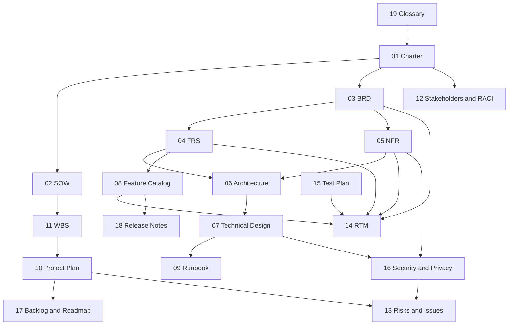
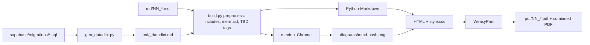

<!-- code: CRY-00-IDX | title: Document Index and Master Guide | subtitle: Explains the Crystal documentation set, how the documents relate, conventions used, and how the set is maintained and regenerated. -->

## 1. Purpose

This index is the entry point to the Crystal project documentation set. Crystal is Rolan Chowdhury's family command-center web application, live at `https://crystal-7ot.pages.dev`. The set describes the project's governance, requirements, architecture, operations, plan, quality and security posture. It follows PMI PMBOK® Guide practice for project management artifacts, IEEE 29148 for requirements specifications, IIBA BABOK® for business analysis, the C4 model for architecture views, and NIST SP 800-30 / STRIDE for risk and threat modelling.

All facts come from the source code, SQL migrations, test suites and git history at the **source baseline**: repository `iamrolanatl/starcraft`, branch `sync-agent` at commit `588f344` (which includes `main` at `987aa68`), plus the box-side data pipeline in `/workspace/eli-dashboard` and the live deployment as observed on October 14, 2026. Where the sources do not settle a fact, the documents mark it **TBD** rather than guess. Secrets, keys and passwords never appear in these documents; only environment variable names do.

## 2. Audience

| Audience | Primary documents | Use |
|---|---|---|
| Rolan Chowdhury (Sponsor, Product Owner, Owner/Admin) | 01, 03, 10, 12, 13, 17, 18 | Approve scope, track delivery, decide on risks and pending actions |
| Engineering agents / future developers | 04, 05, 06, 07, 09, 11, 14, 15 | Build, change, test and operate Crystal |
| Family members, trusted adults (read-only viewers) | 08, 19 | Understand what Crystal shows and how sharing works |
| Second family (planned onboarding) | 08, 09 §Crystal Sync, 16 | Install Crystal Sync, understand data handling |
| Auditor / reviewer (privacy, security) | 05, 07, 16, 13, 14 | Verify least privilege, RLS, minor-data protections |

## 3. Document Set

| # | Document | ID | Answers | Primary standard |
|---|---|---|---|---|
| 00 | Document Index and Master Guide | CRY-00-IDX | What is in the set and how is it maintained? | — |
| 01 | Project Charter | CRY-01-CHR | Why does the project exist, who authorizes it, what is in scope? | PMBOK Initiating |
| 02 | Statement of Work | CRY-02-SOW | What work is delivered, how, and how is it accepted? | PMBOK Procurement / Scope |
| 03 | Business Requirements Document | CRY-03-BRD | What business outcomes are required (SMART objectives)? | BABOK |
| 04 | Functional Requirements Specification | CRY-04-FRS | What must the system do (FR-xxx)? | IEEE 29148 |
| 05 | Non-Functional Requirements | CRY-05-NFR | How well must it do it (NFR-xxx)? | ISO/IEC 25010, WCAG 2.2 |
| 06 | Solution Architecture | CRY-06-SAD | How is the solution structured and deployed? | C4, arc42 |
| 07 | Technical Design Document | CRY-07-TDD | APIs, schema, data dictionary, RLS, authentication | IEEE 1016 |
| 08 | Feature Catalog | CRY-08-FEA | What features exist and in what state? | — |
| 09 | SOPs and Runbook | CRY-09-RUN | How is Crystal deployed, operated and recovered? | ITIL 4 practices |
| 10 | Project Plan | CRY-10-PLN | Phases, sprints, milestones, done vs planned | PMBOK Planning |
| 11 | Work Breakdown Structure | CRY-11-WBS | Hierarchy of deliverables plus dictionary | PMBOK WBS Practice Standard |
| 12 | Stakeholder Register and RACI | CRY-12-STK | Who is involved and who is accountable? | PMBOK Stakeholder |
| 13 | Risk Register and Issue Log | CRY-13-RSK | What could go wrong and what is going wrong? | PMBOK Risk, ISO 31000 |
| 14 | Requirements Traceability Matrix | CRY-14-RTM | BO → FR/NFR → feature → test coverage | BABOK, IEEE 29148 |
| 15 | Test Plan and Results Summary | CRY-15-TST | How is quality verified and what were the results? | IEEE 829 / ISO 29119 |
| 16 | Security and Privacy Plan | CRY-16-SEC | Least privilege, threat model, minor-data protections | NIST SP 800-53 (selected), STRIDE |
| 17 | Product Backlog and Roadmap | CRY-17-BKL | What is next and in what order? | Scrum |
| 18 | Release Notes and Change Log | CRY-18-REL | What changed, when and why? | Keep a Changelog |
| 19 | Glossary | CRY-19-GLO | What do the terms and acronyms mean? | — |

A single combined volume (`Crystal_Documentation_Set_v1.0.pdf`) contains all twenty documents, with one page sequence and a document-level contents list.

## 4. How the Documents Relate

## 5. Conventions

### 5.1 Identifiers

| Prefix | Meaning | Defined in | Example |
|---|---|---|---|
| BO-nn | Business objective (SMART) | 03 BRD | BO-02 Timely school data |
| BR-nnn | Business requirement | 03 BRD | BR-010 |
| FR-nnn | Functional requirement | 04 FRS | FR-061 Pairing code |
| NFR-nnn | Non-functional requirement | 05 NFR | NFR-020 Sync latency |
| F-nnn | Feature | 08 Feature Catalog | F-040 Crystal Sync |
| T-nnn | Test case or suite | 15 Test Plan | T-020 Sync RLS suite |
| WBS n.n.n | Work package | 11 WBS | 1.4.3 |
| R-nnn / I-nnn | Risk / issue | 13 Register | R-001 |
| SOP-nn | Standard operating procedure | 09 Runbook | SOP-03 |
| M-nn | Milestone | 10 Plan | M-07 |
| AD-nn | Architecture decision | 06 Architecture | AD-03 |
| TM-nn | Threat | 16 Security | TM-04 |
| A-nn / C-nn / D-nn | Assumption / constraint / dependency | 01 Charter | A-03 |

### 5.2 Priority and status vocabulary

- **Priority (MoSCoW):** Must, Should, Could, Won't (this release).
- **Implementation status:** [[ok|Done]] implemented in the baseline and verified; [[partial|Partial]] implemented but limited, unverified in production or awaiting an external action; [[no|Open]] not implemented.
- **Migration status:** "Applied" means confirmed in production; "Pending" means Rolan still has to run it in the Supabase SQL editor (018, 019, 020_family_invites_grant, 020_sync_devices as of the baseline).
- **TBD** (highlighted) marks a value the sources do not establish. Each TBD is listed in §8.

### 5.3 Times and dates

All times are US Eastern (America/New_York, EDT, UTC-4 in October 2026) unless shown otherwise. Git commit times are as recorded by the commits.

## 6. Maintenance Process

1. **Source of truth.** Markdown files in `docs/md/` (repository) or `/workspace/crystal-docs/md/` (box) are the editable sources. PDFs are build outputs and are never edited by hand.
2. **Generated sections.** The data dictionary (`md/_datadict.md`) is generated from `supabase/migrations/*.sql` by `build/gen_datadict.py`. Regenerate it whenever a migration is added: `CRYSTAL_MIGRATIONS=supabase/migrations python3 docs/build/build.py`.
3. **Change triggers.** Update the documents in the same pull request as any change that:
   - adds or changes a migration (07, 16, 14, 18, and 09 if operational steps change);
   - adds a feature or module (04, 08, 14, 17, 18);
   - changes deployment, schedules, cron, or the agent (06, 09);
   - changes a risk, issue, or pending action (13, 10).
4. **Versioning.** Minor edits raise the minor version (1.1, 1.2). A re-baseline after a phase gate raises the major version (2.0). Every change adds a row to the Revision History block of the affected document.
5. **Review.** Rolan Chowdhury approves each baseline (the Approvals block in each document's Document Control page).
6. **Regeneration.** `python3 build/build.py` rebuilds all PDFs plus the combined volume. `python3 build/build.py 06 07` rebuilds selected documents. Mermaid diagrams are rendered to PNG through `mmdc` and cached in `diagrams/` by content hash.

## 7. Build Toolchain

| Component | Version used for v1.0 | Role |
|---|---|---|
| Python | 3.13 (venv in `build/.venv`) | Build orchestration |
| WeasyPrint | 70.0 | HTML/CSS to PDF (paged media, running headers, page counters, TOC page numbers) |
| Python-Markdown | latest at build | Markdown to HTML (tables, fenced code, attribute lists) |
| @mermaid-js/mermaid-cli (`mmdc`) | latest at build | Mermaid diagrams to PNG via headless Chrome (`/usr/bin/google-chrome`) |
| IBM Plex Sans / Mono | system fonts | Typography |

## 8. Consolidated TBD Register

The following facts are not established by the sources and are marked TBD in the documents. Each needs a decision or an observation from Rolan.

| # | TBD item | Document(s) | Owner |
|---|---|---|---|
| 1 | Formal approval dates of all v1.0 documents | All | Rolan |
| 2 | Project budget ceiling (monthly run cost and annual signing costs) | 01, 03, 13 | Rolan |
| 3 | Production status of migrations 018, 019, 020 (pending at baseline) | 07, 09, 10, 13 | Rolan |
| 4 | Measured sync SLO attainment (5-minute landing, 15-minute alert) over a 4-week window | 03, 05, 15 | Rolan / Ops |
| 5 | Second family's identity, start date and number of children (10th grade, Cobb high school) | 01, 12, 17 | Rolan |
| 6 | Other family members' identities and roles beyond Rolan and Eli | 12 | Rolan |
| 7 | Decision and timing on Apple Developer (~$99/yr) and Windows code-signing (~$100–300/yr) | 10, 13, 17 | Rolan |
| 8 | Date GitHub authentication is restored on the build box | 09, 10, 13 | Rolan |
| 9 | Google OAuth provider enablement, iPhone Shortcut set-up, Office 365 ICS URL | 04, 08, 17 | Rolan |
| 10 | Backup schedule and retention on the Supabase plan in use (point-in-time recovery availability) | 09, 16 | Rolan |
| 11 | Recovery time and recovery point objectives (RTO/RPO) formally accepted | 05, 09 | Rolan |
| 12 | Grade-improvement target for BO-06 | 03 | Rolan |
| 13 | Data retention period for mirrored school email and sync logs | 16 | Rolan |
| 14 | Completion date of the mobile readability redesign (branch `mobile`) | 10, 17 | Delivery team |
| 15 | Where the 7 AM–7 PM school-email send window is enforced in code (it is enforced by the mail routine; no repository code enforces it) | 04, 16 | Delivery team |
