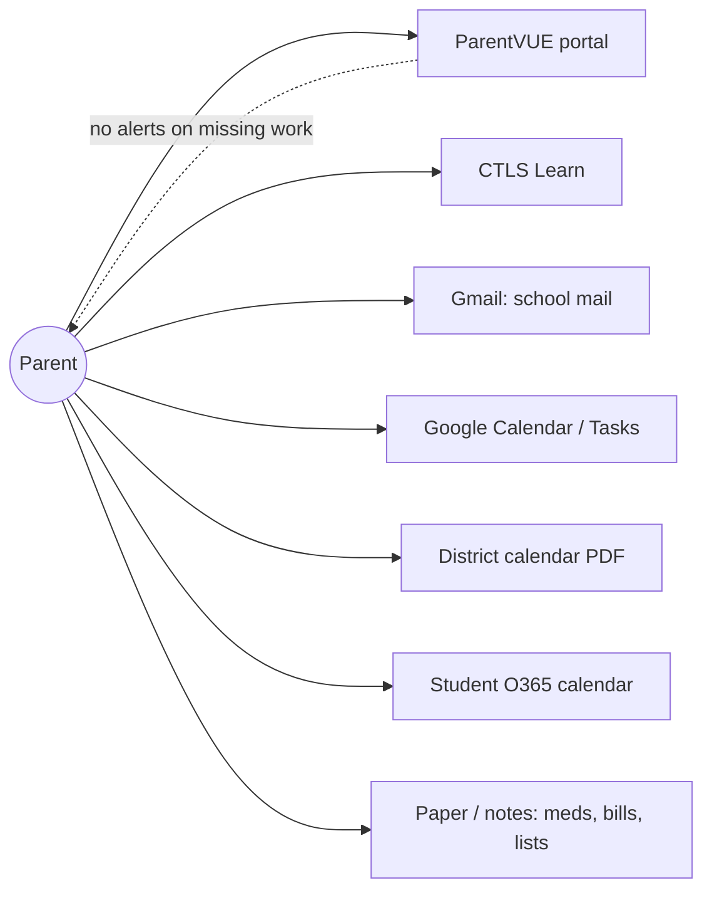
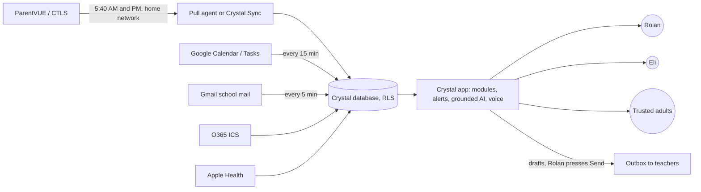

<!-- code: CRY-03-BRD | title: Business Requirements Document | subtitle: States the business need, SMART business objectives, current and future state, business requirements, business rules and success measures for Crystal, following BABOK practice. -->

## 1. Executive Summary

Crystal consolidates a family's school, calendar, communications, health, finance and shopping information into one secure command center. Its most important job is to keep a parent informed about a minor student's school standing (Cobb County School District, ParentVUE) without the parent logging into multiple portals, while guaranteeing that the information is current, correct, logged and visible only to the family.

## 2. Business Context

### 2.1 Stakeholders served

| Stakeholder | Need |
|---|---|
| Rolan (parent, owner) | One place to see what needs attention today; trustworthy school data; help answering teachers; control over who sees what |
| Eli (student, minor) | A motivating, kid-friendly view of grades and goals (90% goal marker, medals) without exposing more than needed |
| Trusted adults (viewers) | Read-only access to selected scopes of a child's education data, optionally time-limited |
| Second family (planned) | Same capabilities with their own data, installed with minimal technical effort |

### 2.2 Current state (before Crystal)

Pain points: many logins; no combined priorities; no alert when a pull fails; easy to miss unexcused absences and missing assignments; replies to teachers take time; no safe way to share a child's data with another adult.

### 2.3 Future state (with Crystal)

## 3. Business Problem and Opportunity

| # | Problem | Opportunity |
|---|---|---|
| P-1 | School signals are scattered and noticed late | Twice-daily automated pull with DEFCON alerts and Missing / Due soon tiles |
| P-2 | Portal data cannot be questioned in plain language | Grounded AI: "What is Eli's grade in Math?" answered from synced data with source and "as of" time |
| P-3 | Teacher correspondence costs time | Mirror school mail, draft replies in Rolan's style, Rolan approves and sends |
| P-4 | Scraping from the cloud is blocked by Cobb (C-01) | Pull from a home computer; desktop agent for other families |
| P-5 | Sharing a child's data safely is hard | Code-based invites with 6-digit confirmation, scoped viewer access, revocation |

## 4. Business Objectives (SMART)

| ID | Specific | Measurable | Achievable | Relevant | Time-bound |
|---|---|---|---|---|---|
| BO-01 | Deliver one family command center with Home, Health, Communications, Education, School Hub, Finance, Shopping/Wish, OCR and Rank & Medals | All listed modules reachable in production and passing the FR audit | Built on managed services | Removes multi-portal checking (P-1) | By Oct 14, 2026 ([[ok|Met]]: production build `bmv7xg9th`) |
| BO-02 | Keep Eli's school data current | ≥ 95% of school-day sync slots (5:40 AM, 5:40 PM) land in Crystal within 5 minutes of the pull starting | Pull ~1 min; box poller runs every minute; Crystal Sync uploads directly | Timely action on grades and attendance | Measured over 4 consecutive school weeks starting TBD |
| BO-03 | Alert on sync failure | 100% of failed or missed syncs produce an alert to Rolan within 15 minutes | Poller alerts on the next minute for failures; missed-pull check at 6:00 (see gap in 05 NFR-021) | Silent failures erode trust | From go-live of each pipeline |
| BO-04 | Keep family data private | 0 cross-family or anonymous exposures; RLS enabled on 100% of tables in the exposed schema; all RLS suites pass for each migration | RLS by default; SECURITY DEFINER RPCs | Minor's records (FERPA/COPPA considerations) | Continuous; checked at each migration |
| BO-05 | Reduce parent effort on school email | School mail mirrored within 5 minutes; Crystal drafts replies only for individual staff senders; 0 messages sent without Rolan pressing Send; sends only 7 AM–7 PM | 5-minute routine exists | Saves time, keeps control | Continuous |
| BO-06 | Help Eli stay on track academically | Missing work, low scores (< 74) and dips below 90 surfaced the same day; outcome target (e.g., missing-assignment count or GPA change) TBD | Alerts implemented | Core family goal | Term Q2 2026-27 (ends Feb 3, 2027 per ParentVUE periods); target TBD |
| BO-07 | Onboard a second family | Second family (one 10th-grade Cobb high-school student) paired with Crystal Sync and syncing twice daily | Agent 0.1.0 built; needs signed installers | Validates multi-family design | TBD |
| BO-08 | Keep cost low | Recurring platform cost ≤ TBD per month; one-time/annual signing costs approved before purchase | Managed tiers | Family budget | Reviewed monthly from TBD |
| BO-09 | Be resilient and auditable | Agents survive reboot (systemd/launchd/Task Scheduler, cron `@reboot`); 100% of runs recorded in `sync_runs` / `edu_sync_runs` with step logs | Implemented | Trust and troubleshooting | Continuous |

## 5. Business Requirements

Each business requirement (BR) is refined into functional (04) and non-functional (05) requirements; see 14 RTM.

| ID | Business requirement | Objective | Priority | Acceptance criteria |
|---|---|---|---|---|
| BR-001 | The family can sign in securely and see only its own data | BO-04 | Must | Email OTP sign-in works; another account sees no rows (RLS tests pass) |
| BR-002 | Crystal shows a child's grades, assignments, attendance, schedule, messages, calendar and report cards from ParentVUE | BO-01, BO-06 | Must | Education tabs populated from the latest sync with "as of" time |
| BR-003 | School data is pulled at 5:40 AM and 5:40 PM, once per run, from a home computer | BO-02 | Must | Run log shows one login per slot; times match |
| BR-004 | Sync results land within 5 minutes, failures alert within 15 minutes, every run is logged | BO-02, BO-03, BO-09 | Must | Run timestamps and alert timestamps meet the thresholds |
| BR-005 | A bad or partial pull never erases good data | BO-02 | Must | Quarantine gates and non-destructive merge (docs/data-validation-strategy.md) |
| BR-006 | Parents' portal passwords never leave their computer | BO-04 | Must | Passwords exist only in DPAPI/Keychain/OS keyring; server stores none |
| BR-007 | Crystal answers questions only from the family's data | BO-04, BO-06 | Must | Grounding tests pass; unknown → "I don't know" |
| BR-008 | School emails are mirrored and replies drafted, never auto-sent | BO-05 | Must | Outbox requires status `queued` set by the user; drafts never listed for sending |
| BR-009 | The parent can share a child's education data or a list with another person, revocably | BO-04, BO-07 | Should | Code + 6-digit confirmation + approval; revoke removes access |
| BR-010 | Another family can install a sync agent with least privilege | BO-07 | Should | Device key can only upload for paired children; cannot read data |
| BR-011 | The owner can administer Crystal safely | BO-04, BO-09 | Should | Owner-only `/admin`, typed confirmations, audit log |
| BR-012 | Visitors who hit an error can reach support | BO-09 | Should | Styled error pages; support ticket queued; owner notified by email |
| BR-013 | Crystal is usable hands-free and on phones | BO-01 | Should | Voice loop works on Chromium and iOS (Whisper fallback); no horizontal scroll at 320–390 px |
| BR-014 | Household modules (health, finance, shopping) support daily life | BO-01 | Could | CRUD works; NL commands create items |
| BR-015 | Calendar and tasks from Google and O365 appear in Crystal | BO-01 | Should | Items with source badges; write-back to Google |
| BR-016 | Grading rules (Cobb IHA-R) and category weights explain grades | BO-06 | Should | Grading Rules tab cites the policy page and section |
| BR-017 | Routines brief the family (morning briefing, Sunday review) | BO-01 | Could | Routines run on schedule (operated by Grok Bot routines outside the repo) |
| BR-018 | Visitors can understand Crystal, try a demo and read its legal terms before signing up | BO-01, BO-04 | Should | Landing, sales chat, demo mode and 5 legal pages available without sign-in |

## 6. Business Rules

| ID | Rule | Source |
|---|---|---|
| RULE-01 | One ParentVUE login per scheduled run per account; no automatic retry | Laptop scripts, agent |
| RULE-02 | Pull slots are 5:40 AM and 5:40 PM local time; a missed slot is caught up within 6 hours | `agent/README.md` |
| RULE-03 | Across several family computers, only the lease leader logs in for a slot; a standby takes over if the leader has not finished in 10 minutes | `sync_claim` (020) |
| RULE-04 | Grade colors: A green, B yellow, C red; below 74 flashes red (reduced motion: outline + warning icon) | commits `445a76f`, `02f7d9f` |
| RULE-05 | Grade calculation and make-up rules follow Cobb policy IHA-R; Grading Rules cites page and section | `5cd0ede` |
| RULE-06 | Excuse letters go to the school only after Rolan picks a reason, edits and presses Send | `2c518e3` |
| RULE-07 | Crystal drafts replies only to individual staff senders (`first.last@cobbk12.org`), never bulk/broadcast | `sync/README-mail.md` |
| RULE-08 | School emails are sent only between 7 AM and 7 PM | Owner requirement (enforced by the mail routine; code location TBD) |
| RULE-09 | Blank incoming values never overwrite known values; rows are archived after 3 consecutive missing good pulls, never deleted | docs/data-validation-strategy.md |
| RULE-10 | Grades history and report cards are permanent (no deletes) | 007, 013 triggers |
| RULE-11 | Pairing codes last 15 minutes, are single-use, one live per family, max 10 per hour | 020 |
| RULE-12 | Destructive admin actions need a typed confirmation and are audited | 019 |

## 7. Data and Regulatory Considerations

| Topic | Consideration | Treatment |
|---|---|---|
| FERPA | Education records originate from the school district. Crystal holds a parent's copy obtained with the parent's own credentials. FERPA obligations bind the school, but the same sensitivity is respected | Family-only RLS; scoped viewer access; no public bundle data (`650da76`) |
| COPPA | Applies to online services directed to children under 13 that collect their personal information. Eli's age is not recorded in the sources (TBD); child logins exist (017) | Child accounts are created and approved by a parent; minimal data; legal review TBD |
| Georgia student data privacy | District-side obligations; family-side use | Treated as sensitive; see 16 |
| Email content | Teachers' messages contain third-party personal data | Owner-only access; private storage bucket `mail` |

## 8. Success Metrics and Measurement Plan

| Metric | Source | Frequency | Owner |
|---|---|---|---|
| Slot landing time (pull start → `edu_students.last_synced_at` or `sync_runs.finished_at`) | `edu_sync_runs`, `sync_runs` | Weekly | Rolan |
| Alert latency | `edu_alerts.created_at` vs. failure time | Weekly | Rolan |
| RLS test pass rate | `supabase/tests/run_local.sh`, `019_admin_test.sh` | Each migration | Delivery team |
| Emails sent without approval | `mail_outbox` rows not created by a user Send | Monthly (target 0) | Rolan |
| Missing assignments trend | Education summary tiles | Weekly | Rolan / Eli |

## 9. Assumptions, Constraints, Dependencies

See Charter §8.

## 10. Approval

| Role | Name | Signature | Date |
|---|---|---|---|
| Sponsor / Product Owner | Rolan Chowdhury | | TBD |
| Business Analyst (agent-assisted) | Grok Bot delivery team, for Rolan Chowdhury | | TBD |
