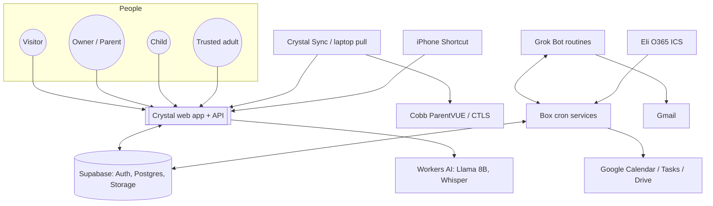

<!-- code: CRY-04-FRS | title: Functional Requirements Specification | subtitle: Specifies the functional behavior of Crystal as numbered FR-xxx requirements with priority, acceptance criteria, source evidence and implementation status, following IEEE 29148. -->

## 1. Introduction

### 1.1 Purpose and scope

This specification states what Crystal shall do. It covers the web application, the Pages Functions API, the database behavior visible to users, and the sync agents. Quality attributes are in 05 NFR. Design detail is in 07 TDD.

### 1.2 Requirement attributes

| Attribute | Meaning |
|---|---|
| ID | FR-nnn, stable; never reused |
| Statement | "Crystal shall …" form, one testable behavior |
| Pri | MoSCoW: M (Must), S (Should), C (Could), W (Won't this release) |
| Acceptance criteria | Observable conditions that verify the requirement (Given/When/Then where useful) |
| Source | Commit, file or owner statement the requirement is taken from |
| Status | [[ok|Done]], [[partial|Partial]], [[no|Open]] at baseline `588f344`. Migrations 001–017 are treated as applied in production (owner reports only 018, 019 and 020 pending); requirements that depend on 018–020 are Partial until those are applied |

Business objectives (BO) and business requirements (BR) trace to these FRs in 14 RTM.

### 1.3 Actors

| Actor | Description |
|---|---|
| Visitor | Not signed in; sees landing, legal pages, sales chat, demo mode, error pages |
| Owner / Parent | Signed-in parent who owns a family (Rolan). The admin owner is `iamrolan@gmail.com` (ADMIN_EMAILS default) |
| Child member | A child login that joined the family and was approved (017) |
| Viewer (trusted adult) | Read-only access to scoped child data (017) |
| List collaborator | Person a shopping/wish list is shared with (view or edit) |
| Device | A paired Crystal Sync installation, holding a device key |
| Box services | Cron jobs on the build box using a service-role key held only on the box |
| Grok Bot routines | Scheduled agent routines (mail pull/send every 5 minutes, calendar feed, morning briefing, Sunday review) |

### 1.4 System context

## 2. Public Site and Authentication (FR-001 – FR-012)

| ID | Requirement | Pri | Acceptance criteria | Source | Status |
|---|---|---|---|---|---|
| FR-001 | Crystal shall show a landing page with a looping background video, features and a sales pitch | M | `video[loop]` with src present; "Modules online" grid visible | FR audit P1–P2 | [[ok|Done]] |
| FR-002 | Crystal shall let users sign up and sign in with an email one-time code | M | `signInWithOtp` sends a code; `verifyOtp` creates a session | FR audit P4 | [[ok|Done]] |
| FR-003 | Crystal shall offer Google sign-in (OIDC) | S | Google button completes sign-in when the Supabase provider is enabled | FR audit P3 | [[partial|Wired; provider not enabled]] |
| FR-004 | Crystal shall provide an AI sales chat for visitors that describes only real features and never invents pricing | S | `/api/chat` mode `sales` answers under 80 words using the SALES prompt | `functions/api/chat.ts` | [[ok|Done]] |
| FR-005 | Crystal shall publish Terms, Privacy, Cookies, Accessibility and Do Not Sell pages | M | Each `/legal/<slug>` returns 200 | FR audit P6 | [[ok|Done]] |
| FR-006 | Crystal shall offer a demo cockpit without sign-in at `/app/?demo=1`, storing demo data only on the device | S | Demo opens; no Supabase writes; demo badge in answers | README | [[ok|Done]] |
| FR-007 | Crystal shall derive the user's display name from the Google identity (never the email) and greet by time of day in ET | S | "Good morning, Rolan!" in the morning ET; fallback "Commander" | 016, `test-names` | [[ok|Done]] |
| FR-008 | Crystal shall show the signed-in user as "Firstname L." with full name and email in a tooltip | C | Chip text and tooltip match profile | `10ee921` | [[ok|Done]] |
| FR-009 | Crystal shall let the user log out and return Home from anywhere (header, HUD, `H` key, palette) | M | Each path works | FR audit A1 | [[ok|Done]] |
| FR-010 | Crystal shall map an expired session to a friendly message and re-sign-in prompt | M | Expired token → message, no crash | stability report | [[ok|Done]] |
| FR-011 | On the pre-login landing, background video shall use Calm motion regardless of saved preferences | C | Landing uses calm motion | `126a3cd` | [[ok|Done]] |
| FR-012 | Crystal shall recover from a stale deploy: one guarded reload on ChunkLoadError, then a "Crystal Updated — Tap to Reload" card, with `version.json` polling | S | Simulated chunk error triggers one reload, then the card | `140416f` | [[ok|Done]] |

## 3. Cockpit Experience (FR-013 – FR-030)

| ID | Requirement | Pri | Acceptance criteria | Source | Status |
|---|---|---|---|---|---|
| FR-013 | Crystal shall present modules as applets in a window manager with open, minimize, close, drag and resize from all 8 edges/corners (min 320×200, persisted per applet; double-click a handle resets) | M | e2e WM suite passes at 1280×800, 1920×1080, 390×844, 320×640 | `55c1995`, v4suite | [[ok|Done]] |
| FR-014 | Crystal shall toggle an applet between full and normal size with `F` or a title double-click, saved in `user_prefs` | S | Toggle persists across reload | `2f32067`, keys suite | [[ok|Done]] |
| FR-015 | Crystal shall provide keyboard shortcuts: Esc / Shift+Esc / Alt+0 close all; 1–9 and Alt+1–9 open; Alt+←/→ cycle; Shift+1–9 abilities; `?` cheat sheet; shortcuts ignored while typing | S | keys suite 40/40 | `77bad51` | [[ok|Done]] |
| FR-016 | Crystal shall provide a Cmd-K command palette with free-text natural-language commands | S | Palette opens; free text routed to `/api/command` | `69ef54f` | [[ok|Done]] |
| FR-017 | Crystal shall show a bottom edge-to-edge HUD with pilot view, 3×3 ability grid with cooldowns, 360° and tactical radar, squad status, tactical and comm feeds | S | FR audit A5–A10 pass | FR audit | [[ok|Done]] |
| FR-018 | Crystal shall compute a DEFCON 5→1 alert level from real data and support a manual Red Alert, driving theme and ambient sound | S | DEFCON changes with alerts; manual label | FR audit A11 | [[ok|Done]] |
| FR-019 | Crystal shall keep the Modules toolbar always visible, with module buttons in one row, horizontal scroll with fade edges, and icon-only buttons below 1280 px (label in tooltip/aria) | S | Toolbar present when applet maxed/tiled | `e3dd299`, `2a5629d` | [[ok|Done]] |
| FR-020 | Crystal shall use a slim single-row chrome on short screens or when an applet is open, with a remembered collapse chevron | C | Slim row at short heights | `fbeeacb` | [[ok|Done]] |
| FR-021 | Crystal shall boot with all applets closed and keep applets below the header and toolbar | S | Boot state verified | `9b68164` | [[ok|Done]] |
| FR-022 | Crystal shall offer five skins: Crystal Cockpit (default), Blockcraft, Brick City, Battle Island, Kart Rush (original CSS art) | C | Settings › Look lists 5 skins; selection persists | `SettingsCenter.tsx` | [[ok|Done]] |
| FR-023 | Crystal shall offer a Settings center: text size S–XL, high contrast, reading mode, background video and speed, motion level, glass clarity, accent | S | Each setting applies and persists | `lib/settings.ts` | [[ok|Done]] |
| FR-024 | Defaults (v2) shall be Calm background, Reduced UI motion, Hands-Free on with "Tap to Start Hands-Free", Balanced glass; untouched v1 preferences upgrade automatically | S | `test-defaults` passes | `8e17281` | [[ok|Done]] |
| FR-025 | Crystal shall show a robot mascot (Crystal) with idle animations, speech bubbles, mood reactions and a robot buddy strolling the HUD with kid-safe poses every 45–90 s; configurable Lively/Calm/Off | C | Settings › Look › Robot Buddy changes behavior | `340a472` | [[ok|Done]] |
| FR-026 | Crystal shall play Web Audio sound effects (hover, press, whoosh, palette) and DEFCON ambient hum, with mute | C | Mute silences all | FR audit A12 | [[ok|Done]] |
| FR-027 | Crystal shall show toasts, skeleton loaders, bottom sheets on mobile and an offline banner | S | Offline banner on network loss | stability report | [[ok|Done]] |
| FR-028 | Crystal shall be installable as a PWA (manifest, service worker) | C | Manifest + `sw.js` served | `629cefd` | [[ok|Done]] |
| FR-029 | Crystal shall show a shared ProgressBar with neon fill, 90% GOAL marker, goal-met pulse and kid-friendly messages ("You're only 13.2 points from 90!") | S | `test-progress` passes | `b445cc2` | [[ok|Done]] |
| FR-030 | Crystal shall show a Rank & Medals panel (XP, rank, next rank, medals earned) driven by real cockpit data | C | Panel renders from data | `Ops.tsx` | [[ok|Done]] |

## 4. AI, Natural Language and Voice (FR-031 – FR-042)

| ID | Requirement | Pri | Acceptance criteria | Source | Status |
|---|---|---|---|---|---|
| FR-031 | Crystal shall answer questions about the user's school, tasks, calendar, health, money, shopping, comms and weather only from that user's RLS-scoped data, citing source and "as of" time | M | Grounding tests; unknown facts → "I don't know; I don't have that in your data." | `5d0625c`, `test-grounding` | [[ok|Done]] |
| FR-032 | Crystal shall answer common school questions deterministically (grades by class, class list, missing work, sync status, schedule, absences, weights, report cards) before calling the LLM | M | Deterministic answers marked `grounded-db` | `functions/_lib/answer.ts` | [[ok|Done]] |
| FR-033 | Crystal shall answer district-calendar questions (breaks, last day, early release) from the official CCSD 2026-27 calendar | S | "Last day of school" answered with source | `district-answer.ts` | [[ok|Done]] |
| FR-034 | Crystal shall route chat to Workers AI models in order (Llama 3.1 8B fast, Llama 3.2 3B, Llama 3.1 8B) with a 20 s timeout each, then a friendly fallback | M | Router returns the first non-empty answer | `router.ts` | [[ok|Done]] |
| FR-035 | Crystal shall escalate hard questions (signed-in users only) to a queue processed by a box worker on a larger model, and show the answer when ready | S | `chat_escalations` row queued; answer appears | `8f765bd`, 006 | [[ok|Done]] |
| FR-036 | Crystal shall parse natural-language commands across modules (tasks with dates, health logs, meds, bills, stocks, credit, shopping/wish, comms notes, check-ins, open app, remove items) | M | `test-nlp` 13/13 | `/api/command`, `lib/nlp.ts` | [[ok|Done]] |
| FR-037 | Crystal shall support voice input with Web Speech and a Whisper fallback (`/api/transcribe`) for iPhone and Firefox | M | Audio ≤ ~4 MB transcribed; not stored | `transcribe.ts` | [[ok|Done]] |
| FR-038 | Crystal shall provide a hands-free loop: listen → transcribe → chat → speak → resume, mic paused while speaking, "stop" ends | S | handsfree e2e | `6aa6c12` | [[ok|Done]] |
| FR-039 | Crystal shall unlock iOS text-to-speech on first tap and show the Hands-Free cue inside the toolbar button | S | Tap starts loop on iOS | `6aa6c12`, `fa9004c` | [[ok|Done]] |
| FR-040 | The Grok fallback provider shall be used when configured | W | — | `router.ts` stub | [[no|Stub]] |
| FR-041 | Crystal shall provide a morning briefing routine | C | Briefing delivered daily | Owner context (routine outside repo) | [[partial|Routine; not in repo]] |
| FR-042 | Crystal shall provide a Sunday review routine | C | Review delivered Sundays | Owner context (routine outside repo) | [[partial|Routine; not in repo]] |

## 5. Home, Health, Finance, Shopping, Communications, OCR (FR-043 – FR-060)

| ID | Requirement | Pri | Acceptance criteria | Source | Status |
|---|---|---|---|---|---|
| FR-043 | Home shall show priorities, weather, calendar, to-do and a holo globe | M | Home applet renders each section | FR audit M1 | [[ok|Done]] |
| FR-044 | Crystal shall manage tasks (create, edit, complete, delete with undo) stored in `tasks` | M | Delete → undo → reload persistence (v4suite) | 001 | [[ok|Done]] |
| FR-045 | Health shall log steps and glucose with gauges and sparklines, and track meds with "take" check-off | S | CRUD works | 004 | [[ok|Done]] |
| FR-046 | Health shall ingest iPhone Apple Health steps via `POST /api/health/steps` with a per-user hashed token, keep-max per day, backfill up to 40 days, and an ingest log | S | Valid `hst_` token → 200; invalid → 401 | 010 | [[partial|Built; iPhone Shortcut not set up]] |
| FR-047 | The Steps applet shall show a ring, 7/30-day bars, streaks, DEFCON readiness, last sync and Connect iPhone | C | Renders from `health_logs` | `2b6daaf` | [[ok|Done]] |
| FR-048 | Finance shall manage bills (due dates, overdue radar, budget gauge) | S | CRUD; overdue shown on radar | 004 | [[ok|Done]] |
| FR-049 | Finance shall log credit scores manually with gauge and trend | C | CRUD | 004 | [[ok|Done]] |
| FR-050 | Finance shall show delayed stock quotes through `/api/quote` (edge cache 60 s, ≤ 20 symbols) | C | AAPL/MSFT quotes returned | `quote.ts` | [[ok|Done]] |
| FR-051 | Bureau/bank monitoring shall be automated | W | — | FR audit M10 | [[no|Out of scope]] |
| FR-052 | Shopping shall manage a shopping list and a wish list (CRUD, wish → cart, estimates) | S | CRUD works | 004 | [[ok|Done]] |
| FR-053 | Shopping/Wish lists shall be shareable by email invite with a code and 6-digit match, owner Approve, view/edit permission, revoke | S | Share invite → join → approve → collaborator sees list; revoke removes | 017 | [[ok|Done]] |
| FR-054 | Shared lists shall keep an activity log (who added, changed, removed what) | S | `list_activity` rows on change | 017 | [[ok|Done]] |
| FR-055 | Communications shall keep follow-up notes per channel (mail, email, drive) with deep links | C | CRUD | 004 | [[ok|Done]] |
| FR-056 | Communications › Email shall mirror school-related Gmail (messages, attachments) into Crystal and show inbox, reader and composer | S | Mirror rows visible; attachments from private bucket | 012 | [[ok|Done]] |
| FR-057 | Communications › Drive shall browse, search and show recent Google Drive files, preview Docs (as PDF), PDFs and images in-app, and pin files to School Hub | C | Preview works for allowed types ≤ 20 MB | 011, `google/*.ts` | [[partial|Needs Google token]] |
| FR-058 | OCR Scanner shall read text from images on the device (Tesseract.js), with 15 MB limit and downscale to 2000 px | S | e2e read "Field trip permission slip" | FR audit A3 | [[ok|Done]] |
| FR-059 | Crystal shall create items from OCR text and from natural language across modules | C | NL suite passes | `lib/nlp.ts` | [[ok|Done]] |
| FR-060 | Check-ins shall support handout upload to a private `handouts` bucket in a per-user folder | S | Demo upload e2e passes | 004 | [[ok|Done]] |

## 6. Education (FR-061 – FR-085)

| ID | Requirement | Pri | Acceptance criteria | Source | Status |
|---|---|---|---|---|---|
| FR-061 | Education shall provide tabs: Grades, Grading Rules, Learn, Work, Messages, Calendar, Schedule, Attendance, Report Cards, School Inboxes, More School Data, Sync Log | M | All 12 tabs render; Work and Messages show counts | `Education.tsx` | [[ok|Done]] |
| FR-062 | Grades shall list all current classes grouped by class with Q1 final as the main number, Q2 live or "Not posted", trend vs Q1, and a Q1/Q2 toggle | M | Class list matches latest sync | `fae62c8`, `4ec45c7` | [[ok|Done]] |
| FR-063 | Grades shall show a fixed-width grade column "letter \| number" in grade color, flashing below 74 | S | Visual check; reduced motion → outline + ⚠ | `ff863a3`, `445a76f` | [[ok|Done]] |
| FR-064 | Grades shall show collapsible graded assignments per class (all quarters) with Missing/Low/Qn filters, ungraded toggle, ParentVUE category weights (Cobb), impact chart and what-if | S | Weights match ParentVUE; what-if recomputes | `cb8f34e`, 013 | [[ok|Done]] |
| FR-065 | Grades shall show grading period, term and semester dates with countdowns (calendar and school days), newest live sync wins per quarter | S | `test-periods` passes | `1ea0677`, `751d6fc` | [[ok|Done]] |
| FR-066 | Grading Rules shall explain Cobb policy IHA-R: scale bar, the student's overlays, make-up timeline, conduct, callouts, each cited with page/section, using the same value and label as Grades | S | Citations present; values match Grades | `5cd0ede`, `987aa68` | [[ok|Done]] |
| FR-067 | Learn shall show the current unit per class with evidence and confidence and verified study links, read only from RLS tables (no student data in the public bundle) | S | Data from `learn_units`; bundle contains no student data | 015, `650da76` | [[ok|Done]] |
| FR-068 | Work shall list assignments with missing count badge | M | Count equals missing assignments | `Education.tsx` | [[ok|Done]] |
| FR-069 | Messages shall list ParentVUE messages with unread count | S | Unread badge | 002 | [[ok|Done]] |
| FR-070 | Calendar shall show the student's school calendar items | S | Items from `edu_calendar` | 002 | [[ok|Done]] |
| FR-071 | Schedule shall show Dickerson bell times and highlight the current class live | S | Highlight moves with time | `7e61772` | [[ok|Done]] |
| FR-072 | Attendance shall show absences and tardies (excused/unexcused per ParentVUE codes), per-period detail, year/quarter totals and monthly trend | M | Totals match ParentVUE | `2c518e3`, 014 | [[ok|Done]] |
| FR-073 | Attendance shall let the parent create an excuse letter (pick reason, edit, Send) that queues an outbox row to the school attendance address, with Queued/Cancel/Sent states, never auto-sent | S | Letter only sent after Send | `2c518e3` | [[ok|Done]] |
| FR-074 | Report Cards shall list ParentVUE report-card PDFs and open them in a full-screen viewer (zoom, download, Esc) through 5-minute signed URLs | S | `/api/report-card?id=` returns signed URL for owner only | 013 | [[ok|Done]] |
| FR-075 | School Inboxes shall link to CTLS, ParentVUE, Outlook and Teams and show latest ParentVUE messages | C | Links open | `cea159b` | [[ok|Done]] |
| FR-076 | More School Data shall show "Not available from Cobb" cards for data Cobb does not provide | C | Cards visible | `7e61772` | [[ok|Done]] |
| FR-077 | Sync Log shall show sync runs and console lines | M | Rows from `sync_log` / `sync_runs` | 003, 020 | [[ok|Done]] |
| FR-078 | Education summary tiles (Missing, Due soon, Absent/tardy) shall be clickable and list their items | S | Click opens list | `4642d13` | [[ok|Done]] |
| FR-079 | Crystal shall raise DEFCON school alerts for a new absence, a new unexcused absence/tardy, missing work, a low score and a dip below 90 | M | Alert appears after a qualifying sync | `7e61772`, `2c518e3` | [[ok|Done]] |
| FR-080 | A child switcher shall let a parent with several children (or a viewer) choose whose data is shown | S | Switch changes data scope | 017 | [[ok|Done]] |
| FR-081 | School Hub shall show the CCSD 2026-27 calendar as a month view (official ICS, 24 h edge cache, bundled snapshot fallback), category chips, max 3 + "+N More", dim weekends, glowing today, legend; mobile agenda by default | M | Calendar renders live or snapshot | `629cefd`, `a051080` | [[ok|Done]] |
| FR-082 | School Hub shall show bell schedules (Master/Flex/Early release for grades 6–8) with live period | S | Live highlight | FR audit M8 | [[ok|Done]] |
| FR-083 | School Hub shall show portal links for StudentVUE/O365/Learn | C | Links | FR audit M5 | [[ok|Done]] |
| FR-084 | Direct StudentVUE / O365 pulls with the student's credentials | W | — | FR audit M5 | [[no|Out of scope]] |
| FR-085 | School Hub shall show per-child sync status lights and SYNC NOW with a live console | M | Light: OK (< 13 h), LATE, FAILED, NEVER SYNCED | `6ec692b` | [[partial|Needs 020]] |

## 7. School Data Pipelines (FR-086 – FR-100)

| ID | Requirement | Pri | Acceptance criteria | Source | Status |
|---|---|---|---|---|---|
| FR-086 | The pull agent shall pull ParentVUE (SOAP `PXPCommunication.asmx`, ChildList and gradebook, attendance, schedule, messages, calendar, report periods, documents) at 5:40 AM and 5:40 PM local time | M | Run log shows both slots | `laptop/`, `agent/` | [[ok|Done]] |
| FR-087 | Each run shall use exactly one ParentVUE login per account and shall not retry | M | One login request per run | `agent/README.md` | [[ok|Done]] |
| FR-088 | The parent's password shall be stored only locally (DPAPI on Windows; Keychain on macOS; Secret Service/KWallet on Linux; Windows Credential Manager for the agent) | M | No password column/endpoint server-side | `agent/README.md`, `sync/README.md` | [[ok|Done]] |
| FR-089 | The laptop watcher shall poll for Sync button presses every 10 s; the Crystal Sync daemon every 30 s | S | Sync Now picked up within the interval | `laptop/`, `agent/` | [[ok|Done]] |
| FR-090 | The box poller shall process uploaded pulls every minute (and at reboot), ingest, run `school_sync.py`, and mark jobs done or failed with a plain reason | M | `edu_sync_runs` row per job | `poller.py` | [[ok|Done]] |
| FR-091 | Pulls shall pass gates (≥ 7 of 9 requests succeed, login succeeded, non-empty gradebook/schedule/student, course count not down > 1, assignments not zero when last good ≥ 5 in same term, timestamp present) or be quarantined | M | `test_merge`, e2e_val | 007 | [[ok|Done]] |
| FR-092 | Merge shall be non-destructive: blank never overwrites, rows missing 3 good pulls are archived (not deleted), grades are append-only snapshots | M | Merge tests pass | 007 | [[ok|Done]] |
| FR-093 | Raw pulls shall be kept 30 days for replay | S | Archive directory pruned at 30 days | data-validation-strategy | [[ok|Done]] |
| FR-094 | Report cards, graded assignments, schedule/attendance extras and Learn shall be refreshed by box scripts | S | Tables populated | `sync/report_cards.py`, `graded_assignments.py`, `school_extras.py`, `learn_refresh.py` | [[ok|Done]] |
| FR-095 | The box shall raise deduplicated alerts (`laptop_failed`, `box_failed`, `missed_pull`, `quarantined`) into `edu_alerts` and an email outbox | M | Alerts appear in Crystal | `poller.py` | [[ok|Done]] |
| FR-096 | The missed-pull check shall run on school days (Mon–Fri minus no-school days) and alert if no job finished since 5:30 by 6:00 AM, or since 17:30 by 6:00 PM | M | Alert at 6:00 when no pull | `poller.py` | [[ok|Done]] |
| FR-097 | Ext sync shall pull Google Calendar/Tasks every 15 minutes and Eli's O365 calendar from a published ICS, with source badges and validation/quarantine | S | `test_ext_sync` passes | 009 | [[partial|Google token / ICS URL pending]] |
| FR-098 | Ext sync shall write back complete/reopen/delete requests to Google after a 60 s undo window; school items read-only | S | `pending_action` applied | 009 | [[partial|Needs Google token or connector route]] |
| FR-099 | The mail routine shall pull school mail every 5 minutes, draft replies only for individual staff senders, and send only rows Rolan queued, each claimed once; rows stuck in `sending` > 30 min fail and are not resent | M | `test_mail_py`, `test_mail_sql` | 012 | [[ok|Done]] |
| FR-100 | School emails shall be sent only between 7 AM and 7 PM | M | No send outside the window | Owner requirement | [[partial|Routine-enforced; code TBD]] |

## 8. Family Sharing (FR-101 – FR-110)

| ID | Requirement | Pri | Acceptance criteria | Source | Status |
|---|---|---|---|---|---|
| FR-101 | A parent shall have a family created on demand (`family_ensure`) and be its parent member | M | `families` row with owner | 017 | [[ok|Done]] |
| FR-102 | A parent shall add children and link each to an existing `edu_students` row | M | `children.edu_student_id` set | 017 | [[ok|Done]] |
| FR-103 | A parent shall invite a child login with a short code (optionally emailed); the child joins as PENDING; the parent approves after matching a 6-digit code shown on both screens | M | Join → pending → approve → active | 017 | [[ok|Done]] |
| FR-104 | Only ACTIVE child members shall read the parent's school/calendar/to-do data | M | RLS tests: pending child reads nothing | 017 RLS tests | [[ok|Done]] (RLS tests pass) |
| FR-105 | A parent shall invite a trusted adult (viewer) to a child with relationship, scopes (grades, assignments, report cards, attendance, schedule, calendar, learn) and optional access expiry | S | Viewer sees only granted scopes | 017 | [[ok|Done]] |
| FR-106 | A parent shall pause, change or revoke a viewer; revoke a member or an invite; a member may leave | M | Access removed immediately | 017 | [[ok|Done]] |
| FR-107 | Join attempts shall be rate-limited | M | `family_join_attempts` throttles | 017 | [[ok|Done]] |
| FR-108 | Family events (invite, join, approve, revoke) shall be recorded | S | `family_events` rows | 017 | [[ok|Done]] |
| FR-109 | Parents shall see which child each login invite is for | S | `family_invites.child_id` readable | 020_family_invites_grant | [[partial|Pending migration]] |
| FR-110 | Family settings shall load children even if another section fails | S | Partial failure tolerated | `852fb0c` | [[ok|Done]] |

## 9. Support, Errors and Administration (FR-111 – FR-122)

| ID | Requirement | Pri | Acceptance criteria | Source | Status |
|---|---|---|---|---|---|
| FR-111 | Crystal shall show styled error pages for 401/403/404/429/500/502/503, route and global boundaries; the edge middleware shall serve the styled page for HTML navigations that error | M | Each code renders `/oops/` style | `a01d548` | [[ok|Done]] |
| FR-112 | Error pages shall offer "Talk to support": a brief Workers AI helper that never invents facts | S | Reply < 60 words; queue note | `support.ts` | [[ok|Done]] |
| FR-113 | Support chats shall become tickets (`support_tickets`) via `support_submit` with a server-held key, and email Rolan through the mail outbox | S | Ticket row + outbox row | 018 | [[partial|Pending 018]] |
| FR-114 | The owner shall manage tickets in a Support Queue at `/support` (queued/open/closed) | S | Owner-only read/update | 018 | [[partial|Pending 018]] |
| FR-115 | `/admin` shall be accessible only to the owner (JWT email in ADMIN_EMAILS and in `public.admins`) | M | Non-admin → 403 | 019 | [[partial|Pending 019]] |
| FR-116 | Admin shall show overview, users, families, data explorer (tables, browse), sync and audit | S | Each view loads | 019 | [[partial|Pending 019]] |
| FR-117 | Admin actions (disable, sign out, soft/hard delete, reset prefs, create child, invite/share revoke, viewer add/remove) shall require typed confirmation and be audited | M | Missing confirm → refused; audit row | `019_admin_test.sh` | [[partial|Pending 019]] |
| FR-118 | Admin shall refuse to disable the current admin and require soft delete before hard delete | M | Tests pass | `019_admin_test.sh` | [[partial|Pending 019]] |
| FR-119 | Admin row edits shall be limited to whitelisted columns | M | Non-whitelisted edit blocked | `019_admin_test.sh` | [[partial|Pending 019]] |
| FR-120 | Admin shall provide a terminal and Cmd-K for admin commands | C | Commands run through the same API | `048024f` | [[partial|Pending 019]] |
| FR-121 | Admin › SYNC shall list Crystal Sync devices with PRIMARY/STANDBY role and revoke (confirm `REVOKE`) | M | Revoke kills key | 020 | [[partial|Pending 020]] |
| FR-122 | Client errors shall be posted to `/api/log` and land in Workers logs | S | Error beacon logged | `log.ts` | [[ok|Done]] |

## 10. Crystal Sync (FR-123 – FR-140)

| ID | Requirement | Pri | Acceptance criteria | Source | Status |
|---|---|---|---|---|---|
| FR-123 | A parent shall create a pairing code in Crystal › Downloads for selected children: 8 characters (`XXXX-XXXX`), valid 15 minutes, single use, one live per family, ≤ 10 per hour | M | 020 tests: issued, single-use, wrong code rejected | 020 | [[partial|Pending 020]] |
| FR-124 | The agent shall exchange the code for a 256-bit device key `csd_…` returned once; Crystal stores only sha256 and the last 4 characters | M | No raw key stored | 020 | [[partial|Pending 020]] |
| FR-125 | The device key shall be stored in the OS keychain | M | Keyring backend used | `agent/` | [[ok|Done]] |
| FR-126 | With the key, a device shall only poll its commands, start/log/finish its runs and upload rows for its paired children | M | Unpaired child → 42501 | 020 tests | [[partial|Pending 020]] |
| FR-127 | A device shall never read Crystal data | M | Anon cannot read devices/grades | 020 tests | [[partial|Pending 020]] |
| FR-128 | Each device shall be limited to 120 calls/minute and 12 uploads/hour, payloads ≤ 4 MB, plus edge limits | M | P0429 beyond limits | 020, middleware | [[partial|Pending 020]] |
| FR-129 | Every run shall be a `sync_runs` row and every step a `sync_logs` line; logs masked on the device and again on the server (`sync_mask`) | M | Password masked in stored log (test) | 020 | [[partial|Pending 020]] |
| FR-130 | SYNC NOW shall queue a command for the child's primary device, reusing an existing queued command; queued commands expire after 30 minutes | M | Tests pass | 020 | [[partial|Pending 020]] |
| FR-131 | Sync Now shall be refused when no device is paired for the child | M | 22023 error | 020 tests | [[partial|Pending 020]] |
| FR-132 | Across several devices, a leader lease per family and slot shall ensure one ParentVUE login; the standby takes over after 10 minutes without completion | M | Lease tests pass | `588f344` | [[partial|Pending 020]] |
| FR-133 | Primary is the last healthy device; Sync Now goes to the primary and falls to the standby if the primary is silent > 2 minutes | M | Tests pass | `588f344` | [[partial|Pending 020]] |
| FR-134 | A parent shall disconnect (revoke) a device in Downloads; the owner in /admin; a revoked key is refused | M | 28000 `device_revoked` | 020 | [[partial|Pending 020]] |
| FR-135 | The agent shall rotate its key (`crystal-sync rotate`); the old key stops working | M | 28000 `bad_device_key` after rotate | 020 | [[partial|Pending 020]] |
| FR-136 | The agent shall install background jobs: systemd user service + timer (Linux), LaunchAgents (macOS), Task Scheduler (Windows), surviving reboots, catching up a missed slot within 6 hours, with a lock to prevent overlap | M | Jobs installed; persistent timers | `agent/schedule.py` | [[ok|Done]] |
| FR-137 | The agent shall provide commands: setup window, `run [--child ID]`, `daemon`, `status`, `install`/`uninstall`, `rotate`, `forget`, `selftest` | S | Each command works | `agent/README.md` | [[ok|Done]] |
| FR-138 | The agent shall write local daily logs in the platform config directory | S | `logs/sync-YYYYMMDD.log` | `agent/runlog.py` | [[ok|Done]] |
| FR-139 | Downloads shall offer installers with SHA-256 checksums and show PRIMARY/STANDBY roles | S | Linux AppImage + .deb + `SHA256SUMS.txt` served | `public/downloads` | [[partial|Linux only]] |
| FR-140 | macOS (.dmg/.pkg) and Windows (Setup.exe) installers shall be built in GitHub Actions and code-signed | S | Signed artifacts published | `crystal-sync.yml` | [[no|Open: GitHub auth, certificates]] |

## 11. Requirements Not Yet Specified

| Topic | Note |
|---|---|
| Second family onboarding flow (invitation of a new owner, their own family) | Uses the same 017/020 mechanisms; specific UX TBD |
| Notification channels beyond in-app and email (push, SMS) | TBD |
| Data export / account deletion by the user (self-service) | Admin soft/hard delete exists; user-facing flow TBD |

## 12. Approval

| Role | Name | Signature | Date |
|---|---|---|---|
| Product Owner | Rolan Chowdhury | | TBD |
