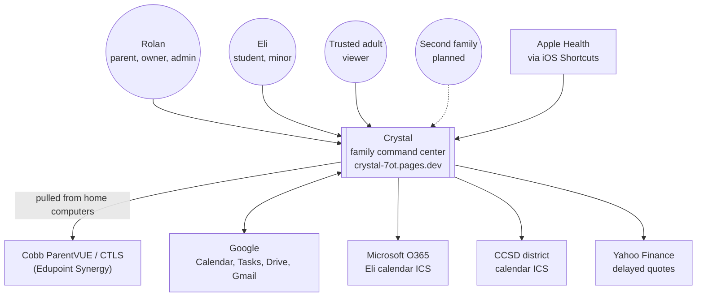
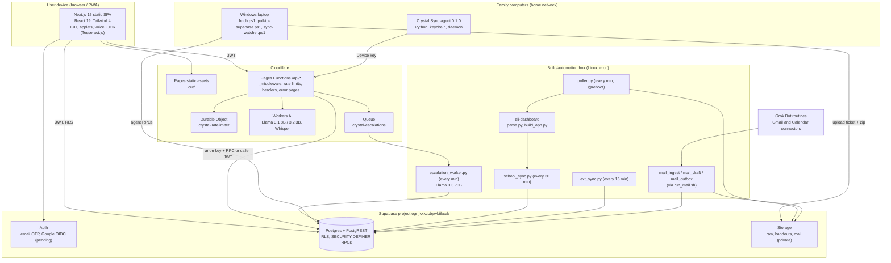
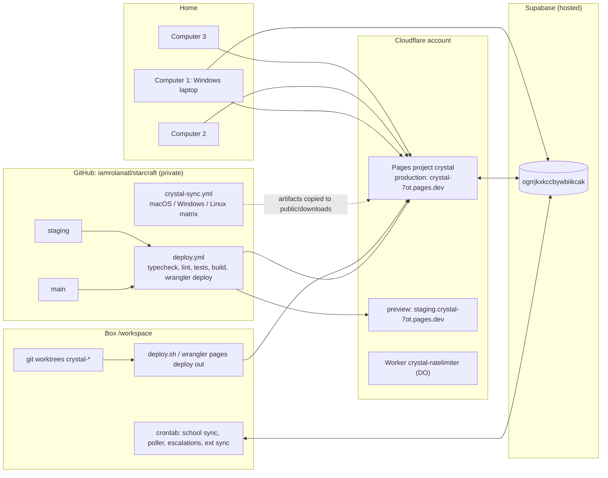
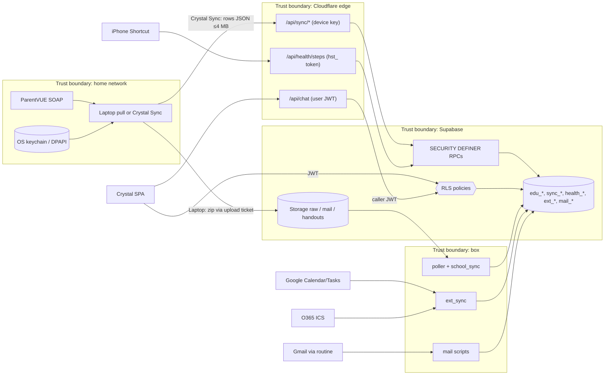
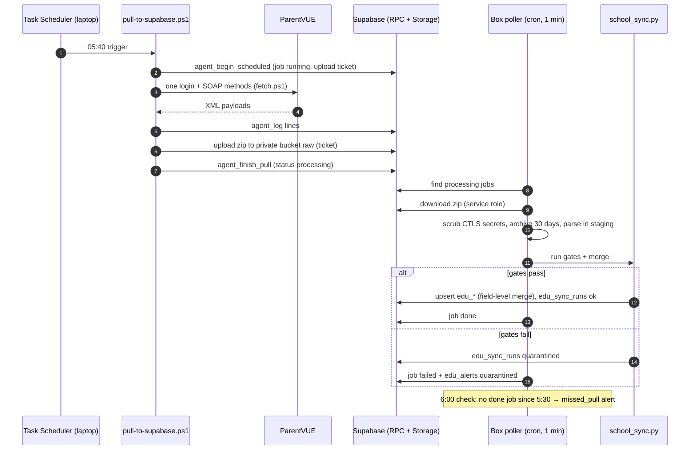
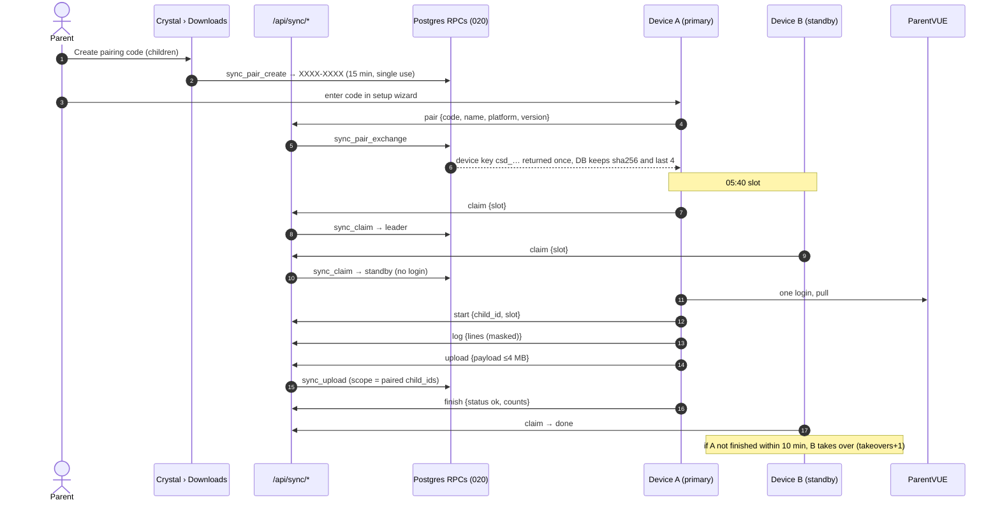
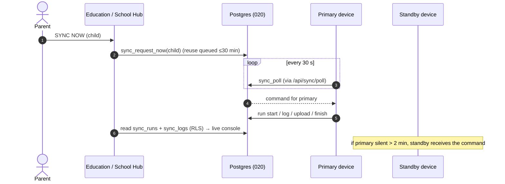
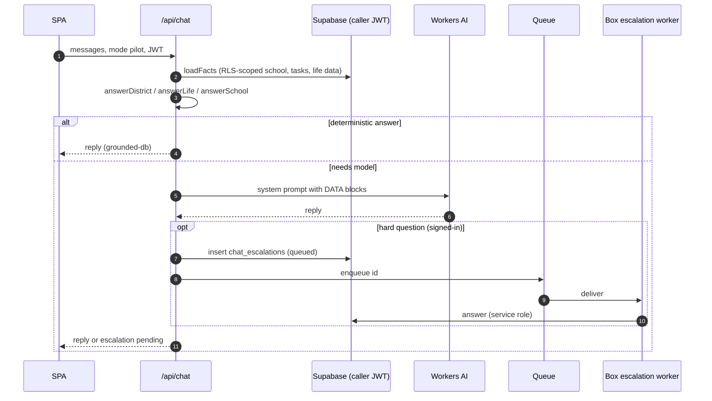
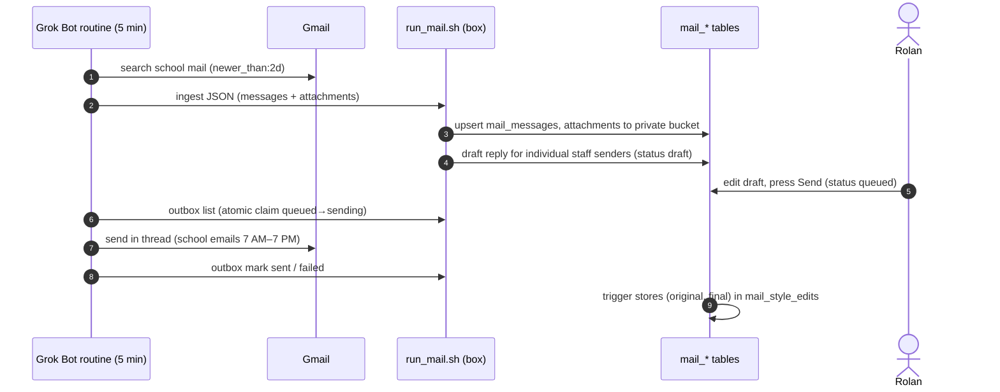

<!-- code: CRY-06-SAD | title: Solution Architecture | subtitle: Describes Crystal's architecture through C4 context and container views, deployment, data flows and sync sequences, with architecture principles, decisions (ADRs), quality-attribute tactics and technology inventory. -->

## 1. Introduction

This document follows the arc42 structure, using C4 diagrams for the context and container levels. It describes the architecture at baseline `588f344` and the production deployment observed on October 14, 2026 (build `bmv7xg9th`). Design detail (endpoints, tables, policies) is in 07 TDD.

## 2. Architecture Drivers

| Driver | Source | Architectural consequence |
|---|---|---|
| Family-only data, minor's records | BO-04, NFR-001, NFR-016 | Postgres RLS as the primary authorization layer; SECURITY DEFINER RPCs for anything cross-user |
| Cobb blocks datacenter IPs | C-01 | ParentVUE pulls run on family computers at home; cloud only receives results |
| One login per run; passwords local | C-02, C-03 | Agent holds credentials in the OS keychain; leader lease across computers |
| Low cost, low ops | BO-08 | Static site + serverless functions + managed Postgres; no always-on servers in the cloud |
| No service key at the edge | C-04 | Device keys and hashed tokens validated inside Postgres functions |
| Sync within 5 min; alert within 15 | BO-02/03 | Minute-level poller; direct upload RPC for Crystal Sync; status lights |
| Grounded AI | BR-007 | Deterministic answer layer before the LLM; facts loaded with the caller's JWT |

## 3. Architecture Principles

| # | Principle | Rationale |
|---|---|---|
| AP-1 | **Database is the policy enforcement point.** Every read and write of family data passes RLS or a SECURITY DEFINER RPC that re-checks identity and scope | One place to audit; front-end bugs cannot leak data |
| AP-2 | **Least privilege per credential.** Anon key: public RPCs only. User JWT: own/family rows. Device key: upload for paired children. Service role: box only | Limits the impact of any one leaked credential |
| AP-3 | **Never trust a pull.** Gates, quarantine, non-destructive merge, immutable snapshots | A bad pull cannot erase good data |
| AP-4 | **Human in the loop for outbound messages.** Drafts only; Rolan presses Send | Avoids embarrassing or harmful automated emails |
| AP-5 | **Degrade gracefully.** Missing migrations, models or providers return clear messages | The app keeps working while setup completes |
| AP-6 | **Idempotent everything.** Migrations re-runnable; upserts on natural keys; outbox claim once | Safe retries and replays |
| AP-7 | **Log every sync, mask every secret.** | Troubleshooting without exposure |

## 4. System Context (C4 Level 1)

## 5. Container View (C4 Level 2)

### 5.1 Container responsibilities

| Container | Responsibility | Technology | Credentials held |
|---|---|---|---|
| SPA | UI, window manager, client-side Supabase queries under RLS, voice capture, OCR | Next.js 15.5 static export, React 19.1, Tailwind 4, supabase-js 2 | User session (JWT) in browser |
| Pages Functions | Chat, command, transcribe, quote, district calendar, log, report-card signing, support, health ingest, admin, sync device API, Drive | TypeScript on Cloudflare Workers runtime | `SUPABASE_ANON_KEY`, `SUPPORT_KEY`, `ADMIN_EMAILS`; Drive: `SUPABASE_SERVICE_ROLE_KEY`, `GOOGLE_CLIENT_ID`, `GOOGLE_CLIENT_SECRET`, `OWNER_EMAIL` (configuration status TBD) |
| Middleware | Per-IP limits (isolate + Durable Object), body caps, security headers, styled error pages, server error capture | `functions/_middleware.ts` | none |
| Rate limiter DO | Global counter per route + IP | `workers/ratelimiter` (`crystal-ratelimiter`) | none |
| Workers AI | LLM chat and command intent; Whisper STT | `@cf/meta/llama-3.1-8b-instruct-fast`, `@cf/meta/llama-3.2-3b-instruct`, `@cf/meta/llama-3.1-8b-instruct`, `@cf/openai/whisper` | binding `AI` |
| Queue | Hand off hard questions | `crystal-escalations` (producer binding `ESCALATIONS`) | binding |
| Supabase | Auth, data, files | Postgres, PostgREST, Storage | anon (public), service role (box only) |
| Box services | Ingest, validation, alerts, ext sync, mail, escalations | Python 3, bash, cron (`CRON_TZ=America/New_York`) | `CRYSTAL_SUPABASE_SERVICE_ROLE_KEY` in `~/.config/crystal/sync.env` (600) |
| Laptop pipeline | ParentVUE pull from home; upload zip | PowerShell, Task Scheduler | DPAPI-encrypted parent password; agent secret (hash stored server-side) |
| Crystal Sync | Pull, parse and upload directly | Python 3.12, keyring, PyInstaller | Device key + parent passwords in OS keychain |
| Grok Bot routines | Gmail pull/send, Calendar feed, briefings | Agent connectors | User-connected accounts |

## 6. Deployment View

| Environment | URL / location | Deployed from | Notes |
|---|---|---|---|
| Production | `crystal-7ot.pages.dev` | `main` via CI, or `wrangler pages deploy out --project-name crystal --branch main` from the box | Live build `bmv7xg9th`, 2026-10-14 09:48:32Z |
| Staging | `staging.crystal-7ot.pages.dev` | `staging` branch | noindex |
| Database | Supabase `ogrrjkxkccbywbiikcak` | Migrations run by Rolan in SQL editor | 018, 019, 020 pending at baseline |
| Box | `/workspace` | git worktrees (21 at baseline) | cron jobs listed in 09 §2 |
| Home computers | Rolan's 3 computers (identities TBD beyond the Windows laptop) | Laptop scripts; Crystal Sync installers | Leader lease decides who pulls |

Note: the GitHub Actions deploy needs repository secrets (`CLOUDFLARE_API_TOKEN`, `CLOUDFLARE_ACCOUNT_ID`, `NEXT_PUBLIC_SUPABASE_ANON_KEY`). GitHub authentication on the build box is currently lost, so recent work is committed locally and deployed from the box with wrangler.

## 7. Data Flow View

| Flow | Frequency | Path | Integrity controls |
|---|---|---|---|
| ParentVUE (laptop path) | 5:40 AM/PM + Sync button | laptop → zip upload (ticket) → box poller → parse → gates → `school_sync.py` → `edu_*` | gates, quarantine, merge, 30-day raw archive |
| ParentVUE (Crystal Sync path) | 5:40 AM/PM + SYNC NOW | agent → `/api/sync/upload` → `sync_upload` → `edu_*` | scope check, size cap, rate limit, run log |
| Google Calendar / Tasks | every 15 min | box `ext_sync.py` (token route) or connector feed | quarantine >20% bad, <40% of current |
| O365 calendar | with ext sync | ICS URL `ELI_O365_ICS_URL` | same |
| School mail | every 5 min | routine → `run_mail.sh ingest` → `mail_*` | idempotent by gmail_id; HTML sanitized (nh3) |
| Outbox | every 5 min | `mail_outbox_claim` → routine sends → mark sent/failed | claim once; 30-min stuck → failed |
| Apple Health steps | on Shortcut run | `/api/health/steps` → `health_ingest` | hashed token; keep-max |
| District calendar | on request, 24 h edge cache | `/api/district-calendar` | snapshot fallback |
| Chat escalation | on demand | `/api/chat` → `chat_escalations` + Queue → box worker | owner-only rows; users cannot write answers |

## 8. Runtime Views

### 8.1 Laptop pipeline (current production path for Eli)

### 8.2 Crystal Sync pairing and scheduled run with leader lease

### 8.3 Sync Now from the web app

### 8.4 Grounded chat and escalation

### 8.5 School mail and outbox

## 9. Architecture Decisions

| ID | Decision | Alternatives considered | Rationale | Consequences |
|---|---|---|---|---|
| AD-01 | Static export on Cloudflare Pages with Pages Functions | Next.js SSR on a server | Cheapest, global, simple | Data fetching client-side under RLS; dynamic routes via functions |
| AD-02 | Supabase Postgres with RLS as authorization | Custom API server with app-layer auth | Policy in one place, testable with SQL | Policies and RPCs must be reviewed carefully; tests per migration |
| AD-03 | Pull ParentVUE from home computers | Pull from the box/cloud | Cobb blocks datacenter IPs (C-01) | Dependency on home computers being on; agent distribution |
| AD-04 | Workers AI first, Grok fallback stubbed | External LLM API | Data stays in Cloudflare; low cost | Small-model limits mitigated by deterministic answers and escalation |
| AD-05 | Deterministic grounded answers before the LLM | LLM with retrieval only | Prevents invented grades | More code paths to maintain; tests (`test-grounding`) |
| AD-06 | Device keys validated in SECURITY DEFINER RPCs called with the anon key | Service-role key at the edge | Least privilege (C-04) | All device logic lives in SQL (020) |
| AD-07 | Leader lease per family and slot | Single designated computer | Several computers, one login per run (C-02) | 10-minute takeover window |
| AD-08 | Durable Object global rate limiter with isolate fallback | Edge cache counter | Accurate global counts | Separate worker deploy |
| AD-09 | Human-approved outbox for all email | Auto-send | Safety (AP-4) | Requires Rolan's attention |
| AD-10 | Box cron instead of systemd | systemd services | Box has no systemd | `ensure_cron.sh` restarts cron |
| AD-11 | Owner-only admin via two gates without service key | Supabase dashboard only | Safe in-app admin with audit | Requires 019 |

## 10. Quality-Attribute Tactics

| Attribute | Tactics |
|---|---|
| Security | RLS deny-by-default, SECURITY DEFINER with empty search_path, hashed tokens, rate limits, security headers, typed confirmations, two-gate admin |
| Privacy | Family-scoped policies, viewer scopes and expiry, private buckets with signed URLs, no student data in bundle, local-only passwords |
| Reliability | Gates and quarantine, non-destructive merge, append-only grades, catch-up within 6 h, lock files, stuck-job sweeps, `@reboot` |
| Performance | Edge caching (quotes 60 s, district calendar 24 h), progressive mount, deferred particles, lazy overlays, immutable hashed assets |
| Availability | Model fallback chain, snapshot fallbacks, graceful "migration pending" responses, offline banner |
| Usability | Window manager, keyboard shortcuts, voice, skins, reduced motion, high contrast, text size |

## 11. Technology Inventory

| Layer | Technology | Version (from sources) |
|---|---|---|
| Front end | Next.js / React / Tailwind / TypeScript | 15.5.27 / 19.1.0 / 4 / 5 |
| Data client | @supabase/supabase-js | ^2.117.3 |
| Edge | Cloudflare Pages Functions, Wrangler | wrangler ^4.151.0, compatibility date 2025-09-01 |
| AI | Workers AI models listed in §5.1; box: `@cf/meta/llama-3.3-70b-instruct-fp8-fast`, `@cf/meta/llama-3.1-70b-instruct` | catalog as of build |
| Database | Supabase Postgres (local tests use Postgres 17) | hosted version TBD |
| Box | Python 3 (3.13 present), bash, cron | — |
| Agent | Python 3.12, keyring, PyInstaller, AppImage/.deb | Crystal Sync 0.1.0 |
| Laptop | PowerShell, Windows Task Scheduler | — |
| CI | GitHub Actions (Node 22, Python 3.12) | — |
| OCR | Tesseract.js (client) | — |

## 12. Approval

| Role | Name | Signature | Date |
|---|---|---|---|
| Sponsor / Product Owner | Rolan Chowdhury | | TBD |
| Solution Architect (agent-assisted) | Grok Bot delivery team | | TBD |
