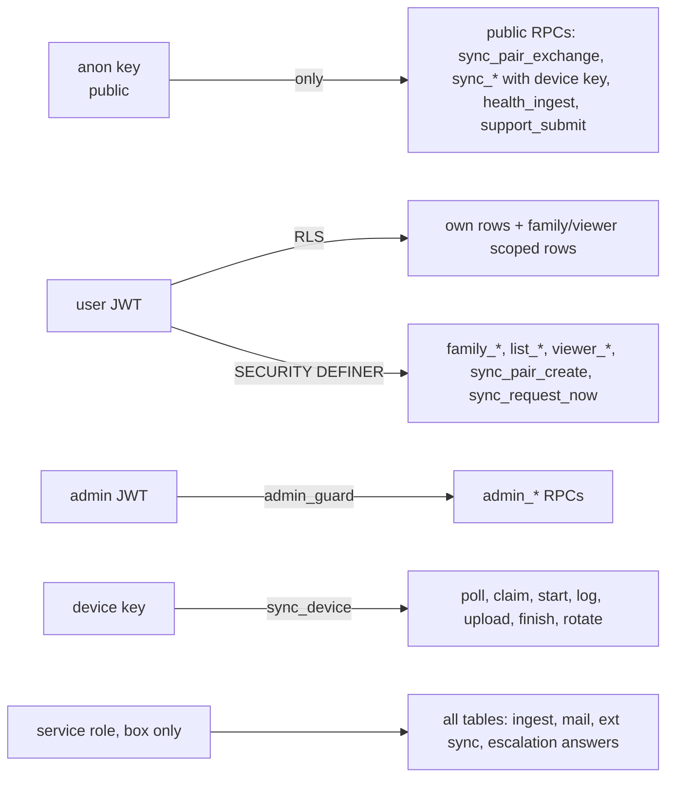
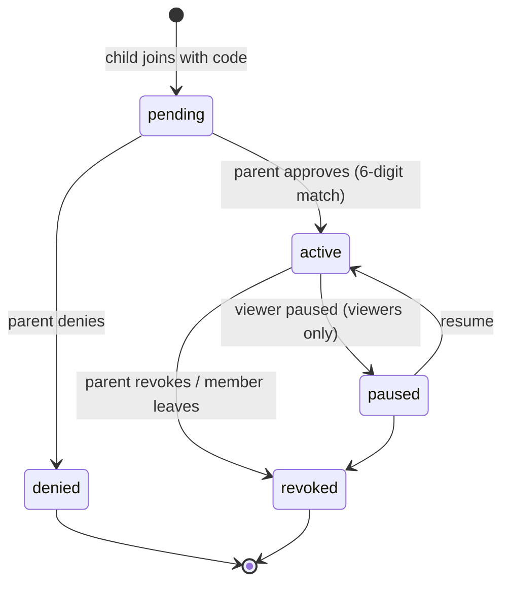
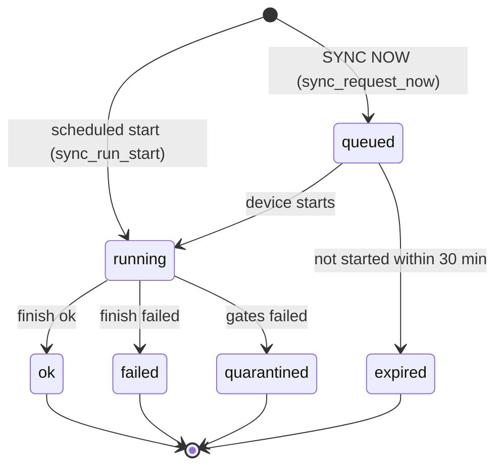
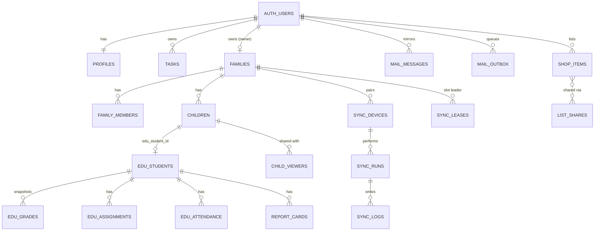

<!-- code: CRY-07-TDD | title: Technical Design Document | subtitle: Details Crystal's API contracts, authentication and authorization design, Row Level Security model, database schema and a per-migration data dictionary generated from the SQL, storage, scheduled jobs and the Crystal Sync protocol (IEEE 1016 viewpoints). -->

## 1. Scope and Conventions

This document describes the design at baseline `588f344`. Section 6 (data dictionary) is generated from `supabase/migrations/*.sql` by `build/gen_datadict.py` and must not be edited by hand. Error codes are PostgreSQL SQLSTATEs as returned by PostgREST: `42501` insufficient privilege, `28000` invalid authorization, `22023` invalid parameter, `P0429` (custom) rate limited, `PGRST202` function not found (migration not applied).

## 2. API Design (Cloudflare Pages Functions)

All routes live under `functions/api/`. Common behavior from `functions/_middleware.ts`: per-IP rate limits (isolate counter plus the `RL` Durable Object), POST body caps (64 KB; ~4.2 MB for `/api/transcribe` and `/api/sync/upload`), security headers, JSON 429 with `retry-after`, styled HTML error pages for browser navigations, and server-error capture with the Cloudflare ray ID. JSON responses use `cache-control: no-store` unless stated.

### 2.1 Endpoint catalog

| Method + path | Auth | Purpose | Request (summary) | Response / errors | Rate limit |
|---|---|---|---|---|---|
| POST `/api/chat` | none (sales) or user JWT (pilot) | Sales chat or grounded pilot chat; escalation | `{mode, messages[], demoFacts?, coords?}` | `{reply, model, provider, grounded?, escalation?}`; 400 if no messages | 20/min |
| POST `/api/command` | optional JWT | Natural-language intent (task, item creation, chat) | `{text, …}` | `{intent, provider}` | 40/min |
| POST `/api/transcribe` | none | Whisper speech-to-text; audio never stored | raw `audio/*` ≤ 4 MB | `{text, model}`; 413, 415, 502 | 15/min |
| GET `/api/quote?symbols=` | none | Delayed quotes (≤ 20 symbols), edge cache 60 s | symbols CSV | `{quotes[]}` | 60/min |
| GET `/api/district-calendar` | none | CCSD 2026-27 calendar (live ICS, 24 h cache; snapshot fallback) | — | `DistrictCal + live` (cache 1 h) | — |
| POST `/api/log` | none | Client error beacon to Workers logs | `{message, stack?, url?}` | `{ok}` | 30/min |
| GET `/api/report-card?id=` | user JWT | 5-minute signed URL for one report-card PDF (RLS decides) | uuid | `{url}`; 401, 404, 502 | — |
| POST `/api/support` | none | Support helper reply + ticket via `support_submit` with server-held `SUPPORT_KEY`; email via outbox | `{messages[], code, url, ticket?, name?, email?}` | reply + ticket `{id, secret}` | 12/min |
| POST `/api/health/steps` | `hst_` token (Bearer or body) | Apple Health steps ingest via `health_ingest` (anon key) | `{date, steps, distance?, activeEnergy?, flights?}` or `{days[≤40]}` | `{ok}` / `{ok, results[]}`; 401 | 60/min |
| GET `/api/health/steps` | none | Usage hint | — | `{ok, endpoint}` | 60/min |
| GET `/api/google/drive` | owner JWT | Drive browse/search/recent (read-only scope) | `folder`, `q`, `recent`, `page` | Drive files JSON; 502 | — |
| GET `/api/google/file?id=` | owner JWT | Stream/preview one file (Docs → PDF), ≤ 20 MB; CSP sandbox | id | file bytes; 413, 415 | — |
| GET `/api/admin/{whoami,overview,users,user,tables,table,browse,sync,devices,audit}` | admin JWT (2 gates) | Admin reads via `admin_*` RPCs with caller JWT | query params | JSON; 403; 503 pending | 90/min |
| POST `/api/admin/action` | admin JWT | `admin_action(p_action, p_target, p_args, p_confirm)` | `{action, target uuid, args, confirm}` | JSON; 400/403 | 90/min |
| POST `/api/admin/row` | admin JWT | Whitelisted row update `admin_row_update` | `{t, id, patch, confirm}` | JSON | 90/min |
| POST `/api/admin/revoke-device` | admin JWT | `sync_device_revoke` | `{id, confirm:"REVOKE"}` | JSON | 90/min |
| POST `/api/sync/pair` | none (code) | Exchange pairing code for device key | `{code, name, platform, version}` | `{device_id, key, …}` (key once) | 10/10 min |
| POST `/api/sync/poll` | `Device csd_…` | Poll commands; heartbeat; version | `{version?}` | commands | 90/min |
| POST `/api/sync/claim` | device | Leader lease for slot | `{slot}` | `{leader, done, takeover?}` | 30/min |
| POST `/api/sync/start` | device | Start run for paired child | `{child_id, run_id?, trigger, slot?}` | `{run_id}` | — |
| POST `/api/sync/log` | device | Append ≤ 200 masked lines | `{run_id, lines[]}` | ok | 120/min |
| POST `/api/sync/upload` | device | Upload school rows (≤ 4 MB) | `{run_id, child_id, payload}` | counts per table | 20/h (+12/h per device in DB) |
| POST `/api/sync/finish` | device | Finish run | `{run_id, status, counts, error?}` | ok | — |
| POST `/api/sync/rotate` | device | Rotate device key | — | new key | — |

Error mapping in `/api/sync/*` and `/api/admin/*`: `PGRST202`/404 → 503 "migration pending"; `28000` → 401; `42501` → 403; `P0429` → 429; other → 400 with a 300-character message.

### 2.2 Typed contracts

`src/contracts/api.ts` defines request/response types shared by the SPA and functions (`ChatMessage`, `ChatRequest`, `ChatResponse`, `CommandIntent`, `CommandResponse`). Functions are type-checked separately (`npx tsc --noEmit -p functions`).

## 3. Authentication

| Principal | Mechanism | Where validated | Lifetime / rotation |
|---|---|---|---|
| User | Supabase Auth email one-time code; Google OIDC wired (provider pending) | Supabase Auth; JWT on every PostgREST call | Supabase session with `autoRefreshToken`; 15 s timed fetch |
| Admin | User JWT + email in `ADMIN_EMAILS` (default `iamrolan@gmail.com`) + row in `public.admins` | `/api/admin` (GET `/auth/v1/user`) and `admin_guard()` | As user session |
| Device (Crystal Sync) | `Authorization: Device csd_<64 hex>` | `public.sync_device(p_key)` inside each RPC: sha256 lookup, revoked check, rate counters | Until rotated (`sync_rotate`) or revoked |
| Laptop agent | Agent secret (hash in `private.agent_secrets`) and one-time upload tickets | `agent_*` RPCs (003) | Per job ticket |
| Health ingest | `hst_<48 hex>` token, hash in `health_ingest_tokens` | `health_ingest` | `health_rotate_token` |
| Support | `SUPPORT_KEY` (Pages secret), sha256 in `support_config` | `support_submit` | Manual rotation |
| Box services | Service-role key | Supabase (bypasses RLS) | Manual rotation; box only |

## 4. Authorization: Row Level Security Model

### 4.1 Policy patterns

| Pattern | Tables (examples) | Policy |
|---|---|---|
| Owner-only | `tasks`, `user_prefs`, `health_logs`, `meds`, `bills`, `credit_scores`, `stocks`, `comms_notes`, `drive_pins` | `user_id = auth.uid()` for all operations ("owner all") |
| Owner read, box writes | `edu_*` (002, 013, 014), `learn_*` (015), `ext_items`, `ext_sync_runs`, `mail_messages`, `report_cards` | select `user_id = auth.uid()`; writes only by service role; `anon` revoked |
| Constrained user writes | `mail_outbox` (insert only as `queued` with no system fields; cancel only draft/queued), `ext_items` (only `pending_action`, `pending_at`, `hidden`), `chat_escalations` (insert queued; never answer), `edu_attendance_excuses` (own insert) | Column grants + `with check` |
| Family read (additive, 017) | `edu_students` (any), `edu_grades`/`edu_grade_calc` (grades), `edu_assignments`/`edu_graded_assignments` (assignments), `report_cards`, `edu_attendance*` (attendance), `edu_schedule`, `edu_calendar`, `learn_units`/`learn_resources` (learn), `edu_messages`/`edu_alerts`/`edu_sync_runs` (login: child only) | `can_child(user_id, child_id, scope)`: active child member for that child, or active viewer with the scope and unexpired access (not for scope `login`) |
| Family-wide for child logins | `tasks`, `ext_items`, `ext_sync_runs` | `is_family_member(user_id)` (never trusted adults) |
| Never shared | `bills`, `credit_scores`, `stocks`, `mail_*`, `health_logs`, `meds`, `comms_notes`, `drive_pins`, Google tokens, `edu_attendance_excuses`, `learn_history`, `chat_escalations`, `ext_quarantine`, `user_prefs`, `sync_requests` | Owner-only (documented in 017) |
| Shared lists | `shop_items` | `can_list(owner, list, write)` for select/insert/update/delete |
| Owner-only system | `support_tickets` (`support_is_owner()`), `admin_*` (no direct grants; RPC only), `sync_*` (owner select; device RPCs write) | |
| Storage | `raw` (agent upload with ticket; report-card family read), `handouts` (per-user folder), `mail` (folder = auth.uid) | Policies on `storage.objects` |

### 4.2 Membership state machine (017)

### 4.3 Sync run state machine (020)

## 5. Database Schema Overview

### 5.1 Migration inventory

| Migration | Purpose | Key objects | Production status |
|---|---|---|---|
| 001_tasks | Profiles + tasks, RLS | `profiles`, `tasks`, `handle_new_user` | Applied |
| 002_education | Education tables | `edu_students`, `edu_grades`, `edu_assignments`, `edu_attendance`, `edu_messages`, `edu_calendar`, `edu_sync_runs` | Applied |
| 003_laptop_agent | Laptop agent, upload tickets, sync log, alerts | `sync_requests`, `sync_log`, `edu_alerts`, `private.agent_secrets`, `private.upload_tickets`, bucket `raw` | Applied |
| 004_modules | Health, finance, shopping, comms, check-ins | `health_logs`, `meds`, `bills`, `credit_scores`, `stocks`, `shop_items`, `comms_notes`, `edu_checkins`, bucket `handouts` | Applied |
| 005_user_prefs | UI preferences | `user_prefs` | Applied |
| 006_chat_escalations | Escalation queue rows | `chat_escalations` | Applied |
| 007_data_validation | Last-good state, row tracking, immutable grades, current view | `edu_grades_current`, `edu_grades_immutable` | Applied |
| (008) | Number not used in this repository | — | — |
| 009_external_sync | Google/O365 items, quarantine, tokens | `ext_items`, `ext_quarantine`, `ext_sync_runs`, `private.google_tokens` | Applied |
| 010_health_ingest | iPhone steps ingest | `health_ingest_tokens`, `health_ingest_log`, `health_ingest` | Applied |
| 011_drive_pins | Drive pins | `drive_pins` | Applied |
| 012_mail | Gmail mirror + outbox | `mail_messages`, `mail_attachments`, `mail_outbox`, `mail_style_edits`, bucket `mail` | Applied |
| 013_report_cards | Report cards, graded assignments, grade calc | `report_cards`, `edu_graded_assignments`, `edu_grade_calc` | Applied |
| 014_school_extras | Schedule, attendance periods, excuses | `edu_schedule`, `edu_attendance_periods`, `edu_attendance_excuses` | Applied |
| 015_learn | Learn units and resources | `learn_units`, `learn_resources`, `learn_history` | Applied |
| 016_profiles | Names from Google identity | `handle_new_user` (replaced) | Applied |
| 017_family | Families, children, viewers, list sharing | `families`, `family_members`, `family_invites`, `children`, `child_viewers`, `viewer_invites`, `list_shares`, `list_invites`, `list_activity`, … | Applied (owner reports only 018–020 pending) |
| 018_support | Support tickets | `support_tickets`, `support_config`, `support_submit` | **Pending** |
| 019_admin | Admin command center | `admins`, `admin_audit`, `admin_rate`, `admin_user_flags`, `admin_*` RPCs | **Pending** |
| 020_family_invites_grant | Column grant `family_invites.child_id` | grant | **Pending** |
| 020_sync_devices | Crystal Sync | `sync_pairing_codes`, `sync_devices`, `sync_runs`, `sync_logs`, `sync_leases`, `sync_pair_attempts`, `sync_*` RPCs | **Pending** |

"Applied" for 001–017 is based on the owner's statement that only 018, 019 and the two 020 files are pending; a direct production check is TBD.

### 5.2 Core entity relationships

### 5.3 Key RPCs by migration

| Migration | RPC | Caller | Notes |
|---|---|---|---|
| 003 | `request_sync`, `agent_begin_scheduled`, `agent_claim_sync`, `agent_log`, `agent_finish_pull`, `agent_finish_sync` | User (Sync button), laptop agent | Upload ticket for bucket `raw` |
| 009 | `save_google_token`, `google_token_status`, `svc_google_token` | User; service role only for `svc_` | Refresh token in `private.google_tokens` |
| 010 | `health_ingest`, `health_ingest_status`, `health_rotate_token` | anon + token; user | keep-max per day |
| 012 | `mail_outbox_claim`, `mail_guard` | Box; trigger | Atomic claim |
| 017 | `family_ensure`, `family_create_invite`, `family_join`, `family_decide`, `family_revoke_invite`, `family_revoke_member`, `family_leave`, `family_status`, `my_access`, `viewer_invite`, `viewer_manage`, `viewer_invite_revoke`, `list_share_invite`, `list_share_decide`, `list_share_set_perm`, `list_share_revoke`, `list_invite_revoke`, helper predicates `can_child`, `can_list`, `is_family_member`, `is_family_parent_of`, `my_family_id` | Authenticated | Join attempts throttled |
| 018 | `support_submit`, `support_is_owner` | `/api/support` (anon + key) | Owner reads |
| 019 | `admin_guard`, `admin_whoami`, `admin_overview`, `admin_users`, `admin_user_detail`, `admin_tables`, `admin_table_info`, `admin_browse`, `admin_sync`, `admin_audit_list`, `admin_action`, `admin_row_update`, helpers | Admin JWT | Typed confirmation; audit |
| 020 | `sync_pair_create`, `sync_my_devices`, `sync_device_revoke`, `sync_request_now`, `sync_status`, `sync_admin_devices`, `sync_pair_exchange`, `sync_poll`, `sync_claim`, `sync_run_start`, `sync_log`, `sync_upload`, `sync_run_finish`, `sync_rotate`, internal `sync_device`, `sync_mask`, `sync_device_roles`, `sync_admin_ok` | User / admin / device | Least privilege |

### 5.4 Key constants (020)

| Constant | Value |
|---|---|
| Pairing code | 8 chars from `ABCDEFGHJKLMNPQRSTUVWXYZ23456789`, shown `XXXX-XXXX`, sha256 stored with 2-char hint |
| Pairing code lifetime / per family | 15 minutes, single use, one live code, ≤ 10 per hour |
| Pair attempts per IP | 10 bad tries per 15 minutes |
| Device call limits | 120 calls/minute, 12 uploads/hour |
| Queued Sync Now expiry | 30 minutes |
| Lease takeover | 10 minutes after claim without done |
| Slot validity | not more than 5 minutes in the future or 12 hours in the past |
| Primary silence fallback | 2 minutes |
| Status light | OK if last good sync < 13 hours; LATE otherwise; FAILED; NEVER SYNCED |

## 6. Data Dictionary (generated)

The tables below list every table created by each migration, with column types and constraints, columns added by later migrations, views, RLS statements, storage buckets and functions. Tables created through dynamic SQL loops (for example RLS enablement in 002 and 017) show their RLS in §4 rather than in the "RLS enabled" line.

<!-- include: _datadict.md -->

## 7. Storage Design

| Bucket | Public | Contents | Access |
|---|---|---|---|
| `raw` | No | Laptop pull zips; `report-cards/` PDFs (PDF MIME allowed since `74bff53`) | Agent upload with one-time ticket; box service role; report-card family read policy; signed URLs (5 min) |
| `handouts` | No | Check-in handout uploads | Owner folder read/write/delete |
| `mail` | No | Mirrored email attachments | Read where first folder = `auth.uid()` |

## 8. Scheduled Jobs

| Job | Host | Schedule | Command | Log |
|---|---|---|---|---|
| School sync | Box | `*/30 * * * *` ET | `sync/run_sync.sh` (no-op unless `fetched_at` changed) | `~/.local/state/crystal/school_sync.log` |
| Poller | Box | every minute + `@reboot` | `sync/run_poller.sh` | `poller.log` |
| Escalation worker | Box | every minute + `@reboot` | `sync/run_escalation_worker.sh` | `escalations.log` |
| Ext sync | Box | `*/15 * * * *` | `sync/run_ext_sync.sh` | TBD |
| Mail pull / draft / send | Grok Bot routine + box | every 5 minutes | `sync/run_mail.sh` ingest / draft / outbox | routine logs |
| Laptop pull | Windows laptop | 05:40, 17:40 | `pull-to-supabase.ps1` | `LAST_FAILURE.txt` on failure |
| Laptop watcher | Windows laptop | at log-on, polls every 10 s | `sync-watcher.ps1` | — |
| Crystal Sync daemon | Each paired computer | always on; polls every 30 s | `crystal-sync daemon` | `logs/sync-YYYYMMDD.log` |
| Crystal Sync schedule | Each paired computer | 05:40, 17:40 local; catch-up ≤ 6 h | systemd timer / LaunchAgent / Task Scheduler | same |
| Morning briefing / Sunday review | Grok Bot routines | daily / Sundays (times TBD) | outside repo | — |

Note: the crontab entries point at several worktrees (`crystal-build`, `crystal-esc`, `crystal`). Consolidating them onto one worktree is backlog item PB-021.

## 9. Crystal Sync Agent Design

| Module | Responsibility |
|---|---|
| `__main__.py` | CLI: setup window, `run`, `daemon`, `status`, `install`, `uninstall`, `rotate`, `forget`, `selftest` |
| `wizard.py` | Local setup wizard: pairing code entry, credentials to keychain |
| `config.py` | Platform config directories |
| `api.py` | HTTP client for `/api/sync/*` with `Authorization: Device` |
| `engine.py` | Run orchestration: claim lease, one ParentVUE login, parse, gates, upload, finish |
| `pv_parse.py` | Vendored `eli-dashboard/parse.py` |
| `pv_rows.py` | Row building and quarantine gates from `sync/school_sync.py` |
| `merge.py` | Non-destructive merge helpers |
| `runlog.py` | Masked, streamed local and remote logs |
| `schedule.py` | systemd / launchd / Task Scheduler installation |

## 10. Design Constraints and Known Gaps

| Item | Detail | Reference |
|---|---|---|
| Drive service key | Drive routes need `SUPABASE_SERVICE_ROLE_KEY` at the edge | NFR-002, PB-010 |
| Missed-pull timing | Check at 6:00 / 18:00 (20 minutes after the slot) | NFR-021, PB-004 |
| Term finals | Crystal Sync does not compute term finals yet; keep `school_sync.py` for them | `agent/README.md` |
| 7 AM–7 PM send window | Enforced by the routine, not in repository code | FR-100 |

## 11. Approval

| Role | Name | Signature | Date |
|---|---|---|---|
| Product Owner | Rolan Chowdhury | | TBD |
| Technical Lead (agent-assisted) | Grok Bot delivery team | | TBD |
