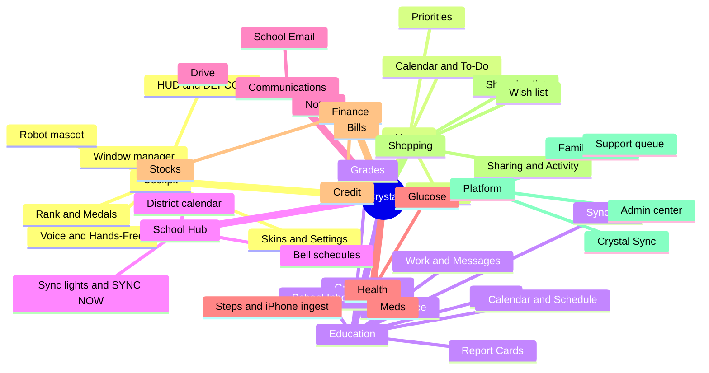

<!-- code: CRY-08-FEA | title: Feature Catalog | subtitle: Catalogs every Crystal feature by module with its description, users, data sources, implementing requirements, introducing commit and status, as the bridge between requirements and releases. -->

## 1. How to Read This Catalog

Each feature has an ID (F-nnn), the module it belongs to, a short description, who uses it, the requirements it implements (04 FRS), the commit that introduced or last materially changed it, and its status at baseline `588f344`. Status pills: [[ok|Live]] in production; [[partial|Partial]] built but waiting on a migration, account action or device; [[no|Planned]] not built.

## 2. Module Map

## 3. Cockpit and Experience

| ID | Feature | Description | Users | FRs | Commit | Status |
|---|---|---|---|---|---|---|
| F-001 | Landing and sales chat | Looping nebula video hero, "Modules online" grid, AI sales chat, legal pages | Visitor | FR-001, 004, 005, 011 | `af3ad4e`, `3799989` | [[ok|Live]] |
| F-002 | Sign-in | Email one-time code; Google OIDC button | All | FR-002, 003, 007 – 009 | `af3ad4e` | [[partial|Google pending]] |
| F-003 | Demo cockpit | `/app/?demo=1` with seeded on-device data | Visitor | FR-006 | `af3ad4e` | [[ok|Live]] |
| F-004 | Window manager | Applets: drag, 8-edge resize, full/normal toggle, tiling, minimized tray, persisted layout | All | FR-013, 014, 021 | `69ef54f`, `55c1995` | [[ok|Live]] |
| F-005 | Keyboard and palette | Shortcuts, cheat sheet, Cmd-K palette with NL | All | FR-015, 016 | `77bad51` | [[ok|Live]] |
| F-006 | HUD | Pilot view, 3×3 abilities with cooldowns, 360°/tactical radar, squad status, feeds | All | FR-017 | `3799989` | [[ok|Live]] |
| F-007 | DEFCON alerting | Computed DEFCON 5→1 meter, manual Red Alert, ambient sound | Parent | FR-018, 079 | `ccb87aa`, `7e61772` | [[ok|Live]] |
| F-008 | Modules toolbar and slim chrome | Always-visible toolbar, icon mode below 1280 px, slim row | All | FR-019, 020 | `e3dd299`, `fbeeacb` | [[ok|Live]] |
| F-009 | Skins | Crystal Cockpit, Blockcraft, Brick City, Battle Island, Kart Rush | All | FR-022 | `5f39d69` | [[ok|Live]] |
| F-010 | Settings center | Text size, contrast, reading mode, motion, video, glass, accent; Defaults v2 | All | FR-023, 024 | `5f39d69`, `8e17281` | [[ok|Live]] |
| F-011 | Robot mascot and buddy | Crystal robot with moods; strolling buddy with poses (Lively/Calm/Off) | All, kid-friendly | FR-025 | `340a472`, `1af7f05` | [[ok|Live]] |
| F-012 | Sound | Web Audio SFX, ambient hum, mute | All | FR-026 | `3799989` | [[ok|Live]] |
| F-013 | Resilience UX | Error boundaries, offline banner, toasts, stale-deploy recovery card | All | FR-010, 012, 027, 122 | `272c6dc`, `140416f` | [[ok|Live]] |
| F-014 | PWA | Manifest, service worker, install | All | FR-028 | `629cefd` | [[ok|Live]] |
| F-015 | ProgressBar and goals | Neon progress with 90% GOAL marker and kid-friendly messages | Student, parent | FR-029 | `b445cc2` | [[ok|Live]] |
| F-016 | Rank & Medals | XP, rank, medals panel | Student | FR-030 | `3799989` | [[ok|Live]] |

## 4. AI and Voice

| ID | Feature | Description | Users | FRs | Commit | Status |
|---|---|---|---|---|---|---|
| F-020 | Grounded Crystal chat | Answers from RLS-scoped data with source and "as of"; "I don't know" otherwise | Signed-in | FR-031, 032, 033 | `5d0625c` | [[ok|Live]] |
| F-021 | Model router | Llama 8B fast → 3B → 8B; 20 s timeout; friendly fallback | All | FR-034 | `af3ad4e` | [[ok|Live]] |
| F-022 | Escalations | Hard questions to queue → box 70B worker → answer appears | Signed-in | FR-035 | `8f765bd` | [[ok|Live]] |
| F-023 | Natural-language commands | Cross-module creation and removal from free text | All | FR-036, 059 | `3799989` | [[ok|Live]] |
| F-024 | Voice and Hands-Free | Web Speech + Whisper; hands-free loop; iOS TTS unlock; "stop" | All | FR-037, 038, 039 | `6aa6c12` | [[ok|Live]] |
| F-025 | Routines | Morning briefing, Sunday review (Grok Bot routines) | Parent | FR-041, 042 | outside repo | [[partial|Routine]] |

## 5. Home, Health, Finance, Shopping, Communications, OCR

| ID | Feature | Description | Users | FRs | Commit | Status |
|---|---|---|---|---|---|---|
| F-030 | Home | Priorities, weather, calendar, to-do, holo globe | All | FR-043, 044 | `af3ad4e` | [[ok|Live]] |
| F-031 | Unified To-Do / Calendar | Crystal tasks + Google + Eli O365 with source badges, write-back | Parent, child | FR-097, 098 | `c9ca7ec` | [[partial|Google token / ICS pending]] |
| F-032 | Health logs and meds | Steps, glucose gauges and sparklines; meds take check-off | Parent | FR-045 | `3799989` | [[ok|Live]] |
| F-033 | iPhone steps ingest | Shortcut → `/api/health/steps`; Steps applet v2 | Parent | FR-046, 047 | `2b6daaf` | [[partial|Shortcut not set up]] |
| F-034 | Bills | CRUD, overdue radar, budget gauge | Parent | FR-048 | `3799989` | [[ok|Live]] |
| F-035 | Credit and stocks | Manual credit log; delayed quotes | Parent | FR-049, 050 | `3799989` | [[ok|Live]] |
| F-036 | Shopping and wish lists | CRUD, wish → cart, estimates | Family | FR-052 | `3799989` | [[ok|Live]] |
| F-037 | List sharing and activity | Email invite + code + 6-digit match + Approve; view/edit; activity log | Family, collaborators | FR-053, 054 | `9aee962` | [[ok|Live]] |
| F-038 | Comms notes | Follow-up notes per channel with deep links | Parent | FR-055 | `3799989` | [[ok|Live]] |
| F-039 | School Email | Gmail school mirror, reader, composer, Crystal drafts, style learning, outbox | Parent | FR-056, 099, 100 | `8733268`, `6865912` | [[ok|Live]] |
| F-040 | Drive | Browse/search/recent, in-app preview, pin to School Hub | Parent | FR-057 | `ebf5a28` | [[partial|Google token]] |
| F-041 | OCR Scanner | On-device Tesseract.js; create items from text | All | FR-058, 059 | `3799989` | [[ok|Live]] |
| F-042 | Check-ins and handouts | Check-ins with private handout upload | Parent, child | FR-060 | `3799989` | [[ok|Live]] |

## 6. Education and School Hub

| ID | Feature | Description | Users | FRs | Commit | Status |
|---|---|---|---|---|---|---|
| F-050 | Grades by class | Q1 final main number, Q2 live/not posted, trend, toggle, grade colors | Parent, child, viewer (grades) | FR-061 – 063 | `fae62c8`, `ff863a3` | [[ok|Live]] |
| F-051 | Graded assignments and weights | Per-class assignments, Cobb category weights, impact chart, what-if | Parent, child | FR-064 | `cb8f34e` | [[ok|Live]] |
| F-052 | Grading periods | Period/term/semester dates and countdowns | Parent, child | FR-065 | `1ea0677` | [[ok|Live]] |
| F-053 | Grading Rules (Cobb IHA-R) | Scale bar, overlays, make-up timeline, conduct, cited callouts | Parent, child | FR-066 | `5cd0ede` | [[ok|Live]] |
| F-054 | Learn | Current unit per class with evidence/confidence and verified study links | Student, parent | FR-067 | `39a68be` | [[ok|Live]] |
| F-055 | Work and Messages | Assignments with missing count; ParentVUE messages with unread | Parent, child | FR-068, 069 | `9f622da` | [[ok|Live]] |
| F-056 | Calendar and Schedule | Student calendar; Dickerson bell times with live class | Parent, child | FR-070, 071 | `7e61772` | [[ok|Live]] |
| F-057 | Attendance and excuses | Absences/tardies with excused/unexcused, trend, excuse letters with Send | Parent | FR-072, 073 | `2c518e3` | [[ok|Live]] |
| F-058 | Report Cards | PDF list and full-screen viewer via signed URLs | Parent, viewer (report_cards) | FR-074 | `cea159b` | [[ok|Live]] |
| F-059 | School Inboxes and More School Data | Portal links, latest messages, "Not available from Cobb" cards | Parent | FR-075, 076 | `cea159b` | [[ok|Live]] |
| F-060 | Sync Log | Runs and console lines | Parent | FR-077 | `f1e3156` | [[ok|Live]] |
| F-061 | Summary tiles | Clickable Missing, Due soon, Absent/tardy tiles | Parent, child | FR-078 | `4642d13` | [[ok|Live]] |
| F-062 | Child switcher | Choose child scope | Parent, viewer | FR-080 | `9aee962` | [[ok|Live]] |
| F-063 | School Hub district calendar | CCSD 2026-27 month view, chips, legend, mobile agenda | All | FR-081 | `a051080` | [[ok|Live]] |
| F-064 | Bell schedules and portals | Master/Flex/Early release; portal links | All | FR-082, 083 | `3799989` | [[ok|Live]] |
| F-065 | School data pipeline (laptop) | ParentVUE pull 5:40 AM/PM, box ingest, validation, alerts | Parent | FR-086 – 096 | `f1e3156`, `16a1197` | [[ok|Live]] |

## 7. Platform: Sharing, Support, Admin, Crystal Sync

| ID | Feature | Description | Users | FRs | Commit | Status |
|---|---|---|---|---|---|---|
| F-070 | Family and children | Family, children, child logins with code + 6-digit approval | Parent, child | FR-101 – 104, 107 – 110 | `9aee962`, `852fb0c` | [[ok|Live]] (invite child_id grant pending 020) |
| F-071 | Trusted adults | Scoped, expiring viewer access ("Share Child's Education") | Parent, viewer | FR-105, 106 | `9aee962` | [[ok|Live]] |
| F-072 | Styled error pages | 401/403/404/429/500/502/503 with Talk to support | All | FR-111, 112 | `a01d548` | [[ok|Live]] |
| F-073 | Support queue | Tickets + email to Rolan; `/support` queue | Owner | FR-113, 114 | `a01d548` | [[partial|Pending 018]] |
| F-074 | Admin command center | `/admin` overview, users, families, data explorer, sync, audit, terminal, Cmd-K, typed confirmations | Owner | FR-115 – 121 | `048024f` | [[partial|Pending 019]] |
| F-075 | Crystal Sync web | Downloads with pairing codes, device list, Disconnect, status lights, SYNC NOW console | Parent | FR-085, 123, 124, 126 – 131, 134, 135, 139 | `6ec692b` | [[partial|Pending 020]] |
| F-076 | Crystal Sync agent | Python agent: wizard, keychain, one-login pull, masked logs, daemon, schedules | Parent devices | FR-125, 136 – 138 | `21f38e6` | [[partial|Linux only; pending 020]] |
| F-077 | Leader lease | One ParentVUE login across Rolan's three computers, 10-min takeover, primary routing | Parent devices | FR-132, 133 | `588f344` | [[partial|Pending 020]] |
| F-078 | Signed installers | macOS .dmg/.pkg and Windows Setup.exe, signed | Second family | FR-140 | — | [[no|Planned]] |
| F-079 | Second-family onboarding | New owner, children, devices | Second family | BR-010 | — | [[no|Planned]] |
| F-080 | Mobile readability redesign | Phone readability pass | All | NFR-045 | `0ad65fe`, `717441b` (branch `mobile`) | [[partial|In progress]] |

## 8. Feature Status Summary

| Status | Count |
|---|---|
| Live | 49 |
| Partial | 11 |
| Planned | 2 |
| **Total** | **62** |

Counts are by feature row in §3–§7 (F-070 counted as Live).
