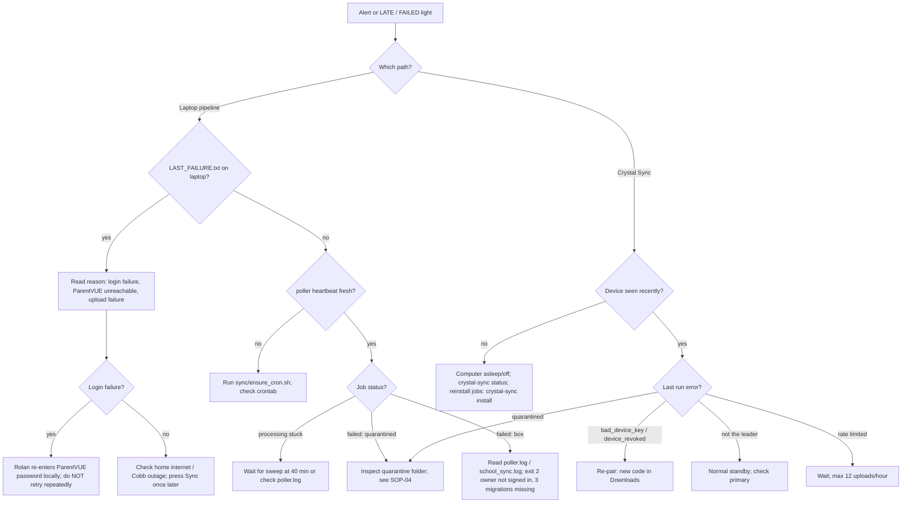
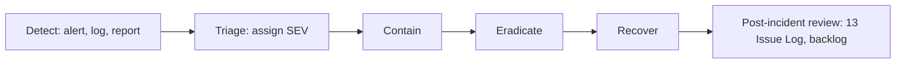

<!-- code: CRY-09-RUN | title: Standard Operating Procedures and Runbook | subtitle: Step-by-step procedures to deploy, migrate, operate, troubleshoot and recover Crystal: deployment, migrations, sync troubleshooting, device revocation and key rotation, support queue, incident response, backup and restore, and routine health checks. -->

## 1. Purpose, Roles and Safety Rules

This runbook is for the owner (Rolan) and the delivery team operating Crystal. Every SOP lists its trigger, prerequisites, steps, verification and rollback.

| Role | Can do |
|---|---|
| Owner (Rolan) | Everything, including production migrations in the Supabase SQL editor, purchases, account settings, sending email |
| Delivery team (Grok Bot agents on the box) | Build, test, deploy Pages, run box jobs, read logs; never apply production migrations, never send email without Rolan's Send, never print secrets |

**Safety rules**

1. Never print, paste or commit a secret. Refer to environment variable names only (`CLOUDFLARE_API_TOKEN`, `CLOUDFLARE_ACCOUNT_ID`, `NEXT_PUBLIC_SUPABASE_ANON_KEY`, `SUPABASE_ANON_KEY`, `SUPPORT_KEY`, `ADMIN_EMAILS`, `CRYSTAL_SUPABASE_SERVICE_ROLE_KEY`, `CRYSTAL_SMTP_*`, `ELI_O365_ICS_URL`, `GOOGLE_CLIENT_ID`, `GOOGLE_CLIENT_SECRET`).
2. Never run more than one ParentVUE login per slot. Do not "just retry" a failed pull; use SYNC NOW once.
3. Treat Eli's data as sensitive. Share screenshots of grades or attendance only with family.
4. Destructive admin actions require typed confirmation; double-check the target UUID.

## 2. System Inventory (operational)

| Component | Where | How to check health |
|---|---|---|
| Production site | `https://crystal-7ot.pages.dev` | `curl -s https://crystal-7ot.pages.dev/version.json` returns `{"build", "at"}` (baseline `bmv7xg9th`, 09:48:32Z) |
| Staging | `https://staging.crystal-7ot.pages.dev` | same |
| API | `/api/*` | `curl -s -X POST …/api/sync/poll -d '{}'` → `{"error":"device key required"}` means the function is up |
| Database | Supabase `ogrrjkxkccbywbiikcak` | Supabase dashboard; `/admin` overview (after 019) |
| Box cron | crontab (`CRON_TZ=America/New_York`) | `crontab -l`; `pgrep -x cron`; heartbeat files in `~/.local/state/crystal/` |
| Poller | `*/1` + `@reboot` → `/workspace/crystal-build/sync/run_poller.sh` | `poller.heartbeat` < 5 min old; `poller.log` |
| School sync | `*/30` → `/workspace/crystal-build/sync/run_sync.sh` | `school_sync.log` |
| Escalation worker | `*/1` + `@reboot` → `/workspace/crystal-esc/sync/run_escalation_worker.sh` | `escalation.heartbeat` < 2 min old |
| Ext sync | `*/15` → `/workspace/crystal/sync/run_ext_sync.sh` | `ext_sync_runs` rows |
| Laptop pull | Windows laptop Task Scheduler 05:40 / 17:40 | `LAST_FAILURE.txt` absent; Sync Log tab |
| Crystal Sync devices | Rolan's computers | Downloads page lights; `crystal-sync status` |

## 3. SOP-01 Deploy the Web App

**Trigger:** a change is merged and tested. **Prerequisites:** Node 22 (`/tmp/node22/bin` on the box), the anon key and Cloudflare credentials available as environment variables, tests green.

### 3.1 Standard path (CI)

1. Push to `staging` → GitHub Actions `CI / Deploy` runs typecheck (app and functions), ESLint, NL and grounding tests, build, and deploys to `staging.crystal-7ot.pages.dev`.
2. Verify staging (§3.3).
3. Merge to `main` → the same workflow deploys production.

Status: the workflow is defined, but GitHub authentication on the build box is lost and repository secrets are TBD. Until restored, use §3.2.

### 3.2 Box path (current)

```bash
cd /workspace/crystal-<worktree>          # the worktree that holds the release commit (baseline: crystal-sync @ 588f344)
export PATH=/tmp/node22/bin:$PATH
rm -rf .next out
NEXT_PUBLIC_SUPABASE_ANON_KEY=$NEXT_PUBLIC_SUPABASE_ANON_KEY npx next build
# keep older hashed chunks so open tabs can still lazy-load (stale-deploy protection)
mkdir -p /workspace/chunk-archive && cp -rn /workspace/chunk-archive/. out/_next/static/ && cp -rn out/_next/static/. /workspace/chunk-archive/
CLOUDFLARE_API_TOKEN=$CLOUDFLARE_API_TOKEN CLOUDFLARE_ACCOUNT_ID=$CLOUDFLARE_ACCOUNT_ID \
  npx wrangler pages deploy out --project-name crystal --branch main --commit-dirty=true   # --branch staging for staging
```

`/workspace/deploy.sh` and `/workspace/stage.sh` wrap these steps for the `crystal-v4` worktree (detached at `origin/main`). Note that those scripts currently hold credentials inline; see risk R-010 and issue I-009.

### 3.3 Verification

1. `curl -s https://crystal-7ot.pages.dev/version.json` shows the new build id and time.
2. Open `/`, `/app/?demo=1`, `/admin` (403 for non-admin), `/downloads`, `/oops/?code=404`.
3. Check the browser console is clean; check `wrangler pages deployment tail` for server errors.

### 3.4 Rollback

In the Cloudflare dashboard (Pages › crystal › Deployments) choose the previous production deployment and "Rollback", or redeploy the previous commit with §3.2. Open tabs on the new build recover through the stale-deploy card.

## 4. SOP-02 Apply Database Migrations

**Trigger:** a new migration file or the pending list (018, 019, 020_family_invites_grant, 020_sync_devices at baseline). **Who:** Rolan only.

1. Run the local tests first (delivery team):
   ```bash
   bash supabase/tests/run_local.sh        # 001–016 + 017 twice + 017 RLS + 020 twice + 020 tests
   bash supabase/tests/019_admin_test.sh   # admin RPCs
   ```
2. Open Supabase Dashboard › SQL Editor for project `ogrrjkxkccbywbiikcak`.
3. Paste and run, in this order: `018_support.sql`, `019_admin.sql`, `020_family_invites_grant.sql`, `020_sync_devices.sql`. Each is idempotent; re-running is safe. Copies are in `/workspace/` and in `supabase/migrations/`.
4. `019_admin.sql` seeds the owner row in `public.admins` (`iamrolan@gmail.com`); confirm with `select email from public.admins`.
5. For 018, make sure the Pages secret `SUPPORT_KEY` is set. 018 stores only the key's SHA-256 in `support_config` (`key_sha256`); the secret must match that hash. To rotate, set a new secret and update `key_sha256` in the same change.
6. PostgREST reloads its schema (`notify pgrst, 'reload schema'` is in 020_family_invites_grant).

**Verification:**

| Migration | Check |
|---|---|
| 018 | Error page → Talk to support creates a ticket visible at `/support` |
| 019 | `/admin` loads overview for the owner; non-owner gets 403 |
| 020 grant | Family settings show which child each invite is for |
| 020 sync | `/api/sync/poll` with a bad key → 401 `bad device key` instead of 503 "migration 020 pending"; Downloads can create a pairing code |

**Rollback:** migrations are additive. To disable a feature, revoke execute on its RPCs (`revoke execute on function public.sync_pair_create(uuid[]) from authenticated;`) rather than dropping tables. Dropping data requires a backup (§11).

## 5. SOP-03 School Sync Troubleshooting



### 5.1 Steps

1. **Identify the failure.** Open Education › Sync Log, School Hub status light, or `/admin` › SYNC. Note the run id, time and error.
2. **Laptop path.** On the laptop, look for `LAST_FAILURE.txt` next to the scripts. Login failures need Rolan to update the stored password (DPAPI); never paste it into chat.
3. **Box path.** On the box:
   ```bash
   bash /workspace/crystal-sync/sync/ensure_cron.sh          # restarts cron if needed, warns on stale heartbeats
   tail -n 50 ~/.local/state/crystal/poller.log
   tail -n 50 ~/.local/state/crystal/school_sync.log
   ```
   `school_sync.py` exit codes: 0 ok/skip, 2 owner hasn't signed in, 3 migrations not run.
4. **Crystal Sync path.** On the device: `crystal-sync status`, then local logs in `~/.config/crystal-sync/logs/`, `~/Library/Application Support/CrystalSync/logs/` or `%APPDATA%\CrystalSync\logs\`.
5. **Re-run once.** Press SYNC NOW once (queued commands are reused and expire after 30 minutes). The daemon polls every 30 seconds.
6. **Verify.** The light turns OK; a new `sync_runs`/`edu_sync_runs` row shows status ok with counts.

## 6. SOP-04 Handle a Quarantined Pull

1. Find the folder `~/.local/state/crystal/quarantine/<time>_job<id>/` (raw zip, parsed data, reasons).
2. Read the reasons (for example "courses dropped by more than 1", "zero assignments vs last good").
3. Decide: a genuine change (term change, schedule change) or a bad pull.
4. Genuine change: replay with force after review (`sync/school_sync.py --force`, delivery team with Rolan's approval).
5. Bad pull: do nothing; the next slot will pull again. Raw zips are kept 30 days for replay.

## 7. SOP-05 Revoke a Device or Rotate a Key

| Situation | Action |
|---|---|
| Computer lost, sold or compromised | Crystal › Downloads › **Disconnect**, or `/admin` › SYNC › CRYSTAL SYNC DEVICES › Revoke (type `REVOKE`). The key is refused immediately (`device_revoked`). Then change the ParentVUE password from a trusted computer, because it was stored in that computer's keychain |
| Routine rotation | On the device: `crystal-sync rotate` (old key stops working at once) |
| Remove the agent | `crystal-sync forget` (removes keys, config and jobs), then Disconnect in Downloads |
| Re-pair | Downloads › create pairing code (15 minutes, single use) → enter in the setup window |

Verification: `/admin` › SYNC shows the device as revoked; role recalculates (another device becomes PRIMARY).

## 8. SOP-06 Support Queue

1. A visitor on an error page uses **Talk to support**. The helper replies briefly and `support_submit` creates a ticket (`queued`); an email to Rolan is queued through the mail outbox.
2. Rolan opens `/support` and moves tickets `queued → open → closed`.
3. Reply by email from Gmail (the outbox does not auto-reply).
4. If the ticket reveals a defect, log it in 13 Issue Log and the backlog.

Requires migration 018; before it is applied, the helper still answers but tickets are not stored.

## 9. SOP-07 Incident Response

### 9.1 Severity levels

| Sev | Definition | Examples | Response target |
|---|---|---|---|
| SEV-1 | Confirmed or suspected exposure of family data, or credential leak | RLS bypass, leaked service-role key, device key leaked with upload abuse | Immediate; contain within 1 hour |
| SEV-2 | Core function down for the family | Site down, all syncs failing, sign-in broken | Same day |
| SEV-3 | Degraded feature | One module broken, AI fallback only, a calendar source failing | Within 2 days |
| SEV-4 | Cosmetic | Layout glitch | Backlog |

### 9.2 Procedure



| Phase | SEV-1 actions |
|---|---|
| Contain | Revoke affected device keys (SOP-05); rotate the exposed secret (Supabase service-role key on the box, `SUPPORT_KEY`, Cloudflare token); disable the affected RPC with `revoke execute`; if needed, put the site in maintenance by rolling back (SOP-01 §3.4) |
| Eradicate | Fix the policy or code; add a regression test to `supabase/tests` |
| Recover | Redeploy; re-run RLS suites; verify with an unprivileged account |
| Notify | Inform affected family members and trusted adults. If a minor's education records were exposed, consider notifying the school (TBD with legal advice) |
| Review | Record timeline, cause, actions in 13 Issue Log within 7 days |

## 10. SOP-08 Mail Outbox Operations

| Situation | Action |
|---|---|
| Row stuck in `sending` | After 30 minutes it is marked failed automatically and not resent; Rolan re-queues if appropriate |
| Draft should not exist (bulk sender) | `sync/run_mail.sh draft --prune` lists; `--prune --apply` deletes unedited drafts that no longer qualify |
| Regenerate a draft | Rolan presses ↻ Regenerate; `run_mail.sh draft --pending` |
| Outside 7 AM–7 PM | The routine holds school emails until the window opens |

## 11. SOP-09 Backup and Restore

| Asset | Backup | Restore |
|---|---|---|
| Database | Supabase managed backups (daily backups and point-in-time recovery depend on the plan; plan and retention TBD). Recommended: weekly logical dump by Rolan (`pg_dump` with the database connection string, stored encrypted off-box) | Supabase dashboard › Backups › Restore, or `psql` the dump into a new project and repoint `NEXT_PUBLIC_SUPABASE_URL` |
| Storage buckets (`raw`, `mail`, `handouts`) | Not covered by database backups. Recommended: periodic download by Rolan (TBD) | Re-upload to the same paths |
| Raw school pulls | 30-day archive on the box (`~/.local/state/crystal/raw-archive/`) | Replay through `school_sync.py` |
| Code | GitHub repository plus 21 local worktrees; `origin/backup/*` branches | `git worktree add` / clone |
| Box configuration | `~/.config/crystal/*.env` (secrets, mode 600), crontab | Recreate from this runbook; secrets from Rolan's password manager |
| Agent configuration | Per device; keys in keychain | Re-pair (SOP-05) |

Objectives: RTO TBD, RPO TBD (proposed: RTO 1 day, RPO 24 hours for the database; school data can be re-pulled at the next slot).

Restore test: perform once per term (TBD) into a scratch project and run `supabase/tests` against it.

## 12. SOP-10 Routine Health Checks

| Frequency | Check | Command / place |
|---|---|---|
| Daily (automatic) | Missed-pull alerts at 6:00 AM/PM on school days | `edu_alerts` |
| Daily | Status lights OK for each child | School Hub / Education |
| Weekly | `crontab -l`, heartbeats, log sizes | box |
| Weekly | Device list: unexpected devices, last seen | `/admin` › SYNC |
| Weekly | Quarantine folder empty or explained | box |
| Monthly | Review `admin_audit`, `family_events`, viewer expiries | `/admin` |
| Monthly | Run all test suites | 15 §4 |
| Each term | No-school days list updated (`~/.config/crystal/no-school-days.txt`) | box |

## 13. SOP-11 Onboard a Second Family (planned)

1. The new parent signs in at `https://crystal-7ot.pages.dev` (email code).
2. Family settings: create the family, add the child (10th grade, Cobb high school).
3. Downloads: create a pairing code for that child.
4. The parent installs Crystal Sync on a home computer (Linux available; macOS/Windows after signed builds), enters the code and their own ParentVUE credentials locally.
5. Run `crystal-sync run` once; confirm the status light.
6. Confirm via `/admin` that the device is scoped to that family's child only.

Prerequisites: migration 020 applied; signed installers (recommended). Dates TBD.

## 14. SOP-12 Restore GitHub Access on the Build Box

1. Rolan re-authenticates GitHub on the box (method TBD: `gh auth login` device flow or a fine-grained token with access to `iamrolanatl/starcraft`).
2. Push pending local branches (`sync-agent` including this documentation commit).
3. Set repository secrets `CLOUDFLARE_API_TOKEN`, `CLOUDFLARE_ACCOUNT_ID`, `NEXT_PUBLIC_SUPABASE_ANON_KEY`.
4. Run `crystal-sync.yml` (workflow_dispatch or tag `crystal-sync-v0.1.0`) to build macOS/Windows artifacts; copy them into `public/downloads/` and deploy.

## 15. Contacts and Escalation

| Need | Contact |
|---|---|
| Any decision, secret, migration, purchase | Rolan Chowdhury (owner) |
| School data questions | Dickerson MS / Cobb (attendance address used by excuse letters: `dickersonmssupport@cobbk12.org`) |
| Platform outages | Cloudflare status, Supabase status pages |
