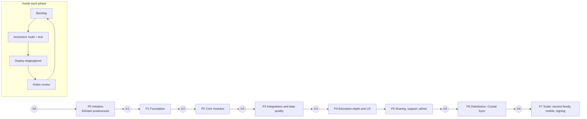
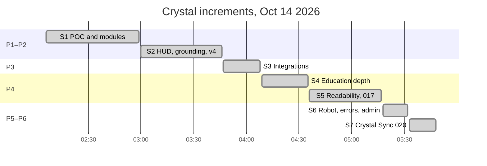

<!-- code: CRY-10-PLN | title: Project Management Plan | subtitle: Integrated hybrid plan for Crystal: Waterfall phases with gates for governance and data-sensitive platform work, Agile increments for features, milestones, schedule baseline, done-versus-planned status, and the subsidiary management plans. -->

## 1. Planning Approach

### 1.1 Why hybrid

| Work type | Approach | Reason |
|---|---|---|
| Data model, RLS, sync protocol, credentials, migrations | **Waterfall phases with gates** (design → build → local test → owner applies migration → verify) | Privacy-critical, hard to reverse once data exists; requires the owner's action in production |
| UI modules, UX polish, AI behavior | **Agile increments** (time-boxed agent sessions, each ending in a deployable build and a commit) | Fast feedback from Rolan; low cost of change |
| Distribution (installers, signing, second family) | Waterfall milestones with external dependencies | Purchases and accounts gate progress |

### 1.2 Lifecycle

## 2. Scope Baseline

The scope baseline is the Charter scope (01 §4), the SOW deliverables (02 §5) and the WBS (11). Requirements baselines: 04 FRS (FR-001 – FR-140) and 05 NFR (NFR-001 – NFR-061).

## 3. Phases and Gates

| Phase | Objective | Key deliverables | Gate criteria | Status |
|---|---|---|---|---|
| P0 Initiation | Prove value with Eli's data | EliDash dashboard (`eli-dashboard`), `fetch.ps1`, `parse.py`, `build_app.py`; backups from Oct 6, 2026 | Charter (this set) | [[ok|Done]] |
| P1 Foundation | Live POC with auth and RLS | Landing, auth, cockpit HUD, robot, Home, Workers AI router; rate limiter; 001 | Site live; RLS on | [[ok|Done]] |
| P2 Core modules | All modules functional | Education (002), laptop agent (003), modules (004), prefs (005), HUD v2/v3, grounding, FR audit | FR audit passes | [[ok|Done]] |
| P3 Integrations and data quality | Trustworthy pipelines | Escalations (006), validation (007), ext sync (009), health ingest (010), Drive (011), mail (012) | Gates and quarantine in place | [[ok|Done]] |
| P4 Education depth and UX | Rich school view, readability | Report cards (013), extras (014), Learn (015), profiles (016), Grading Rules, attendance, voice, skins, ProgressBar, calendar redesign | Review pass complete | [[ok|Done]] |
| P5 Sharing, support, admin | Safe multi-user operation | 017 family, 018 support, 019 admin | Migrations applied and verified in prod | [[partial|017 applied; 018/019 pending]] |
| P6 Distribution | Least-privilege agent | 020 sync devices + leader lease, agent 0.1.0, Linux builds, Downloads | 020 applied; signed builds | [[partial|Built; 020 pending; unsigned]] |
| P7 Scale | Second family, mobile, signing | Mobile readability, signed macOS/Windows installers, Google OAuth, iPhone Shortcut, O365 ICS | Second family syncing for 2 weeks | [[no|Planned]] |

## 4. Agile Increments Delivered (Oct 14, 2026)

The repository history records 102 commits (7 merges) between 02:06 and 05:48 ET on October 14, 2026, adding about 19,000 lines across 298 files (309 tracked files at baseline). Work was organized as short, time-boxed agent increments, each ending in a commit and usually a deployment. They are grouped below as increments S1–S7 by time window.

| Increment | Window (ET) | Commits | Phase | Goal | Delivered (examples) |
|---|---|---|---|---|---|
| S1 | 02:06–02:59 | 9 | P1–P2 | POC and first modules | Phase 1 (`af3ad4e`), Education + box sync (`9f622da`), FR build (`3799989`), rate limiter DO (`5a91bcb`), laptop agent 003 (`f1e3156`) |
| S2 | 03:00–03:46 | 13 | P2 | Premium HUD, grounding, v4 | HUD v2/v3 (`69ef54f`), grounded Crystal (`5d0625c`), FR audit (`9b6f472`), v4 stability/voice (`272c6dc`), district calendar + PWA (`629cefd`), escalations (`8f765bd`) |
| S3 | 03:47–04:08 | 19 | P3 | Integrations | Data validation (`16a1197`), ext sync (`c9ca7ec`), health ingest (`2b6daaf`), Drive (`ebf5a28`), mail (`8733268`), report cards (`cea159b`), grading periods (`1ea0677`) |
| S4 | 04:09–04:35 | 10 | P4 | Education depth | Graded assignments (`cb8f34e`), macOS port (`f76d474`), schedule/attendance (`7e61772`), Learn (`39a68be`), excuses (`2c518e3`), stale-deploy recovery (`140416f`) |
| S5 | 04:36–05:17 | 26 | P4 | Readability and kid-friendly UX | Dark glass, hands-free voice (`6aa6c12`), review pass + skins (`5f39d69`), Grading Rules (`5cd0ede`), grade colors, Defaults v2, calendar redesign (`a051080`), ProgressBar (`b445cc2`), family sharing 017 (`9aee962`) |
| S6 | 05:18–05:32 | 11 | P4–P5 | Robot, errors, toolbar, admin | Robot buddy (`340a472`), error pages + support (`a01d548`), resizable applets (`55c1995`), admin (`048024f`) |
| S7 | 05:33–05:48 | 14 | P6 | Crystal Sync | 020 (`4eaa2ca`), sync UI (`6ec692b`), attendance tiles, agent 0.1.0 (`21f38e6`), family fix (`852fb0c`), leader lease (`588f344`) |

Production build `bmv7xg9th` (09:48:32Z = 5:48 AM ET) corresponds to the `sync-agent` worktree build at `588f344`.

### 4.1 Planned increments (cadence proposed: 1 week; dates TBD)

| Increment | Goal | Backlog items (17) | Dependency |
|---|---|---|---|
| S8 | Go-live of P5/P6 and hardening | PB-001/002 apply and verify 018–020; PB-003 GitHub auth; PB-004 alert ≤ 15 min; PB-009 secrets out of scripts; PB-019 grounding tests; PB-021 cron consolidation | Rolan runs migrations and restores GitHub auth |
| S9 | Mobile readability | PB-005 merge `mobile`; PB-006 UI audit re-run; PB-017 real iPhone check; PB-022 send-window guard | — |
| S10 | Distribution | PB-007 macOS/Windows builds; PB-008 signing; PB-014 laptop → Crystal Sync | PB-003; certificate purchase |
| S11 | Integrations completion | PB-010 Drive without service key; PB-011 Google OAuth; PB-012 iPhone Shortcut; PB-013 O365 ICS | Rolan's accounts |
| S12 | Second family | PB-015 onboarding; PB-016 high-school support; PB-030 legal review | PB-007, PB-008 |

## 5. Milestones: Planned vs Actual

| ID | Milestone | Planned | Actual | Variance | Status |
|---|---|---|---|---|---|
| M-00 | EliDash predecessor in use | — | by Oct 6, 2026 | — | [[ok|Done]] |
| M-01 | POC live | Oct 14 | Oct 14 02:06 | 0 | [[ok|Done]] |
| M-02 | Education + school sync | Oct 14 | Oct 14 02:29 / 02:52 | 0 | [[ok|Done]] |
| M-03 | All modules + FR audit | Oct 14 | Oct 14 03:15 | 0 | [[ok|Done]] |
| M-04 | v4 stability, voice, PWA | Oct 14 | Oct 14 03:38 | 0 | [[ok|Done]] |
| M-05 | Integrations (006–012) | Oct 14 | Oct 14 03:58 | 0 | [[ok|Done]] |
| M-06 | Education depth (013–016) | Oct 14 | Oct 14 04:44 | 0 | [[ok|Done]] |
| M-07 | Family sharing 017 | Oct 14 | Oct 14 05:12 (applied per owner) | 0 | [[ok|Done]] |
| M-08 | Support 018 + Admin 019 in production | Oct 14 | built 05:19 / 05:30; not applied | open | [[partial|Pending migrations]] |
| M-09 | Crystal Sync 020 in production | Oct 14 | built 05:33–05:48; not applied | open | [[partial|Pending migration]] |
| M-10 | Signed macOS/Windows installers | TBD | — | — | [[no|Open]] |
| M-11 | Mobile readability merged | TBD | in progress | — | [[partial|In progress]] |
| M-12 | Second family onboarded | TBD | — | — | [[no|Open]] |
| M-13 | Sync SLO measured over 4 school weeks | TBD | — | — | [[no|Open]] |
| M-14 | Documentation set v1.0 | Oct 14 | Oct 14 | 0 | [[ok|Done]] |

## 6. Done vs Planned Summary

| Measure | Planned | Done | Remaining |
|---|---|---|---|
| Functional requirements (04) | 140 | 104 Done (incl. 017) | 32 Partial (mostly waiting on 018–020, accounts or routines), 4 Open / Won't / stub |
| Features (08) | 62 | 49 Live | 11 Partial, 2 Planned |
| Migration files | 20 (001–020, two 020 files, no 008) | 16 applied (001–007, 009–017) | 4 pending: 018, 019, 020_family_invites_grant, 020_sync_devices |
| Installers | Linux, macOS, Windows | Linux AppImage + .deb | macOS, Windows (unbuilt, unsigned) |

FR counts are computed from 04 status pills at baseline; see 14 RTM for the per-requirement view.

## 7. Subsidiary Plans

| Plan | Summary |
|---|---|
| Schedule management | Increments end with a commit and build; milestones tracked in §5; dates for open milestones set when dependencies clear |
| Cost management | Track platform spend monthly against a ceiling (TBD); approve certificates before purchase (~$99/yr Apple, ~$100–300/yr Windows) |
| Quality management | 15 Test Plan: unit, RLS, e2e, accessibility, performance and chaos suites; Definition of Done (§8) |
| Resource management | Owner time; Grok Bot agents in parallel worktrees on the shared box (21 worktrees at baseline) |
| Communications | §9 |
| Risk management | 13 Register; reviewed at each increment |
| Procurement | Certificates, any paid plan upgrades; owner-approved |
| Stakeholder engagement | 12 Register and RACI |
| Change control | 02 SOW §10 |
| Configuration management | Git branches per feature (`admin`, `family`, `sync-agent`, `mobile`, …), merged into `sync-agent`/`main`; migrations numbered and idempotent; build id in `version.json` |

## 8. Definition of Done

1. Code merged on a branch with a descriptive commit; typecheck and ESLint clean; label lint passes.
2. Unit tests (and RLS tests for any migration) added or updated and passing.
3. Deployed to staging or production and smoke-tested (SOP-01 §3.3).
4. No secret in code, logs or docs; RLS reviewed for any new table.
5. Documentation updated (this set and `docs/`).
6. For migrations: Rolan has applied it and verification in SOP-02 passed.

## 9. Communication Plan

| What | Audience | Channel | Frequency | Owner |
|---|---|---|---|---|
| Increment summary (what changed, what to do) | Rolan | Chat with Grok Bot | Each increment | Delivery team |
| Pending actions list (migrations, accounts) | Rolan | Chat; 13 Issue Log | When changed | Delivery team |
| Sync alerts | Rolan | Crystal feed, email | On event | System |
| Morning briefing | Rolan | Routine | Daily | Grok Bot routine |
| Sunday review | Rolan | Routine | Weekly | Grok Bot routine |
| Release notes | Family | 18 Release Notes | Each release | Delivery team |

## 10. Approval

| Role | Name | Signature | Date |
|---|---|---|---|
| Sponsor / Product Owner | Rolan Chowdhury | | TBD |
| Delivery Lead | Rolan Chowdhury for the Grok Bot delivery team | | TBD |
