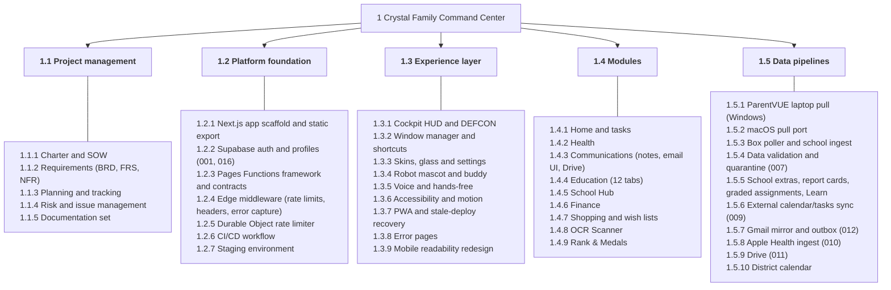
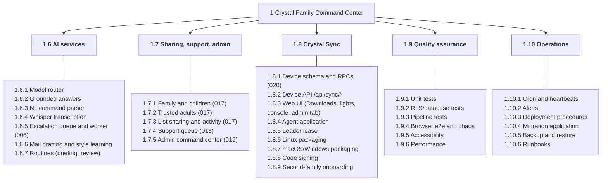

<!-- code: CRY-11-WBS | title: Work Breakdown Structure | subtitle: Deliverable-oriented decomposition of all Crystal work (100% rule) into control accounts and work packages, with the WBS dictionary giving each package's description, deliverables, acceptance criteria, owner, dependencies and status. -->

## 1. Conventions

The WBS is deliverable-oriented and follows the 100% rule: level 2 elements together cover the whole project scope in 01 Charter §4. Level 2 elements are control accounts; level 3 elements are work packages. Codes are referenced by 10 Plan and 17 Backlog. Owner "DT" = delivery team (Grok Bot agents); "RC" = Rolan Chowdhury.

## 2. WBS Diagram (levels 1–3)

## 3. WBS Hierarchy

- **1 Crystal Family Command Center**
  - **1.1 Project management**: 1.1.1 Charter and SOW · 1.1.2 Requirements (BRD, FRS, NFR) · 1.1.3 Planning and tracking · 1.1.4 Risk and issue management · 1.1.5 Documentation set
  - **1.2 Platform foundation**: 1.2.1 Next.js app scaffold and static export · 1.2.2 Supabase auth and profiles (001, 016) · 1.2.3 Pages Functions framework and contracts · 1.2.4 Edge middleware (rate limits, headers, error capture) · 1.2.5 Durable Object rate limiter · 1.2.6 CI/CD workflow · 1.2.7 Staging environment
  - **1.3 Experience layer**: 1.3.1 Cockpit HUD and DEFCON · 1.3.2 Window manager and shortcuts · 1.3.3 Skins, glass and settings · 1.3.4 Robot mascot and buddy · 1.3.5 Voice and hands-free · 1.3.6 Accessibility and motion · 1.3.7 PWA and stale-deploy recovery · 1.3.8 Error pages · 1.3.9 Mobile readability redesign
  - **1.4 Modules**: 1.4.1 Home and tasks · 1.4.2 Health · 1.4.3 Communications (notes, email UI, Drive) · 1.4.4 Education (12 tabs) · 1.4.5 School Hub · 1.4.6 Finance · 1.4.7 Shopping and wish lists · 1.4.8 OCR Scanner · 1.4.9 Rank & Medals
  - **1.5 Data pipelines**: 1.5.1 ParentVUE laptop pull (Windows) · 1.5.2 macOS pull port · 1.5.3 Box poller and school ingest · 1.5.4 Data validation and quarantine (007) · 1.5.5 School extras, report cards, graded assignments, Learn · 1.5.6 External calendar/tasks sync (009) · 1.5.7 Gmail mirror and outbox (012) · 1.5.8 Apple Health ingest (010) · 1.5.9 Drive (011) · 1.5.10 District calendar
  - **1.6 AI services**: 1.6.1 Model router · 1.6.2 Grounded answers · 1.6.3 NL command parser · 1.6.4 Whisper transcription · 1.6.5 Escalation queue and worker (006) · 1.6.6 Mail drafting and style learning · 1.6.7 Routines (briefing, review)
  - **1.7 Sharing, support, admin**: 1.7.1 Family and children (017) · 1.7.2 Trusted adults (017) · 1.7.3 List sharing and activity (017) · 1.7.4 Support queue (018) · 1.7.5 Admin command center (019)
  - **1.8 Crystal Sync**: 1.8.1 Device schema and RPCs (020) · 1.8.2 Device API `/api/sync/*` · 1.8.3 Web UI (Downloads, lights, console, admin tab) · 1.8.4 Agent application · 1.8.5 Leader lease · 1.8.6 Linux packaging · 1.8.7 macOS/Windows packaging · 1.8.8 Code signing · 1.8.9 Second-family onboarding
  - **1.9 Quality assurance**: 1.9.1 Unit tests · 1.9.2 RLS/database tests · 1.9.3 Pipeline tests · 1.9.4 Browser e2e and chaos · 1.9.5 Accessibility · 1.9.6 Performance
  - **1.10 Operations**: 1.10.1 Cron and heartbeats · 1.10.2 Alerts · 1.10.3 Deployment procedures · 1.10.4 Migration application · 1.10.5 Backup and restore · 1.10.6 Runbooks

## 4. WBS Dictionary

| WBS | Work package | Description | Deliverables / evidence | Acceptance criteria | Owner | Depends on | Status |
|---|---|---|---|---|---|---|---|
| 1.1.1 | Charter and SOW | Authorize and define work | 01, 02 | Signed by RC | RC/DT | — | [[ok|Done]] |
| 1.1.2 | Requirements | BRD, FRS, NFR with IDs | 03, 04, 05 | Traceable in 14 | DT | 1.1.1 | [[ok|Done]] |
| 1.1.3 | Planning and tracking | Plan, milestones, backlog | 10, 17 | Current at each increment | DT | 1.1.2 | [[ok|Done]] |
| 1.1.4 | Risk and issues | Register and log | 13 | Reviewed each increment | DT/RC | — | [[ok|Done]] |
| 1.1.5 | Documentation set | 20 docs + combined PDF + build | `docs/` | Builds from source | DT | all | [[ok|Done]] |
| 1.2.1 | App scaffold | Next.js 15 static export, Tailwind 4 | `src/app`, `next.config.ts` | Build succeeds | DT | — | [[ok|Done]] |
| 1.2.2 | Auth and profiles | Email OTP, Google OIDC, profiles from identity | 001, 016, `AuthPanel.tsx` | Sign-in works; names | DT/RC | 1.2.1 | [[partial|Google provider pending]] |
| 1.2.3 | Functions framework | `/api/*`, typed contracts | `functions/`, `src/contracts/api.ts` | Typecheck passes | DT | 1.2.1 | [[ok|Done]] |
| 1.2.4 | Edge middleware | Limits, caps, headers, error pages | `_middleware.ts` | 429/413 tests | DT | 1.2.3 | [[ok|Done]] |
| 1.2.5 | DO rate limiter | Global counters | `workers/ratelimiter` | `x-ratelimit: do` | DT | 1.2.4 | [[ok|Done]] |
| 1.2.6 | CI/CD | Typecheck, lint, tests, build, deploy | `deploy.yml` | Green run + deploy | DT/RC | GitHub auth, secrets | [[partial|Auth/secrets pending]] |
| 1.2.7 | Staging | `staging.crystal-7ot.pages.dev` | `stage.sh` | Staging deploys | DT | 1.2.6 | [[ok|Done]] |
| 1.3.1 | HUD and DEFCON | Abilities, radar, feeds, alerts | `Hud.tsx`, `Ops.tsx` | FR audit A5–A11 | DT | 1.4 data | [[ok|Done]] |
| 1.3.2 | Window manager | Drag, resize, full toggle, shortcuts | `Applet.tsx` | WM and keys suites | DT | 1.2.1 | [[ok|Done]] |
| 1.3.3 | Skins and settings | 5 skins, glass, settings, Defaults v2 | `SettingsCenter.tsx`, `settings.ts` | `test-defaults` | DT | — | [[ok|Done]] |
| 1.3.4 | Robot | Mascot, buddy | `CrystalBot.tsx`, `RobotWalker.tsx` | Settings modes | DT | — | [[ok|Done]] |
| 1.3.5 | Voice | Web Speech, Whisper, hands-free | `voice.ts`, `handsfree.ts` | handsfree e2e | DT | 1.6.4 | [[ok|Done]] |
| 1.3.6 | Accessibility | Contrast, keyboard, reduced motion, labels | axe, keys suites | 0 contrast violations | DT | — | [[partial|UI audit re-run pending]] |
| 1.3.7 | PWA and recovery | Manifest, SW, chunk guard | `sw.js`, `chunkguard.ts` | Recovery card | DT | — | [[ok|Done]] |
| 1.3.8 | Error pages | Styled pages + middleware | `oops/`, `ErrorScreen.tsx` | Each code renders | DT | 1.2.4 | [[ok|Done]] |
| 1.3.9 | Mobile readability | Phone readability pass | branch `mobile` | UI audit at 360/390 passes | DT | — | [[partial|In progress]] |
| 1.4.1 | Home and tasks | Home applet, tasks CRUD | 001, `Apps.tsx` | v4suite persistence | DT | 1.2.2 | [[ok|Done]] |
| 1.4.2 | Health | Logs, meds, Steps v2 | 004, 010, `HealthSteps.tsx` | CRUD | DT | 1.5.8 | [[ok|Done]] |
| 1.4.3 | Communications | Notes, email UI, Drive | 004, 011, 012, `MailInbox.tsx`, `Drive.tsx` | Mirror visible | DT | 1.5.7, 1.5.9 | [[ok|Done]] |
| 1.4.4 | Education | 12 tabs | `Education.tsx` and related | All tabs render | DT | 1.5.1–1.5.5 | [[ok|Done]] |
| 1.4.5 | School Hub | District calendar, bells, sync lights | `SchoolCalendar.tsx`, `CrystalSync.tsx` | Calendar renders | DT | 1.5.10, 1.8.3 | [[ok|Done]] |
| 1.4.6 | Finance | Bills, credit, stocks | 004, `/api/quote` | CRUD; quotes | DT | — | [[ok|Done]] |
| 1.4.7 | Shopping | Lists, wish → cart, sharing | 004, 017, `ShoppingLists.tsx` | Share flow | DT | 1.7.3 | [[ok|Done]] |
| 1.4.8 | OCR | Tesseract.js | `Ocr.tsx` | e2e text read | DT | — | [[ok|Done]] |
| 1.4.9 | Rank & Medals | XP and medals | `Ops.tsx` | Renders | DT | — | [[ok|Done]] |
| 1.5.1 | Laptop pull | `fetch.ps1`, `pull-to-supabase.ps1`, watcher | `laptop/` | One login per run | DT/RC | 003 | [[ok|Done]] |
| 1.5.2 | macOS pull port | Keychain, launchd | `mac/` | Mocked tests | DT | — | [[ok|Done]] |
| 1.5.3 | Box poller and ingest | Poller, `school_sync.py`, alerts | `sync/poller.py` | e2e 30 checks | DT | 1.5.1 | [[ok|Done]] |
| 1.5.4 | Validation | Gates, quarantine, merge | 007, `merge.py` | e2e_val 46 checks; test_merge | DT | 1.5.3 | [[ok|Done]] |
| 1.5.5 | School extras | Report cards, graded, extras, Learn | 013–015, `sync/*.py` | Tables populated | DT | 1.5.3 | [[ok|Done]] |
| 1.5.6 | Ext sync | Google + O365 | 009, `ext_sync.py` | `test_ext_sync` | DT/RC | Google token, ICS URL | [[partial|Accounts pending]] |
| 1.5.7 | Mail | Mirror, drafts, outbox | 012, `mail_*.py` | Mail tests | DT | Routine | [[ok|Done]] |
| 1.5.8 | Health ingest | `/api/health/steps` | 010 | 200/401 | DT/RC | iPhone Shortcut | [[partial|Shortcut pending]] |
| 1.5.9 | Drive | Browse, preview, pins | 011, `google/*.ts` | Preview works | DT/RC | Google token | [[partial|Token pending]] |
| 1.5.10 | District calendar | ICS + snapshot | `district-calendar.ts` | Live or snapshot | DT | — | [[ok|Done]] |
| 1.6.1 | Model router | Fallback chain | `router.ts` | Answers returned | DT | — | [[ok|Done]] |
| 1.6.2 | Grounded answers | Deterministic school/life/district | `answer.ts`, `life.ts`, `district-answer.ts` | `test-grounding` | DT | 1.4 data | [[partial|2 live-data tests stale]] |
| 1.6.3 | NL commands | Intent parsing | `/api/command`, `nlp.ts` | 13/13 | DT | — | [[ok|Done]] |
| 1.6.4 | Whisper | STT | `transcribe.ts` | Transcribes sample | DT | — | [[ok|Done]] |
| 1.6.5 | Escalations | Queue + worker | 006, `escalation_worker.py` | Answers appear | DT | — | [[ok|Done]] |
| 1.6.6 | Mail drafting | Reply gate, style learning | `mail_draft.py` | Mail tests | DT | 1.5.7 | [[ok|Done]] |
| 1.6.7 | Routines | Briefing, review | outside repo | Delivered on schedule | Grok Bot | — | [[partial|Outside repo]] |
| 1.7.1 | Family and children | Families, members, invites, approval | 017 | RLS tests | DT/RC | 016 | [[ok|Done]] |
| 1.7.2 | Trusted adults | Scoped viewers | 017 | RLS tests | DT | 1.7.1 | [[ok|Done]] |
| 1.7.3 | List sharing | Invites, perms, activity | 017 | RLS tests | DT | 1.7.1 | [[ok|Done]] |
| 1.7.4 | Support queue | Tickets + email | 018, `support.ts`, `/support` | Ticket created | DT/RC | 012 | [[partial|Pending 018]] |
| 1.7.5 | Admin | `/admin` + RPCs | 019, `admin/[[path]].ts` | `019_admin_test.sh` | DT/RC | 017 | [[partial|Pending 019]] |
| 1.8.1 | Device schema | 020 tables and RPCs | 020 | `020_sync_test.sql` (36 checks) | DT/RC | 017 | [[partial|Pending 020]] |
| 1.8.2 | Device API | `/api/sync/[op]` | `functions/api/sync` | Error mapping | DT | 1.8.1 | [[ok|Done]] |
| 1.8.3 | Web UI | Downloads, lights, console, admin tab | `CrystalSync.tsx`, `downloads/` | Pairing flow | DT | 1.8.1 | [[partial|Pending 020]] |
| 1.8.4 | Agent | Python app | `agent/crystal_sync` | selftest, import ok | DT | 1.8.2 | [[ok|Done]] |
| 1.8.5 | Leader lease | One login across computers | `sync_claim` | Lease tests | DT | 1.8.1 | [[partial|Pending 020]] |
| 1.8.6 | Linux packaging | AppImage + .deb + SHA256SUMS | `public/downloads` | Download served | DT | 1.8.4 | [[ok|Done]] |
| 1.8.7 | macOS/Windows packaging | dmg, pkg, Setup.exe | `crystal-sync.yml` | Artifacts built | DT/RC | GitHub auth | [[no|Open]] |
| 1.8.8 | Code signing | Developer ID, OV/EV cert | — | Signed, notarized | RC | Purchases | [[no|Open]] |
| 1.8.9 | Second family | Onboarding | SOP-11 | Syncing 2 weeks | RC/DT | 1.8.7, 1.8.8 | [[no|Open]] |
| 1.9.1–1.9.6 | Quality assurance | Suites listed in 15 | test scripts and reports | Pass criteria in 15 | DT | — | [[ok|Done]] (see 15 for defects) |
| 1.10.1 | Cron and heartbeats | crontab, `ensure_cron.sh` | crontab | Heartbeats fresh | DT | — | [[ok|Done]] |
| 1.10.2 | Alerts | `edu_alerts`, email outbox | `poller.py` | Alerts raised | DT | — | [[partial|Missed-pull 20 min]] |
| 1.10.3 | Deployment | SOP-01 | `deploy.sh` | Build live | DT | — | [[ok|Done]] |
| 1.10.4 | Migrations | SOP-02 | pending list | Verified | RC | — | [[partial|4 pending]] |
| 1.10.5 | Backup and restore | SOP-09 | — | Restore test | RC | Plan details | [[no|Open (TBD)]] |
| 1.10.6 | Runbooks | 09 | this set | Executed | DT | — | [[ok|Done]] |
