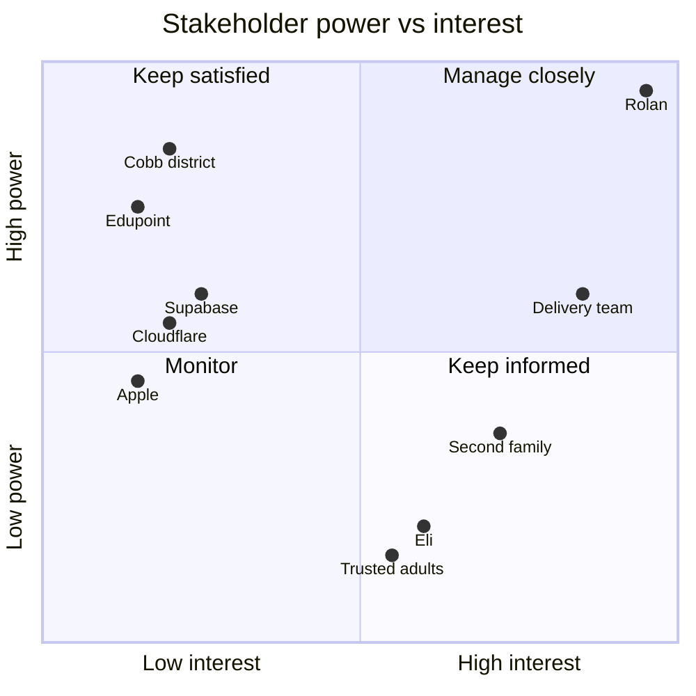

<!-- code: CRY-12-STK | title: Stakeholder Register and RACI Matrix | subtitle: Identifies Crystal's stakeholders with their interests, influence, expectations and engagement strategy, and assigns responsibility for key activities and decisions with a RACI matrix. -->

## 1. Stakeholder Register

| ID | Stakeholder | Type | Role in project | Interests / expectations | Influence | Interest | Current → desired engagement | Communication |
|---|---|---|---|---|---|---|---|---|
| SH-01 | Rolan Chowdhury | Internal, key | Sponsor, Product Owner, owner/admin (`iamrolan@gmail.com`), parent, operator of migrations and accounts | Current, correct school data; alerts; privacy; minimal effort; attractive, fun app | High | High | Leading → Leading | Chat each increment; alerts; briefings |
| SH-02 | Eli | Internal, end user (minor) | Student, 7th grade, Dickerson Middle School (Cobb); child member | Kid-friendly view, goals, medals; not overwhelmed; privacy | Low | Medium | Unaware/Neutral → Supportive | In-app; via Rolan |
| SH-03 | Other family members | Internal | Possible parents/child members/list collaborators | Shared lists, calendar | Medium | Medium | TBD (identities not in sources) | In-app invites |
| SH-04 | Trusted adults (viewers) | External, invited | Read-only scoped access to a child's education data | Timely info, easy access | Low | Medium | Unaware → Supportive | Email invite + code |
| SH-05 | Second family (10th grade, Cobb high school) | External, planned customer | New owner/parent with their own family and device | Easy install, trust, privacy | Medium | High (when engaged) | Unaware → Supportive | Onboarding (SOP-11) |
| SH-06 | Grok Bot delivery team | Internal | Design, build, test, document, deploy | Clear scope, access to accounts when needed | Medium | High | Supportive → Leading (delivery) | Chat |
| SH-07 | Cobb County School District / Dickerson MS staff | External | Source of data (ParentVUE, CTLS, district calendar); email correspondents; attendance office for excuse letters | Correct, polite, timely parent communication; policy compliance (IHA-R) | High (data access, IP blocking) | Low | Unaware → Neutral | Email (Rolan-approved only) |
| SH-08 | Edupoint (ParentVUE/Synergy) | External vendor | SOAP API provider | Normal portal usage | High | Low | Unaware | None |
| SH-09 | Cloudflare | External provider | Hosting, functions, AI, DO, queues | Terms of service | Medium | Low | Neutral | Status page |
| SH-10 | Supabase | External provider | Database, auth, storage | Terms of service | Medium | Low | Neutral | Status page |
| SH-11 | Google | External provider | Calendar, Tasks, Drive, Gmail, OAuth | OAuth consent, API policy | Medium | Low | Neutral | Google Cloud console |
| SH-12 | Microsoft | External provider | Eli's O365 calendar; Windows signing ecosystem (SmartScreen) | — | Low | Low | Neutral | — |
| SH-13 | Apple | External provider | Developer ID, notarization; iOS Shortcuts; Safari behavior | Program terms (~$99/yr) | Medium | Low | Neutral | — |
| SH-14 | GitHub | External provider | Repository `iamrolanatl/starcraft`, Actions | — | Medium | Low | Neutral | — |
| SH-15 | Certificate authority (Windows OV/EV) | External vendor | Code-signing certificate (~$100–300/yr) | Identity verification | Low | Low | Unaware | — |

## 2. Power / Interest Grid

## 3. Engagement Strategies

| Stakeholder | Strategy |
|---|---|
| Rolan | Short increment summaries with a clear "what you need to do" list (migrations, accounts, purchases); never act on privacy, sharing, messaging or spending without approval |
| Eli | Kid-safe copy and robot humor; goal framing (90% GOAL) rather than punishment; only data he needs; parent controls his account |
| Trusted adults | Least access: choose scopes and expiry; easy revoke |
| Second family | Signed installers, a one-page setup guide, pairing code flow, clear privacy statement (16) |
| Cobb / Dickerson staff | Every outgoing message is reviewed by Rolan; school emails sent only 7 AM–7 PM; one ParentVUE login per run to respect the portal |
| Providers | Stay within free/low tiers and terms; monitor status pages |

## 4. RACI Matrix

R = Responsible (does the work), A = Accountable (approves; exactly one), C = Consulted, I = Informed.

| Activity / decision | Rolan (Sponsor/PO/Owner) | Delivery team | Eli | Trusted adults | Second family | Cobb/School | Providers |
|---|---|---|---|---|---|---|---|
| Approve charter, scope, phase gates | A/R | C | I | — | — | — | — |
| Prioritize backlog | A | R | C | — | C | — | — |
| Requirements and acceptance criteria | A | R | C | — | C | — | — |
| Architecture and design decisions | A | R | — | — | — | — | C |
| Write code and tests | A | R | — | — | — | — | — |
| Deploy to staging/production | A | R | I | — | — | — | — |
| Apply database migrations | A/R | C | — | — | — | — | — |
| Manage secrets and accounts (Cloudflare, Supabase, Google, GitHub) | A/R | C | — | — | — | — | — |
| Purchase certificates / paid plans | A/R | C | — | — | — | — | I |
| Store ParentVUE password on a device | A/R | — | — | — | R (own) | — | — |
| Scheduled school sync operation | A | R | I | I | R (own device) | — | C |
| Respond to sync alerts | A/R | R | — | — | R (own) | — | — |
| Send emails to school | A/R (presses Send) | R (drafts) | — | — | — | I | — |
| Approve family members and viewers | A/R | — | I | I | A/R (own family) | — | — |
| Revoke a device or viewer | A/R | C | — | I | A/R (own) | — | — |
| Admin destructive actions | A/R | C | — | — | — | — | — |
| Support tickets | A/R | C | — | — | I | — | — |
| Incident response (SEV-1) | A | R | I | I | I | C (if records exposed) | C |
| Documentation set maintenance | A | R | — | — | I | — | — |
| Second-family onboarding | A | R | — | — | R/C | — | — |

## 5. Approval

| Role | Name | Signature | Date |
|---|---|---|---|
| Sponsor / Product Owner | Rolan Chowdhury | | TBD |
