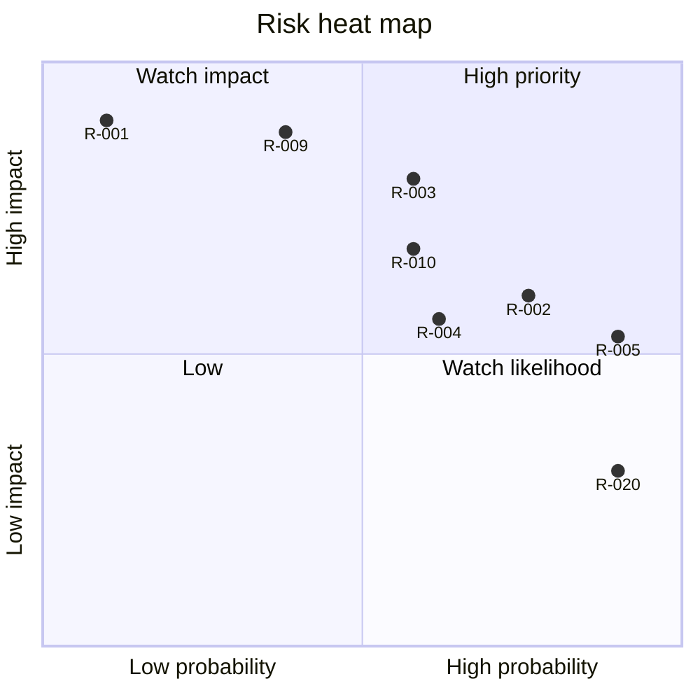

<!-- code: CRY-13-RSK | title: Risk Register and Issue Log | subtitle: Identifies, analyzes and plans responses for Crystal's project and operational risks (ISO 31000 / PMBOK), and logs current issues with owner, priority, resolution path and status. -->

## 1. Method

Probability (P) and impact (I) are rated 1 (very low) to 5 (very high); score = P × I. Rating bands: 15–25 **High**, 8–14 **Medium**, 1–7 **Low**. Response strategies: Avoid, Mitigate, Transfer, Accept (threats); Exploit, Enhance (opportunities). Risks are reviewed at each increment and at each phase gate. A risk that occurs becomes an issue (§4).

## 2. Risk Register

| ID | Risk (cause → event → effect) | Category | P | I | Score | Strategy and response | Trigger / indicator | Owner | Status |
|---|---|---|---|---|---|---|---|---|---|
| R-001 | Misconfigured policy or RPC → a non-family user reads a minor's education records → privacy harm, trust loss | Privacy/Security | 2 | 5 | 10 Med | Mitigate: RLS by default, SECURITY DEFINER with empty search_path, RLS suites per migration (105 checks), review of every new table, no student data in bundle | Any RLS test failure; unexpected rows in `/admin` | RC/DT | Open |
| R-002 | Migrations 018/019/020 not applied → support, admin, Crystal Sync stay "pending" → BO-07, BR-010–012 slip | Schedule | 4 | 3 | 12 Med | Mitigate: graceful degradation; SOP-02 checklist; reminder in increment summaries | 503 "migration pending" responses | RC | Open (I-002) |
| R-003 | Cobb changes ParentVUE SOAP or adds bot protection → pulls fail → stale data | External | 3 | 4 | 12 Med | Mitigate: gates and quarantine; one login per run; parser isolated (`pv_parse.py`); alerts | Quarantine or login failures on consecutive slots | DT | Open |
| R-004 | Unsigned installers → SmartScreen/Gatekeeper warnings → second family abandons setup | Adoption | 4 | 3 | 12 Med | Mitigate: buy Apple (~$99/yr) and Windows (~$100–300/yr) certificates; publish SHA-256; written guide | Second-family feedback | RC | Open |
| R-005 | GitHub auth lost on the box → no pushes, CI or installer builds → work only local, single point of failure | Delivery | 5 | 3 | 15 High | Mitigate: restore auth (SOP-12); keep `origin/backup/*` branches; local commits | Push fails | RC | Occurring (I-001) |
| R-006 | Home computer asleep/offline at 5:40 → missed slot → stale data | Operational | 3 | 2 | 6 Low | Mitigate: catch-up within 6 h; leader lease across 3 computers; missed-pull alert | `missed_pull` alerts | RC | Open |
| R-007 | Two computers log in at the same slot → extra ParentVUE logins → account lock or district attention | Operational | 2 | 4 | 8 Med | Avoid: leader lease (020) with 10-min takeover; lock files | `takeovers` counter rising | DT | Mitigated in design (pending 020) |
| R-008 | Device key stolen → attacker uploads false school rows for paired children | Security | 2 | 3 | 6 Low | Mitigate: key in OS keychain; scope to child_ids; 12 uploads/h; revoke/rotate; uploads logged | Unexpected runs from a device | RC | Open |
| R-009 | Box service-role key exposed → full database access | Security | 2 | 5 | 10 Med | Mitigate: only in `~/.config/crystal/sync.env` (600); never printed; rotate on suspicion | Secret scanning finding | RC | Open |
| R-010 | Plaintext deploy credentials in `/workspace/deploy.sh` and `stage.sh` on the shared box → misuse by any process on the box | Security | 3 | 4 | 12 Med | Mitigate: move to an env file (600) or wrangler login; rotate the Cloudflare token | File inspection (found at baseline) | RC/DT | Occurring (I-009) |
| R-011 | Drive routes require the service-role key at the edge → a function bug could expose more than intended | Security | 2 | 4 | 8 Med | Mitigate: replace with owner-scoped RPC; keep Drive owner-only (`caller` checks owner) | — | DT | Open (I-008) |
| R-012 | LLM produces wrong statements about a child's grades → bad decisions | Quality | 2 | 4 | 8 Med | Mitigate: deterministic answers first; DATA-only prompt; "I don't know"; tests | Grounding test failures | DT | Open |
| R-013 | Automated email sent to a teacher in error → reputational harm | Communication | 1 | 4 | 4 Low | Avoid: drafts only; user Send required; claim once; 7 AM–7 PM | Outbox rows without user action | RC | Mitigated |
| R-014 | COPPA/FERPA-related obligations misunderstood for child accounts → legal exposure | Compliance | 2 | 4 | 8 Med | Mitigate: parent-created child accounts; minimal data; legal review (TBD) | Before second-family launch | RC | Open |
| R-015 | Workers AI model retirement → chat fails | Technical | 3 | 2 | 6 Low | Mitigate: model fallback chain; deterministic layer | `workers-ai error` logs | DT | Open |
| R-016 | Supabase or Cloudflare outage → Crystal unavailable | External | 2 | 3 | 6 Low | Accept; offline banner; status pages | Outage | RC | Accepted |
| R-017 | No tested backup/restore for storage buckets → loss of report-card PDFs or attachments | Operational | 2 | 4 | 8 Med | Mitigate: SOP-09 periodic export; restore test | — | RC | Open |
| R-018 | Mobile readability not finished → poor phone experience for family | Usability | 3 | 2 | 6 Low | Mitigate: finish `mobile` branch; UI audit | UI audit failures | DT | Open |
| R-019 | Many parallel worktrees and cron pointing to different worktrees → configuration drift, wrong code running | Operational | 3 | 3 | 9 Med | Mitigate: consolidate cron to one release worktree; document | Mismatched behavior | DT | Open (I-010) |
| R-020 | Missed-pull alert after 20 minutes breaches the 15-minute requirement | Requirement | 5 | 2 | 10 Med | Mitigate: check at 5:55/17:55 or slot timeout via lease | — | DT | Occurring (I-007) |
| R-021 | Workers AI and Supabase usage grows with a second family → cost exceeds budget | Cost | 2 | 2 | 4 Low | Monitor monthly against ceiling (TBD) | Bill increase | RC | Open |
| O-001 | Opportunity: Crystal Sync proves reusable for other Cobb families → wider value | Opportunity | 3 | 3 | 9 | Enhance: signed installers, onboarding guide | Interest from families | RC | Open |

### 2.1 Heat map

## 3. Assumption Log (linked to risks)

| ID | Assumption (from 01) | Related risk | Validation |
|---|---|---|---|
| A-01 | ParentVUE format stable | R-003 | Quarantine rate |
| A-02 | Home computer on at 5:40 | R-006 | Missed-pull alerts |
| A-03 | Rolan applies migrations | R-002 | SOP-02 checks |
| A-04 | Workers AI models available | R-015 | Logs |
| A-06 | Unsigned installers acceptable for now | R-004 | Second-family feedback |

## 4. Issue Log

Priority: P1 (blocks a goal), P2 (degrades), P3 (minor).

| ID | Issue | Raised | Priority | Impact | Owner | Resolution path | Target | Status |
|---|---|---|---|---|---|---|---|---|
| I-001 | GitHub authentication on the build box is lost; nothing can be pushed; installers for macOS/Windows cannot be built | Oct 14, 2026 | P1 | No remote backup of latest commits (incl. this documentation commit); CI idle | RC | SOP-12 | TBD | Open |
| I-002 | Migrations 018, 019, 020_family_invites_grant, 020_sync_devices not applied in production | Oct 14, 2026 | P1 | Support queue, admin, Crystal Sync unavailable; invite child names hidden | RC | SOP-02 | TBD | Open |
| I-003 | Crystal Sync macOS/Windows installers unbuilt and all installers unsigned | Oct 14, 2026 | P2 | Second family cannot install easily | RC | Restore GitHub; buy certificates; run `crystal-sync.yml` | TBD | Open |
| I-004 | Two live-data grounding tests fail because the expected values in the test no longer match the latest synced data (expectation drift, not an answer error) | Oct 14, 2026 (test run 5:52 AM) | P3 | CI step `test-grounding` would fail | DT | Make live tests assert structure, not fixed values | Next increment | Open |
| I-005 | Title Case label lint reports 6 labels (e.g., "Try again", "Close list") | Oct 14, 2026 | P3 | Inconsistent labels | DT | Fix labels | Next increment | Open |
| I-006 | Last full UI audit (`e2e/ui.mjs`, 04:45) failed 12 of 21 checks (overflow, labels, an aria-label at 360 px, tooltip at 1920 px); later commits addressed several items; not re-run | Oct 14, 2026 | P2 | Mobile and a11y quality uncertain | DT | Re-run after mobile redesign | S9 | Open |
| I-007 | Missed-pull check fires at 6:00/18:00, 20 minutes after the 5:40 slot (requirement: alert within 15 minutes) | Oct 14, 2026 (doc analysis) | P2 | NFR-021 partially unmet | DT | Move check to 5:55/17:55 or use slot timeout in 020 | S8 | Open |
| I-008 | Drive routes need `SUPABASE_SERVICE_ROLE_KEY` in Pages | Oct 14, 2026 (doc analysis) | P2 | Weakens "no service key at edge" | DT | Owner-scoped RPC for the Google token | S11 | Open |
| I-009 | `/workspace/deploy.sh` and `/workspace/stage.sh` contain credentials inline | Oct 14, 2026 (doc analysis) | P2 | Credential exposure on shared box | RC/DT | Move to env file (600), rotate token | S8 | Open |
| I-010 | Cron jobs run from three different worktrees (`crystal-build`, `crystal-esc`, `crystal`) | Oct 14, 2026 | P3 | Drift risk | DT | Consolidate | S8 | Open |
| I-011 | Google OAuth provider not enabled in Supabase | Oct 14, 2026 (FR audit) | P2 | No Google sign-in; Drive/ext sync token route unavailable | RC | Enable provider + consent | S11 | Open |
| I-012 | iPhone Apple Health Shortcut not set up | Oct 14, 2026 | P3 | Steps not automatic | RC | Follow `docs/iphone-steps.md` | S11 | Open |
| I-013 | Eli's Office 365 ICS URL not provided | Oct 14, 2026 | P3 | O365 calendar absent | RC | Publish calendar; set `ELI_O365_ICS_URL` | S11 | Open |
| I-014 | WebKit cannot run on the box; iOS checked only by Chromium emulation | Oct 14, 2026 (stability report) | P3 | iOS-specific bugs possible | RC | Real iPhone spot check | S9 | Open |
| I-015 | Chaos suite recorded 2 console-error failures (vibrate) | Oct 14, 2026 | P3 | — | DT | Fixed (`45e7cc0`: haptics only after activation) | — | Closed |
| I-016 | ESLint reports 15 warnings (0 errors) | Oct 14, 2026 | P3 | Code hygiene | DT | Clean up | Backlog | Open |
| I-017 | Crystal Sync does not compute term finals; `school_sync.py` must keep running for finals and box extras | Oct 14, 2026 (agent README) | P3 | Two pipelines during migration | DT | Port term finals | Backlog | Open |
| I-018 | 7 AM–7 PM school-email window not enforced in repository code (routine-enforced) | Oct 14, 2026 (doc analysis) | P3 | Depends on routine configuration | DT | Add a guard in `mail_outbox_claim` or `mail_outbox.py` | Backlog | Open |
| I-019 | Mobile readability redesign in progress on branch `mobile` (2 commits ahead of `852fb0c`) | Oct 14, 2026 | P2 | Phone experience | DT | Finish and merge | S9 | Open |

## 5. Approval

| Role | Name | Signature | Date |
|---|---|---|---|
| Sponsor / Risk owner | Rolan Chowdhury | | TBD |
