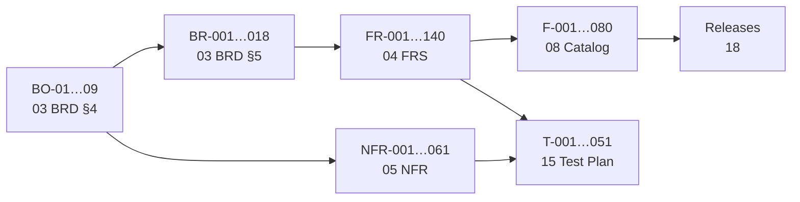

<!-- code: CRY-14-RTM | title: Requirements Traceability Matrix | subtitle: Traces every business objective to business, functional and non-functional requirements, to the features that implement them and to the tests that verify them, with coverage statistics. Generated from documents 03, 04, 05 and 08. -->

## 1. Purpose and Method

The Requirements Traceability Matrix (RTM) gives forward traceability (objective → requirement → feature → test) and backward traceability (test or feature → requirement → objective). It supports impact analysis for change requests (02 SOW §10) and confirms coverage at phase gates (10 Plan §3).

The tables in §3 are generated by `build/gen_rtm.py` directly from 03 BRD, 04 FRS, 05 NFR and 08 Feature Catalog every time the documentation is built, so IDs, titles and statuses cannot drift. The mapping from requirements to business requirements and to tests is maintained in `gen_rtm.py`.

## 2. Objective Coverage Overview

| Objective | Business requirements | Key NFRs | Verification evidence | Coverage |
|---|---|---|---|---|
| BO-01 One command center | BR-002, 013, 014, 015, 017, 018 | NFR-023–026, 037–049 | T-040–T-047 | [[ok|Covered]] |
| BO-02 Timely school data | BR-003, 004, 005 | NFR-020, 022 | T-021, T-027; SLO measurement M-13 | [[partial|Measurement pending]] |
| BO-03 Fail loudly | BR-004 | NFR-021 | T-027; analysis (I-007) | [[partial|Missed-pull 20 min]] |
| BO-04 Family-only data | BR-001, 006, 007, 009, 011, 018 | NFR-001–019, 059–061 | T-020, T-021, T-022, T-023, T-050 | [[ok|Covered]] (production after 018–020) |
| BO-05 Parent email effort | BR-008 | NFR-022 | T-023, T-024 | [[ok|Covered]] (send window routine-enforced) |
| BO-06 Student outcome | BR-002, 007, 016 | — | T-002, T-003, T-047 | [[partial|Target TBD]] |
| BO-07 Second family | BR-009, 010 | NFR-050, 054 | T-021, T-030 | [[partial|Installers unsigned]] |
| BO-08 Low cost | — | — | Monthly cost review | [[no|Ceiling TBD]] |
| BO-09 Resilience, audit | BR-004, 011, 012 | NFR-027–036, 051–058 | T-021, T-022, T-027, T-040 | [[ok|Covered]] |

## 3. Traceability Tables (generated)

<!-- include: _rtm.md -->

## 4. Backward Trace: Tests to Requirements

| Test | Verifies |
|---|---|
| T-001 | FR-036, FR-059 |
| T-002 | FR-031–034, FR-062–063 |
| T-003 | FR-065 |
| T-004 | FR-007, FR-008 |
| T-005 | FR-029 |
| T-006 | FR-024 |
| T-007 | FR-081 |
| T-009, T-010 | NFR-052, NFR-053 |
| T-011 | NFR-046 |
| T-020 | FR-053–054, FR-101–109, NFR-001, NFR-016, NFR-051 |
| T-021 | FR-085, FR-121, FR-123–135, NFR-001, 005, 012, 015, 016, 030, 051 |
| T-022 | FR-115–120, NFR-001, 010, 011 |
| T-023, T-024 | FR-056, FR-099 |
| T-025, T-028 | FR-091–093, NFR-031 |
| T-026 | FR-097–098 |
| T-027, T-029 | FR-086–096, NFR-029, 030, 032 |
| T-030 | FR-136–138, NFR-028, NFR-054 |
| T-040 | FR-010, 012, 013, 019–021, 027, 043–052, NFR-007, 008, 025, 034, 035, 040, 041, 044 |
| T-041 | FR-014, FR-015, NFR-038 |
| T-042 | FR-019–021, NFR-048 |
| T-043 | FR-022, FR-023, NFR-037 |
| T-044 | NFR-039, 044, 045, 046 |
| T-045 | NFR-026 |
| T-046 | NFR-024, NFR-043 |
| T-047 | FR-001–006, 009, 016–018, 025–026, 028, 030, 035, 037, 043–055, 057, 060–085, 111–112, 122; NFR-007, 013, 060 |
| T-048 | FR-058 |
| T-049 | FR-038, FR-039 |
| T-050 | FR-139, NFR-009, 010, 033 |
| T-051 | NFR-049 |

## 5. Gaps

| Gap | Action |
|---|---|
| FR-040 (Grok fallback) and FR-140 (signed mac/win installers) have no verification yet | FR-040 is Won't for this release; FR-140 gets a CI test once built |
| FR-040, FR-051, FR-084 have no feature | All three are Won't / out of scope |
| BO-08 has no requirement | Add a cost NFR once a ceiling is set (TBD) |
| Several Education FRs are verified only by the FR audit (T-047) | Add focused e2e tests per tab (backlog PB-020) |

## 6. Approval

| Role | Name | Signature | Date |
|---|---|---|---|
| Product Owner | Rolan Chowdhury | | TBD |
