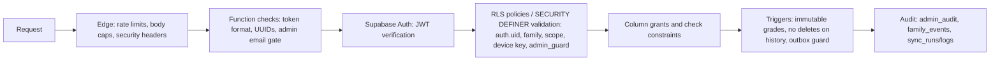

<!-- code: CRY-16-SEC | title: Security and Privacy Plan | subtitle: Defines how Crystal protects family data, especially a minor's education records: data classification, least-privilege access model, STRIDE threat model, control catalog mapped to NIST SP 800-53 families, secrets management, privacy practices (FERPA/COPPA considerations), monitoring and residual risk. -->

## 1. Objectives

| ID | Objective |
|---|---|
| SO-1 | Confidentiality: family data is visible only to the owner, approved family members and scoped viewers |
| SO-2 | Least privilege: every credential can do only what its holder needs |
| SO-3 | Integrity: school data cannot be silently corrupted or erased by bad pulls or forged uploads |
| SO-4 | Accountability: every sync, admin action and family event is logged without secrets |
| SO-5 | Privacy by design: minimize the minor's data, never sell or advertise, keep passwords on the parent's device |
| SO-6 | Recoverability: incidents are contained quickly and data can be restored |

## 2. Data Inventory and Classification

| Class | Definition | Examples (tables / stores) | Handling |
|---|---|---|---|
| C4 Secret | Credentials that grant access | ParentVUE/CTLS passwords (device keychain only), service-role key (box `sync.env`), Cloudflare token, `SUPPORT_KEY`, Google refresh token (`private.google_tokens`), device keys (device keychain; server hash only) | Never displayed, logged or committed; hashed where stored server-side; rotate on suspicion |
| C3 Sensitive (minor) | Education records and related data about a child | `edu_*`, `report_cards` + `raw/report-cards/`, `edu_graded_assignments`, `edu_attendance*`, `edu_attendance_excuses`, `learn_*`, `children`, raw pulls (30 days on box) | Family-scoped RLS; viewer scopes; private buckets; signed URLs (5 min); no public bundle data |
| C3 Sensitive (household) | Health, finance, communications | `health_logs`, `meds`, `bills`, `credit_scores`, `stocks`, `mail_*` + `mail` bucket, `comms_notes`, `chat_escalations` | Owner-only (never shared with children or viewers) |
| C2 Internal | Operational data | `sync_runs`, `sync_logs` (masked), `edu_sync_runs`, `admin_audit`, `family_events`, `support_tickets`, `user_prefs` | Owner/admin only |
| C1 Public | Published content | Landing, legal pages, district calendar snapshot, downloads + checksums | No restriction |

## 3. Access Control Model (least privilege)

### 3.1 Principals and permissions

| Principal | Can | Cannot |
|---|---|---|
| Anonymous (anon key) | Call public RPCs: `sync_pair_exchange` (with a valid code), device RPCs (with a valid device key), `health_ingest` (with a valid token), `support_submit` (with the server-held key) | Read any family table (revoked from anon; tests confirm 42501) |
| Owner / parent (JWT) | Full access to own rows; manage family, children, viewers, list shares, devices; queue outbox rows; request Sync Now | Write system fields (answers, sent status, sync results), read other families |
| Child member (JWT, ACTIVE) | Read own child's education data (incl. `login` scope: messages, alerts, sync runs), family tasks and calendar; write own check-ins | Read household C3 data, other children, mail |
| Viewer / trusted adult (JWT, ACTIVE, unexpired) | Read granted scopes for one child (grades, assignments, report_cards, attendance, schedule, calendar, learn) | `login`-scope data, family tasks/calendar, household data |
| List collaborator | View or edit the shared list | Other lists or data |
| Admin (JWT + ADMIN_EMAILS + `public.admins`) | Admin RPCs with typed confirmation and audit; whitelisted row edits | Disable self; hard delete without soft delete; edit non-whitelisted columns |
| Device (device key) | Poll own commands, claim slot, start/log/finish own runs, upload rows for paired `child_ids`, rotate own key | Read any data; act for other children; exceed 120 calls/min, 12 uploads/h, 4 MB |
| Laptop agent | Begin/claim jobs, log, upload zip with one-time ticket | Read family data |
| Box services (service role) | Ingest, merge, mail, ext sync, escalation answers | — (full; hence box-only) |
| Pages Functions | Anon key + caller JWT; Drive routes additionally use the service role (exception, I-008) | — |

### 3.2 Defense in depth

## 4. Threat Model (STRIDE)

Scope: the data flow in 06 Figure 6-4 with four trust boundaries (home network, Cloudflare edge, Supabase, box).

| ID | Component / flow | STRIDE | Threat | Controls | Residual |
|---|---|---|---|---|---|
| TM-01 | User sign-in | S | Account takeover via email | Email OTP; session refresh; owner-only admin | Medium (email security depends on provider) |
| TM-02 | PostgREST from browser | I | User queries another family's rows | RLS deny-by-default; anon revoked; T-020/T-021 | Low |
| TM-03 | Family invite flow | S, E | Attacker guesses an invite code to join a family | 8-char codes without ambiguous letters; 6-digit confirmation on both screens; parent approval; lock after 5 wrong codes; attempts throttled | Low |
| TM-04 | Pairing | S | Brute-force a pairing code | 15-min, single-use, one live per family, 10 bad tries per IP per 15 min; edge 10/10 min | Low |
| TM-05 | Device upload | T | Stolen device key uploads forged grades | Scope to child_ids; 12 uploads/h; run logging; revoke/rotate; non-destructive merge | Medium (forged-but-plausible rows possible until revoked) |
| TM-06 | Device upload | D | Flood uploads/logs | Per-device and per-IP limits; 4 MB cap | Low |
| TM-07 | Sync logs | I | Passwords or tokens leak into logs | Device masking + server `sync_mask`; test "password masked in stored log" | Low |
| TM-08 | Laptop pipeline | I | Password theft from laptop | DPAPI encryption bound to the Windows user | Medium (local malware) |
| TM-09 | Box | E, I | Compromise of the shared box exposes service-role key and deploy token | `sync.env` mode 600; no printing; (gap) inline creds in deploy scripts | Medium → fix I-009 |
| TM-10 | Admin API | E | Non-owner reaches admin RPCs | Two gates (edge email + `admin_guard`); typed confirmations; audit; rate limit | Low |
| TM-11 | Admin actions | R | Owner denies a destructive change | `admin_audit` rows | Low |
| TM-12 | Chat | I | Prompt injection makes the model reveal another user's data | Facts loaded with the caller's JWT only (RLS); model has no DB access | Low |
| TM-13 | Chat | T | Model invents grades | Deterministic answers first; DATA-only prompt; "I don't know" | Low–Medium |
| TM-14 | Mail outbox | T | Message sent without consent or twice | Insert only as `queued` by user; claim once; stuck → failed, not resent; drafts never listed | Low |
| TM-15 | Mail mirror | I | Malicious HTML in school mail (XSS) | HTML sanitized with nh3; sandboxed rendering | Low |
| TM-16 | Drive preview | I, E | Active content in previews | `content-security-policy: sandbox`, `nosniff`, type allow-list, 20 MB cap | Low |
| TM-17 | Report cards | I | Link sharing exposes PDFs | Signed URLs valid 5 minutes; private bucket | Low |
| TM-18 | Support endpoint | S, D | Spam tickets; abuse | Server-held key; 12/min; sanitized input | Low |
| TM-19 | Health ingest | S | Forged step uploads | Hashed `hst_` token; rotate | Low |
| TM-20 | Supply chain | T | Malicious npm/pip dependency or tampered installer | Lockfiles; SHA-256 sums; (gap) unsigned installers | Medium → signing (R-004) |
| TM-21 | Clickjacking / transport | T, I | Framing or downgrade | `X-Frame-Options: DENY`, HSTS 1 year | Low |

## 5. Control Catalog (mapped to NIST SP 800-53 Rev. 5 families)

| Family | Control in Crystal | Evidence |
|---|---|---|
| AC Access Control | RLS, SECURITY DEFINER validation, viewer scopes and expiry, device scopes, admin two-gate | 07 §4; T-020–T-022 |
| AU Audit and Accountability | `admin_audit`, `family_events`, `sync_runs`/`sync_logs`, `edu_sync_runs`, Workers logs with ray IDs | 019, 017, 020 |
| CM Configuration Management | Idempotent numbered migrations; git branches; build id in `version.json` | 07 §5.1 |
| CP Contingency Planning | Backups (TBD plan details), raw 30-day archive, rollback | 09 SOP-09 |
| IA Identification and Authentication | Email OTP, hashed device/health/support tokens, key rotation | 07 §3 |
| IR Incident Response | SEV levels and NIST 800-61 phases | 09 SOP-07 |
| MP Media Protection | Private buckets, signed URLs | 07 §7 |
| PL / PM Planning | This plan; risk register | 13 |
| RA Risk Assessment | STRIDE (§4), risk register | 13 |
| SA System Acquisition | Code signing (pending), checksums | R-004 |
| SC System and Communications Protection | HSTS, headers, CSP sandbox for previews, TLS everywhere | NFR-009, NFR-014 |
| SI System and Information Integrity | Gates, quarantine, non-destructive merge, immutable grades, HTML sanitization, input validation | NFR-031 |
| PT PII Processing and Transparency | Privacy page, family-only purposes, no sale | NFR-060 |

## 6. Secrets Management

| Secret (environment name) | Location | Used by | Rotation |
|---|---|---|---|
| `NEXT_PUBLIC_SUPABASE_ANON_KEY` / `SUPABASE_ANON_KEY` | Build env, Pages env (public by design; RLS protects data) | SPA, functions | On Supabase key reset |
| `CRYSTAL_SUPABASE_SERVICE_ROLE_KEY` | Box `~/.config/crystal/sync.env` (600) | Box services | On suspicion; after box compromise |
| `SUPABASE_SERVICE_ROLE_KEY` | Pages env (Drive routes only; status TBD) | `functions/_lib/google.ts` | Remove when I-008 fixed |
| `CLOUDFLARE_API_TOKEN`, `CLOUDFLARE_ACCOUNT_ID` | GitHub secrets (planned); currently inline in box deploy scripts (I-009) | Deploys | Rotate after moving to an env file |
| `SUPPORT_KEY` | Pages secret; sha256 in `support_config` | `/api/support` | Update secret and hash together |
| `ADMIN_EMAILS` | Pages env | `/api/admin` | On owner change |
| `GOOGLE_CLIENT_ID`, `GOOGLE_CLIENT_SECRET`, `OWNER_EMAIL` | Pages env | Drive token refresh | Google console |
| `GROK_API_KEY` | Pages env (optional; stub) | Router | — |
| `CRYSTAL_SMTP_*` | Box env | Poller alert email | Provider |
| `ELI_O365_ICS_URL` | Box env | Ext sync | Republish calendar |
| Device keys `csd_…`, ParentVUE/CTLS passwords | Device OS keychain (Windows Credential Manager, macOS Keychain, Secret Service/KWallet); laptop DPAPI file | Agent | `crystal-sync rotate`; password change at Cobb |

Rule: no secret value appears in this documentation set, in git, or in logs.

## 7. Privacy Plan

### 7.1 Principles applied

| Principle | Practice |
|---|---|
| Purpose limitation | Data is used only to inform the family and help with school and household tasks |
| Data minimization | Only ParentVUE/CTLS data needed for the Education views; CTLS session secrets scrubbed in memory and never read (`userSettings.json`); audio never stored |
| Parental control | Children's accounts are created by invitation and approved by a parent; parents choose viewer scopes and expiry and can revoke at any time |
| No sale, no ads | Legal pages include "Do Not Sell"; no advertising |
| Transparency | Privacy page; Sync Log shows every run; family events visible to the parent |
| Security | §3–§6 |
| Retention | Raw pulls: 30 days. Grades history and report cards: kept permanently by design (immutable). Mail mirror, sync logs, support tickets, audit: retention TBD |
| Processors | Cloudflare (hosting, AI inference), Supabase (database, storage, auth), Google (Gmail/Calendar/Drive via the owner's own account), Microsoft (calendar ICS) |

### 7.2 Minor's data (FERPA / COPPA considerations)

| Topic | Position |
|---|---|
| FERPA | Applies to the school district. Crystal handles the parent's own copy of education records, obtained with the parent's credentials. Crystal treats it as C3 and does not disclose it beyond the family and parent-chosen viewers |
| COPPA | Applies to operators of child-directed online services collecting personal information from children under 13. Crystal is a family tool; children join only by parent invitation and approval. Eli's age is not recorded in the sources (TBD). Before offering Crystal to other families (second family has a 10th grader), obtain legal review (TBD) |
| Data subject requests | Parent can view all data in Crystal; export and deletion by request handled by the owner through `/admin` soft/hard delete; self-service flow TBD |
| Breach notification | SOP-07; notify affected family members; consider the school if records were exposed (legal advice TBD) |

## 8. Monitoring and Logging

| Signal | Where | Review |
|---|---|---|
| Sync runs and alerts | `sync_runs`, `edu_sync_runs`, `edu_alerts` | Daily (automatic alerts) |
| Device activity | `/admin` › SYNC (role, last seen, runs 24 h, last error) | Weekly |
| Admin actions | `admin_audit` | Monthly |
| Family events | `family_events` | Monthly |
| Edge errors and denied admin attempts | Workers logs (`server_error`, `admin_denied`, `client_error`) | On incident |
| Rate limiting | `x-ratelimit` header, 429s | On incident |

## 9. Security Testing

| Test | Frequency |
|---|---|
| RLS/RPC suites (T-020–T-023) | Every migration change; monthly |
| Live anonymous probes (T-050) | Every deploy |
| Family REST probe (`scripts/family-rest-probe.mjs`) | After 017–020 changes in production |
| Dependency review (`npm audit`, pip) | Monthly (TBD) |
| Secret scan of repo and box scripts | Monthly (TBD) |

## 10. Residual Risks and Required Actions

| Action | Reduces | Owner | Priority |
|---|---|---|---|
| Move deploy credentials out of `/workspace/deploy.sh` and `stage.sh`; rotate the Cloudflare token | TM-09, R-010 | RC/DT | High |
| Remove service-role key from Pages by redesigning Drive token access | TM-09, R-011 | DT | Medium |
| Sign installers; publish checksums (done) | TM-20, R-004 | RC | Medium |
| Define retention periods for mail, logs, tickets | Privacy | RC | Medium |
| Legal review of COPPA/FERPA posture before second family | R-014 | RC | Medium |
| Restore test of backups | SO-6 | RC | Medium |

## 11. Approval

| Role | Name | Signature | Date |
|---|---|---|---|
| Sponsor / Data owner | Rolan Chowdhury | | TBD |
| Security lead (agent-assisted) | Grok Bot delivery team | | TBD |
