<!-- code: CRY-17-BKL | title: Product Backlog and Roadmap | subtitle: Ordered product backlog (PB-xxx) with type, priority, value, size, dependencies and target increment, plus a Now / Next / Later roadmap that sequences the remaining work toward the second family. -->

## 1. Backlog Management

The Product Owner (Rolan) orders the backlog. Items are refined into acceptance criteria in 04/05 before an increment starts. Sizes are relative T-shirt sizes (XS ≤ 1 h of agent time, S ≤ half a day, M ≤ 2 days, L ≤ 1 week); calendar dates are TBD because most items wait on owner actions. Types: OPS (operations/owner action), FEAT, TECH (technical debt), SEC, QA, DOC.

Ordering rule (WSJF-style): items that unblock other items or close a privacy/security gap come first, then reliability against stated requirements, then features.

## 2. Ordered Backlog

| Rank | ID | Item | Type | Pri | Value / rationale | Size | Depends on | Increment | Status |
|---|---|---|---|---|---|---|---|---|---|
| 1 | PB-001 | Apply migrations 018, 019, 020_family_invites_grant, 020_sync_devices in production (SOP-02) | OPS | Must | Unblocks support, admin, Crystal Sync (BO-07, BO-09) | XS | — | S8 | [[no|Waiting on Rolan]] |
| 2 | PB-002 | Post-migration verification: support ticket, `/admin`, pairing code, invite child names, production RLS probe | QA | Must | Proves G4/G5 gates | S | PB-001 | S8 | [[no|Open]] |
| 3 | PB-003 | Restore GitHub authentication on the build box; push `sync-agent` (incl. docs commit) | OPS | Must | Off-box backup of work; enables CI and installer builds | XS | — | S8 | [[no|Waiting on Rolan]] |
| 4 | PB-009 | Move inline credentials out of `deploy.sh` / `stage.sh`; rotate Cloudflare token | SEC | Must | Closes I-009 / R-010 | XS | — | S8 | [[no|Open]] |
| 5 | PB-004 | Missed-pull alert at 5:55 / 17:55 (or 15-minute slot timeout via 020 leases) | FEAT | Must | Meets NFR-021 (alert ≤ 15 min) | S | — | S8 | [[no|Open]] |
| 6 | PB-005 | Finish and merge mobile readability redesign (branch `mobile`) | FEAT | Must | Phone usability (NFR-045) | M | — | S9 | [[partial|In progress]] |
| 7 | PB-006 | Re-run UI audit (`e2e/ui.mjs`) at 320–1920 px; fix labels (6 flagged), aria-labels, overflow | QA | Should | Closes I-005, I-006 | S | PB-005 | S9 | [[no|Open]] |
| 8 | PB-017 | Real iPhone check of voice/hands-free and layout | QA | Should | NFR-049 | XS | PB-005 | S9 | [[no|Open]] |
| 9 | PB-007 | Build Crystal Sync macOS (.dmg/.pkg) and Windows (Setup.exe) via `crystal-sync.yml`; publish to `public/downloads` with checksums | FEAT | Must | Second-family install | S | PB-003 | S10 | [[no|Open]] |
| 10 | PB-008 | Code signing: Apple Developer ID + notarization (~$99/yr); Windows OV/EV cert (~$100–300/yr) | OPS | Should | Removes OS warnings (R-004) | S | Purchase decision | S10 | [[no|Decision TBD]] |
| 11 | PB-014 | Migrate Rolan's laptop from the legacy pipeline to Crystal Sync (run both ~1 week, compare counts, then disable old jobs) | OPS | Should | One pipeline; leader lease across 3 computers | S | PB-001 | S10 | [[no|Open]] |
| 12 | PB-010 | Replace Drive service-role usage at the edge with an owner-scoped RPC | SEC | Should | Closes I-008 | S | — | S11 | [[no|Open]] |
| 13 | PB-011 | Enable Google OAuth provider (Supabase + Google Cloud consent) and Connect Google token route | OPS | Should | Google sign-in, Drive, ext sync write-back | S | Rolan's Google Cloud | S11 | [[no|Waiting on Rolan]] |
| 14 | PB-012 | Set up iPhone Shortcut for Apple Health steps | OPS | Could | Automatic steps | XS | — | S11 | [[no|Waiting on Rolan]] |
| 15 | PB-013 | Publish Eli's Office 365 calendar ICS and set `ELI_O365_ICS_URL` | OPS | Could | O365 calendar in To-Do/Calendar | XS | — | S11 | [[no|Waiting on Rolan]] |
| 16 | PB-015 | Second-family onboarding (SOP-11): owner account, child, device pairing, verification | FEAT | Should | BO-07 | M | PB-001, PB-007, PB-008 | S12 | [[no|Open]] |
| 17 | PB-016 | High-school support (10th grade, Cobb high school): schedules, grading periods, bell times, course types | FEAT | Should | BO-07 | M | PB-015 | S12 | [[no|Open]] |
| 18 | PB-018 | Measure sync SLOs for 4 school weeks and report (M-13) | QA | Must | Evidence for BO-02/BO-03 | S | PB-004 | S8–S12 | [[no|Open]] |
| 19 | PB-019 | Make live grounding tests assert structure, not fixed values | QA | Should | Closes I-004; keeps CI green | XS | — | S8 | [[no|Open]] |
| 20 | PB-020 | Focused e2e tests per Education tab | QA | Could | RTM gap | M | — | Later | [[no|Open]] |
| 21 | PB-021 | Consolidate cron jobs onto one release worktree | TECH | Should | Closes I-010 | XS | — | S8 | [[no|Open]] |
| 22 | PB-022 | Enforce the 7 AM–7 PM school-email window in code (`mail_outbox_claim` or `mail_outbox.py`) | SEC | Should | Closes I-018 | XS | — | S9 | [[no|Open]] |
| 23 | PB-023 | Port term-finals computation into Crystal Sync | FEAT | Could | Retire legacy pipeline (I-017) | S | PB-014 | Later | [[no|Open]] |
| 24 | PB-024 | Retention policy and purge jobs for mail mirror, sync logs, tickets | SEC | Should | Privacy (16 §7) | S | Retention decision | Later | [[no|Open]] |
| 25 | PB-025 | Backup export of storage buckets and a restore test | OPS | Should | R-017 | S | Plan details | Later | [[no|Open]] |
| 26 | PB-026 | Self-service data export and account deletion | FEAT | Could | Privacy rights | M | — | Later | [[no|Open]] |
| 27 | PB-027 | Clean up 15 ESLint warnings | TECH | Could | Hygiene (I-016) | XS | — | Later | [[no|Open]] |
| 28 | PB-028 | Grok fallback provider in the model router | FEAT | Won't (this release) | Resilience | S | Key | Later | [[no|Deferred]] |
| 29 | PB-029 | Push notifications (PWA) for alerts | FEAT | Could | Faster alerting | M | — | Later | [[no|Open]] |
| 30 | PB-030 | Legal review of COPPA/FERPA posture before offering to other families | OPS | Should | R-014 | S | — | S12 | [[no|Open]] |

## 3. Roadmap

```mermaid
%% caption: Figure 17-1. Roadmap (sequence, not dates; dates TBD)
flowchart LR
  subgraph NOW["NOW (S8–S9): go live and harden"]
    N1[PB-001/002 apply + verify 018–020]
    N2[PB-003 GitHub auth + push]
    N3[PB-009 secrets out of scripts]
    N4[PB-004 alert ≤ 15 min]
    N5[PB-005/006 mobile + UI audit]
  end
  subgraph NEXT["NEXT (S10–S11): distribute and integrate"]
    X1[PB-007 mac/win builds]
    X2[PB-008 signing]
    X3[PB-014 laptop → Crystal Sync]
    X4[PB-011 Google OAuth]
    X5[PB-010 Drive without service key]
  end
  subgraph LATER["LATER (S12+): second family and maturity"]
    L1[PB-015/016 second family, high school]
    L2[PB-024/025 retention + backups]
    L3[PB-026 export/delete]
    L4[PB-029 push alerts]
  end
  NOW --> NEXT --> LATER
```

| Horizon | Outcome | Exit signal |
|---|---|---|
| Now | All built features live in production; requirement gaps closed (alerting, secrets) | 018–020 verified; SOP-02 checks pass; GitHub push done |
| Next | Installable, signed agent on all three OSes; Rolan's computers on Crystal Sync | Leader lease observed across 3 computers for a week |
| Later | Second family syncing; privacy operations mature | 2 weeks of OK lights for the second family |

## 4. Approval

| Role | Name | Signature | Date |
|---|---|---|---|
| Product Owner | Rolan Chowdhury | | TBD |
